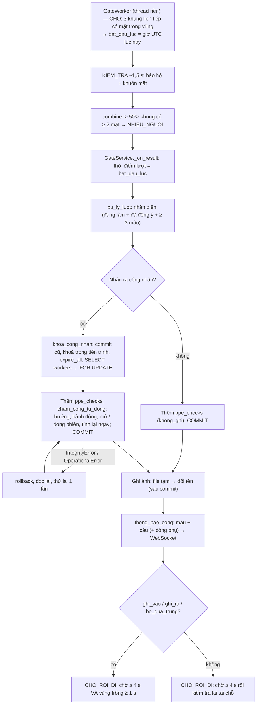

# Logic chấm công của SafeGate — v2 (theo code đang chạy)

Tài liệu này mô tả **đúng những gì code làm** trên nhánh `logic-v2` (30/10/2026), sau khi cài bộ quy tắc mới:
- **Đã cài** (Phần A backend): Q1–Q16 và Q21 (phép / giải trình).
- **Cài trước một phần Q19**: chép giờ ca vào dòng công, để sửa ca không làm đổi số liệu ngày cũ (xem mục 5).
- **Đợt 2, chưa làm**: Q17 (báo nhầm có tác dụng), Q18 (ngày lễ), phần "chỉ áp dụng từ ngày mai" của Q19, Q20 (Excel có màu, ô vắng).
- Bản mô tả logic cũ (trước v2): xem lịch sử git của file này (commit `4f4697f`).

Mọi ví dụ đều đã chạy thật bằng [scripts/kich_ban_cham_cong.py](../scripts/kich_ban_cham_cong.py):
- 34 kịch bản, gọi đúng các hàm nghiệp vụ, chạy trên SQLite trong bộ nhớ, với thời điểm giả lập.
- Kết quả đầy đủ ở **Phụ lục**. Ký hiệu **[KB n]** là kịch bản số n. **T1–T25, P1–P7** là các test nghiệm thu trong [tests/test_cham_cong_v2.py](../tests/test_cham_cong_v2.py).

Mỗi quy tắc ghi theo thứ tự: **Lời** · **Điều kiện / công thức** · **Code** · **Tham số** · **Test** · **Ví dụ**.

**Làm tròn** (mọi phép so sánh đều chính xác tới giây):
- Phút muộn, phút về sớm: làm tròn **lên** (`phut_len`; ví dụ 5 phút 59 giây tính là 6 phút).
- Phút làm, phút ra ngoài, phút công tác: làm tròn **xuống** (`phut_xuong`, tính trên tổng thời gian).
- Không số nào âm.
- Code: [tinh_cong.py](../app/services/tinh_cong.py).

## Tóm tắt nhanh

- **Phiên.** Mỗi lần vào **mở một phiên**, mỗi lần ra **đóng phiên đang mở** (bảng `attendance_segments`). Vào lại không còn xoá giờ ra.
- **Dòng công.** Dòng `attendance` (một dòng mỗi công nhân mỗi ngày) chỉ là **bảng tổng hợp**, tính lại từ các phiên mỗi khi phiên hoặc phép của ngày đó thay đổi.
- **Hướng của lượt.** Trong ngày công của lượt mà có phiên đang mở → **RA**, không có → **VÀO**.
- **Ghi VÀO** cần đủ: nhận ra mặt, bảo hộ `DAT`, công nhân đang làm và đã đồng ý, thời điểm trong cửa sổ `[bắt đầu − 60 phút, kết thúc]`. Ngoài cửa sổ thì không ghi.
- **Ghi RA** cần: nhận ra mặt, kết quả khác `NHIEU_NGUOI`. Không xét bảo hộ.
- **Chống trùng hai chiều.** Chưa đủ 10 phút (sửa được trên trang Cấu hình ca) kể từ lần ghi công gần nhất → `bo_qua_trung`.
- **Thiếu giờ ra được lưu.** Tác vụ nền đánh dấu phiên mở quá hạn. Ngày có phiên thiếu giờ ra **không được tính ngày công** cho tới khi cán bộ xử lý.
- **Trạng thái ngày.** Một hàm backend duy nhất cho bảng công ngày, tháng, Excel và API. Vắng, nghỉ tuần, chưa đến, ngoài thời gian làm việc đều do backend tính.
- **Chấm tay theo phiên.** Thêm, sửa, huỷ phiên; bắt buộc lý do; mỗi thao tác một dòng **nhật ký có giá trị cũ / mới**.
- **Phép / giải trình.** Về sớm, đi muộn, ra ngoài công việc (có thể tính công), nghỉ cả ngày.
- **Việc cần xử lý.** Ngày thiếu giờ ra; ngày đi muộn / về sớm không phép quá 15 phút.
- **Ghi đồng thời.** Khoá theo công nhân (trong tiến trình và `SELECT … FOR UPDATE`), thử lại một lần khi lỗi. Thời điểm lượt là **lúc bắt đầu lượt**. Ảnh chỉ ghi ra đĩa **sau khi commit**.

### Các lựa chọn khi cài đặt (chỗ quy tắc chưa nói rõ)

| # | Chỗ chưa rõ | Đã chọn | Lý do |
|---|---|---|---|
| C1 | `phut_chong_trung` lưu ở đâu | Cột `shifts.phut_chong_trung`; giá trị ban đầu lấy từ `attendance.default_shift.phut_chong_trung` = 10 | Sửa được trên trang Cấu hình ca giống các thông số ca khác |
| C2 | "Số lần ra ngoài" | Chỉ đếm khoảng trống **có phút ra ngoài > 0** | Ra ăn trưa đúng giờ nghỉ (T9) không bị tính là "ra ngoài" |
| C3 | Phép `ra_ngoai_cong_viec` **không** tính công | Phần nằm trong phép không tính ra ngoài, cũng không cộng công tác | Đã có phép thì không phải vi phạm |
| C4 | Vừa đi muộn có phép vừa về sớm có phép | Trạng thái `di_muon_co_phep`; cờ `muon_co_phep`, `som_co_phep` cho biết đủ cả hai | Q10 / Q21 chỉ có một mã trạng thái chính |
| C5 | Thứ tự xét ngày không có phiên | Ngoài thời gian làm việc → nghỉ tuần → nghỉ phép → chưa đến → chưa vào (hôm nay) → vắng | Nghỉ phép rơi vào Chủ nhật vẫn là nghỉ tuần |
| C6 | Lượt VÀO ngoài cửa sổ mà KHONG_DAT | Báo "ngoài giờ vào" (vàng), không báo thiếu bảo hộ (đỏ) | Đằng nào cũng không vào được |
| C7 | "Lượt VÀO đạt" để tính tỷ lệ | Lượt `ghi_vao` (đã ghi giờ vào) | Đối xứng với "lượt không đạt" = lượt màn hình đỏ |
| C8 | Lời nhắc "Về sớm chưa có phép" | Không hiện khi lượt ra nằm trong giờ nghỉ (11:15–12:30) hoặc trong phép ra ngoài công việc | Tránh nhắc nhầm lúc đi ăn trưa |
| C9 | Về sớm trong "Việc cần xử lý" | Chỉ xét khi ca của ngày đó đã kết thúc; bỏ qua ngày cho nghỉ việc | Ra ăn trưa / ra ngoài rồi vào lại không phải về sớm |
| C10 | `ngay_vao_lam` mặc định | API tạo công nhân đặt bằng hôm nay; công nhân cũ chưa có thì lấy ngày tạo | Q10 |
| C11 | CSDL cũ thiếu cột mới | Ứng dụng **không khởi động**, báo rõ cần chạy `seed_demo.py --reset` | `create_all` không thêm cột; tránh lỗi SQL khó hiểu |
| C12 | Sửa ca làm đổi số liệu ngày cũ | **Cài trước phần chép giờ ca của Q19**: dòng công giữ giờ ca lúc tạo | Bản v2 tính lại khi đọc; không chép thì ngày cũ đổi theo ca mới (hồi quy so với bản cũ) |
| C13 | P1 không nói giờ vào | Test dùng 07:02 (làm 420 khớp đề) | 07:00 sẽ cho 422 phút |

---

## 1. Luồng tổng quát: từ lúc một lượt kết thúc tới khi ghi CSDL



- **Thời điểm lượt** (Q16) là lúc mặt ổn định đủ 3 khung, ghi vào `result["bat_dau_luc"]` ([src/gate/worker.py](../src/gate/worker.py) `step`). Trước đây là lúc lượt kết thúc, trễ khoảng 1,5 s. Test: T23 (hai test).
- **Ảnh** (Q16): đường dẫn tính trước; tệp chỉ được ghi **sau khi commit thành công**, ghi vào tệp tạm `.tmp` rồi đổi tên ([luot.py](../app/services/luot.py) `ghi_anh`). Commit lỗi thì không có tệp mồ côi.
- **Lỗi khi ghi** (Q15): `IntegrityError` hoặc `OperationalError` (ví dụ deadlock trên MariaDB) → rollback, rồi thử lại **một lần** cả lượt (kể cả dòng `ppe_checks`). Lần hai vẫn lỗi thì báo lỗi; luồng cổng ghi lỗi và chạy tiếp.
- Code: [luot.py](../app/services/luot.py) `xu_ly_luot`, [cham_cong.py](../app/services/cham_cong.py) `khoa_cong_nhan`, `cham_cong_tu_dong`.

---

## 2. Điều kiện ghi công và màu màn hình cổng

**Code:** `cham_cong_tu_dong` (thứ tự xét: NHIEU_NGUOI → chống trùng → có phiên mở thì RA → cửa sổ vào → DAT → đang làm và đã đồng ý).

| Nhận diện | Kết quả bảo hộ | Không có phiên mở (VÀO) | Có phiên mở (RA) |
|---|---|---|---|
| `KHONG_THAY_MAT` / `KHONG_NHAN_RA` | bất kỳ | `khong_ghi` (vàng) | `khong_ghi` (vàng) |
| `DA_NHAN_RA` | `NHIEU_NGUOI` | `khong_ghi`, hướng rỗng (vàng) | `khong_ghi`, hướng rỗng (vàng) |
| `DA_NHAN_RA` | `DAT` | trong cửa sổ → **`ghi_vao`**; ngoài cửa sổ → `khong_ghi`, lý do `ngoai_gio_vao` (vàng) | **`ghi_ra`** |
| `DA_NHAN_RA` | `KHONG_DAT` | trong cửa sổ → `khong_ghi` (**đỏ**); ngoài → `ngoai_gio_vao` (vàng) | **`ghi_ra`** (xanh) |
| `DA_NHAN_RA` | `KHONG_XAC_DINH` | `khong_ghi` (vàng "mời đứng yên"); ngoài cửa sổ → `ngoai_gio_vao` | **`ghi_ra`** |
| `DA_NHAN_RA` | `KHONG_CO_NGUOI` | `khong_ghi` (vàng "mời đứng vào vị trí") | **`ghi_ra`** (Q4) |

Mọi trường hợp đã nhận ra mặt và khác `NHIEU_NGUOI`: nếu chưa đủ `phut_chong_trung` kể từ lần ghi công gần nhất → **`bo_qua_trung`** (xanh) trước mọi xét khác.

**Hàm phân loại màu dùng chung** (`phan_loai_luot`, Q14):
- `ghi_vao`, `ghi_ra`, `bo_qua_trung` → **xanh**;
- đã nhận ra + `KHONG_DAT` + không có lý do khác → **đỏ**;
- còn lại → **vàng**.

**Câu thông báo** (`thong_bao_cong`):

| Trường hợp | Câu |
|---|---|
| Vào lần đầu | "Xin chào {tên}. Đã ghi giờ vào HH:MM" |
| Vào lại | "Chào mừng trở lại {tên}. Đã ghi giờ vào HH:MM" |
| Ra | "Tạm biệt {tên}. Đã ghi giờ ra HH:MM"; có phép về sớm thì thêm " (về sớm có phép)" |
| Ra sớm quá 15 phút, không phép, không phải giờ nghỉ / công tác | câu "Tạm biệt…" + **dòng phụ** `thong_bao_phu` "Về sớm chưa có phép, vui lòng báo tổ trưởng" (vẫn xanh) |
| Trùng | "{tên}: đã ghi giờ vào HH:MM, không ghi lặp" hoặc "…đã ghi giờ ra HH:MM…" |
| Trước cửa sổ vào | "Chưa đến giờ vào ca (từ 06:00)" |
| Sau cửa sổ vào | "Đã hết giờ vào ca hôm nay" |
| Không đạt (lượt vào) | "{tên}: thiếu mũ bảo hộ, …. Chưa ghi công" |
| Nhiều người / không có người / không nhận ra / không xác định | như bản cũ |

- **Test:** T6, T12, T13, T16, P1, P3, P4, `ThongBaoTest` (10 trường hợp).
- **Ví dụ:** [KB 15–17], [KB 31], [KB 33].

---

## 3. Xác định vào hay ra

### 3.1. Hướng (Q2)
- **Điều kiện:** ngày công của lượt (mục 4) có phiên `mo` → **RA**; không có → **VÀO**.
- Phiên mở của **ngày khác**, kể cả phiên thiếu giờ ra, không ảnh hưởng.
- **Ví dụ:** [KB 12] Hôm trước thiếu giờ ra, hôm sau 07:00 vẫn là VÀO của ngày mới.

### 3.2. Ghi VÀO (Q3)
- **Lời:** cần đủ bốn điều kiện:
  1. đã nhận ra mặt;
  2. bảo hộ `DAT`;
  3. công nhân đang làm và đã đồng ý;
  4. `bắt đầu ca − cho vào sớm ≤ t ≤ kết thúc ca` (tính cả hai biên, tới giây).
- Ngoài cửa sổ: `khong_ghi`, `ppe_checks.action_reason = "ngoai_gio_vao"`, màn hình vàng, **không tạo dòng công**.
- **Không còn sinh `ngoai_ca`** (giá trị vẫn giữ trong danh sách để tương thích).
- **Mở phiên:** `mo`, `nguon_vao = tu_dong`, `vao_check_id` = lượt này. Chưa có dòng ngày thì tạo dòng mới (kèm bản chép giờ ca).
- **Test:** T6 (05:30 bị từ chối; đúng 06:00:00 được ghi), T15, `test_ngoai_cua_so_vao_khong_ghi`.
- **Ví dụ:** [KB 5], [KB 13], [KB 22].

### 3.3. Vào lại (Q1)
- **Lời:** mở **phiên mới**; các phiên trước giữ nguyên giờ ra.
- **Ví dụ:** [KB 9] gồm hai phiên 07:00–11:30 và 12:30–17:00. Test: T9, `test_vao_lai_mo_phien_moi_giu_gio_ra_cu`.

### 3.4. Ghi RA (Q4)
- **Lời:** đóng phiên đang mở: `ra_at = t`, `nguon_ra = tu_dong`, `trang_thai = dong`.
- **Không xét bảo hộ**: `KHONG_DAT`, `KHONG_XAC_DINH`, `KHONG_CO_NGUOI` đều ghi ra; chỉ `NHIEU_NGUOI` thì không.
- **Test:** T16, `test_ra_ghi_gio_ra_khong_can_bao_ho`.

### 3.5. Chống trùng hai chiều (Q5)
- **Điều kiện:** `t − mốc < phut_chong_trung` (nhỏ hơn hẳn) → `bo_qua_trung`.
  - **Mốc** = thời điểm lớn nhất trong mọi giờ vào và giờ ra của các phiên chưa huỷ trong ngày, tính cả phiên tự động lẫn chấm tay.
  - Lượt bị bỏ qua vẫn lưu hướng mà nó *đáng lẽ* có.
- **Tham số:** `shifts.phut_chong_trung` = 10, đổi được qua `PATCH /api/ca-lam` trong khoảng 1–120.
- **Test:** T12 (07:04 bỏ qua, 07:11 ra), T13 (17:01 bỏ qua), `test_ra_trong_10_phut_sau_khi_vao_bi_bo_qua` (07:09:59 bỏ qua, 07:10:00 ra).
- **Ví dụ:** [KB 11], [KB 26], [KB 30], [KB 31].

### 3.6. Máy trạng thái cổng
Không đổi. Sau lượt đã ghi, cổng chờ vùng trống ≥ 1 s. Quét lại sau vài phút chỉ xảy ra khi người đó bước ra rồi quay lại.

---

## 4. Ngày công và múi giờ

- **Ngày công** = ngày lịch theo giờ Việt Nam của thời điểm lượt (`ngay_cong`). Không đổi so với bản cũ.
- Vì chỉ ghi VÀO trong cửa sổ `[06:00, 17:00]`, **không còn phiên nào bắt đầu quanh nửa đêm**: 23:50 và 00:20 đều bị từ chối.
- **Ca qua đêm:** chưa hỗ trợ (`sua_ca` chặn giờ kết thúc ≤ giờ bắt đầu).
- **Test:** `test_ngay_cong_tinh_theo_gio_viet_nam`, T15. **Ví dụ:** [KB 22].

---

## 5. Ca làm

- **Một ca:** dòng có id nhỏ nhất của bảng `shifts` (`ca_mac_dinh`). Chưa có `shift_assignments`, chưa có tăng ca, chưa có nhiều ca.
- **Chép giờ ca vào dòng công** (một phần Q19, lựa chọn C12):
  - Khi tạo dòng ngày, giờ ca đang áp dụng được chép vào các cột `attendance.ca_bat_dau`, `ca_ket_thuc`, `ca_nghi_tu`, `ca_nghi_phut`, `ca_an_han`, `ca_vao_som`.
  - Mọi phép tính của ngày đó (muộn, về sớm, phút làm, cửa sổ vào lại, hạn thiếu giờ ra, Việc cần xử lý) dùng bản chép này (`gio_ca_ngay`).
  - Ngày chưa có dòng công (vắng, chưa đến…) dùng ca hiện tại.
- **Sửa ca** (`PATCH /api/ca-lam` → `sua_ca`):
  - Kiểm tra: tên khác rỗng; kết thúc > bắt đầu; nghỉ 0–240; ân hạn 0–120; cho vào sớm 0–240; chống trùng 1–120; giờ nghỉ nằm trong giờ ca.
  - **Chép lại giờ ca vào các dòng của hôm nay** rồi tính lại. Ngày cũ giữ nguyên.
  - Lựa chọn "chỉ áp dụng từ ngày mai" của Q19 để đợt 2.
- **Test:** `test_sua_ca_lam_kiem_tra_va_tinh_lai_hom_nay`, `test_sua_ca_khong_doi_so_lieu_ngay_cu`. **Ví dụ:** [KB 27] Hôm qua 07:10 vẫn muộn 10 phút; hôm nay (ca 07:30) muộn 0.

---

## 6. Đi muộn (Q6)

- **Điều kiện:** giờ vào của **phiên đầu tiên** `> bắt đầu ca + ân hạn` (so sánh tới giây).
- **Công thức:** muộn = **làm tròn lên** của (giờ vào − bắt đầu ca); không trừ ân hạn.
- **Giờ vào** = lượt `DAT` đầu tiên (chưa đủ bảo hộ thì chưa tính là đã vào làm), hoặc giờ vào do chấm tay.
- **Vào lại** không ảnh hưởng: thời gian ra quá giờ nghỉ được tính vào phút ra ngoài (mục 8).
- **Phép đi muộn** (`den_gio`): muộn > 0 và giờ vào ≤ `den_gio + 15 phút` → `di_muon_co_phep`. Phút muộn vẫn ghi đúng thực tế.
- **Tham số:** ân hạn 5, `dung_sai_phep_phut` 15.
- **Test:** T2 (07:04 → 0), T3 (07:05:59 → **6**), T3b (07:05:00 → 0), T4, T5, P7 (phép đến 09:00, vào 08:50 → `di_muon_co_phep`, muộn 110).
- **Ví dụ:** [KB 2]–[KB 4].

---

## 7. Về sớm (Q7)

- **Điều kiện:** **phiên cuối đã đóng** và giờ ra < kết thúc ca → về sớm = **làm tròn lên** của (kết thúc − giờ ra). Không có ân hạn.
- Phiên cuối đang mở hoặc thiếu giờ ra → về sớm = 0.
- **Phép về sớm** (`tu_gio`): giờ ra ≥ `tu_gio − 15 phút` → `ve_som_co_phep` (phút về sớm vẫn ghi thực tế). Ra sớm hơn mức đó vẫn là `ve_som`.
- **Lúc ra ở cổng:** có phép thì thêm "(về sớm có phép)". Không phép và quá 15 phút thì có dòng phụ nhắc (trừ giờ nghỉ và phép công tác, lựa chọn C8).
- **Test:** T7 (16:30 → 30, `ve_som`), P1 (phép 15:00, ra 15:02 → `ve_som_co_phep`, về sớm 118, làm 420), P2 (ra 13:00 → vẫn `ve_som`), P3, P4, `test_ra_nghi_trua_khong_nhac_ve_som`.
- **Ví dụ:** [KB 7], [KB 33].

---

## 8. Số phút làm, ra ngoài, công tác, công quy đổi (Q8, Q21)

```
phút làm   = ⌊ Σ trên các phiên ĐÃ ĐÓNG của (phiên ∩ giờ ca − phần giao với giờ nghỉ) ⌋
khoảng trống = [giờ ra phiên i, giờ vào phiên i+1] ∩ giờ ca − giờ nghỉ
phút ra ngoài = ⌊ Σ (khoảng trống − phần nằm trong phép ra_ngoai_cong_viec) ⌋
phút công tác = ⌊ Σ (khoảng trống ∩ phép ra_ngoai_cong_viec có tinh_cong) ⌋
số lần ra ngoài = số khoảng trống có phút ra ngoài > 0         (lựa chọn C2)
công quy đổi = làm tròn 2 chữ số của (phút làm + phút công tác) / phút chuẩn,   phút chuẩn = giờ ca − giờ nghỉ (540)
```

- Phiên đang mở hoặc thiếu giờ ra **không cộng** vào phút làm.
- Ngoài giờ ca (đến sớm, ở lại muộn) không tính. Chưa có tăng ca.
- **Test:** T1 (540), T2 (536), T8 (19:30 → 540), T9 (540, ra ngoài 0), T10 (450, ra ngoài 90, 1 lần), T11 (510, ra ngoài 30), P5 (420 + công tác 120, ra ngoài 0, công quy đổi 1,00), `GioNghiTest`.
- **Ví dụ:** [KB 9], [KB 10] (vào lại 12:35 → làm 535, ra ngoài 5), [KB 14], [KB 29], [KB 34].

---

## 9. Thiếu giờ ra (Q9) — được LƯU

- **Điều kiện:** phiên `mo` có `now > kết thúc ca (bản chép) + missing_checkout_hours` (lớn hơn hẳn) → đổi thành `thieu_gio_ra` và tính lại ngày.
- **Ai chạy** (`danh_dau_thieu_gio_ra`, [app/main.py](../app/main.py)):
  - chạy **xong trong lúc khởi động**, sau đó mỗi `quet_thieu_gio_ra_phut` = 5 phút;
  - chạy lại nhiều lần không sai (phiên đã đánh dấu không còn `mo`);
  - mỗi công nhân xử lý dưới khoá theo công nhân.
- **Hệ quả:**
  - trạng thái ngày `thieu_gio_ra`, **ngày công 0**, phiên đó không cộng phút làm;
  - có mặt trong **Việc cần xử lý** cho tới khi cán bộ sửa giờ ra (phiên thành `dong`) hoặc huỷ phiên.
- **Hôm sau:** lượt của ngày mới không đụng vào ngày cũ.
- **Tham số:** `missing_checkout_hours` 4, `quet_thieu_gio_ra_phut` 5.
- **Test:** T14 (21:00:00 vẫn `dang_lam`; 21:00:01 lưu `thieu_gio_ra`, làm 0, ngày công 0, có trong Việc cần xử lý; hôm sau vào bình thường; sửa giờ ra 17:00 → `du_cong` 540, 1 dòng nhật ký `sua_ra` "(thiếu giờ ra) → 17:00:00"), `test_thieu_gio_ra_sau_4_gio`.
- **Ví dụ:** [KB 12], [KB 32].

---

## 10. Trạng thái ngày (Q10) — một hàm duy nhất

**Code:** `tinh_cong.trang_thai_ngay`, gọi qua `cham_cong.tinh_tu_du_lieu`. Dùng chung cho bảng công ngày, bảng công tháng, Excel và mọi API.

| Ngày có phiên (chưa huỷ) | Trạng thái |
|---|---|
| có phiên `mo` | `dang_lam` |
| có phiên `thieu_gio_ra` | `thieu_gio_ra` |
| muộn không phép và về sớm không phép | `di_muon_ve_som` |
| chỉ muộn không phép / chỉ về sớm không phép | `di_muon` / `ve_som` |
| muộn có phép / về sớm có phép (không còn vi phạm nào khác) | `di_muon_co_phep` / `ve_som_co_phep` |
| còn lại | `du_cong` |

| Ngày không có phiên (xét theo thứ tự) | Trạng thái |
|---|---|
| trước `ngay_vao_lam` hoặc sau `ngay_nghi_viec` | `ngoai_thoi_gian_lam_viec` |
| thứ trong `attendance.ngay_nghi_tuan` (Chủ nhật) | `nghi_tuan` |
| có phép `nghi_ca_ngay` | `nghi_phep` |
| sau hôm nay | `chua_den` |
| hôm nay | `chua_vao` |
| đã qua | `vang` |

- **Ngày công = 1** khi trạng thái là `du_cong`, `di_muon`, `ve_som`, `di_muon_ve_som`, `di_muon_co_phep` hoặc `ve_som_co_phep`; các trạng thái khác là 0.
- **Cờ phụ:**
  - `co_sua_tay`: có phiên nguồn thủ công hoặc phiên bị huỷ;
  - `co_ra_ngoai`: phút ra ngoài > 0;
  - `lam_ngay_nghi`: có phiên vào ngày nghỉ tuần;
  - `muon_co_phep`, `som_co_phep`;
  - `can_giai_trinh`: muộn hoặc về sớm không phép quá ngưỡng.
- **Công nhân:** thêm `ngay_vao_lam` (API tạo công nhân đặt bằng hôm nay; chưa đặt thì lấy ngày tạo) và `ngay_nghi_viec`.
- **Test:** T25:
  - ngày 5/10 (trước ngày vào làm 10/10) → `ngoai_thoi_gian_lam_viec`;
  - Chủ nhật 11/10 → `nghi_tuan`;
  - 12/10 có công → `du_cong`;
  - 13/10 → `vang`;
  - hôm nay 29/10 → `chua_vao`;
  - 30/10 → `chua_den`;
  - 15 ngày vắng; P6 (`nghi_phep`).

---

## 11. Ngày nghỉ, ngày lễ, Chủ nhật

- **Nghỉ tuần:** `attendance.ngay_nghi_tuan` = `[chu_nhat]`.
  - Không có phiên → `nghi_tuan` (không tính vắng).
  - Có phiên → tính bình thường, kèm cờ `lam_ngay_nghi`.
- **Ngày lễ:** **chưa có** (Q18, đợt 2). Ngày 02/09 vẫn tính như ngày thường; không có phiên thì là `vang`.
- **Ví dụ:** [KB 21].

---

## 12. Chấm công thủ công, phép, xác nhận không phép

### 12.1. Theo phiên (Q11)

| Thao tác | API | Hàm |
|---|---|---|
| Thêm phiên (giờ ra để trống = phiên mở) | `POST /api/phien` {worker_id, ngay, gio_vao, gio_ra?, ly_do} | `them_phien` |
| Sửa giờ vào / giờ ra (kể cả đóng phiên mở hoặc phiên thiếu giờ ra) | `PATCH /api/phien/{id}` {gio_vao?, gio_ra?, ly_do} | `sua_phien` |
| Huỷ phiên | `POST /api/phien/{id}/huy` {ly_do} | `huy_phien` |
| Giao diện cũ: sửa giờ vào **phiên đầu** / giờ ra **phiên cuối** | `POST /api/cham-cong-thu-cong` (giữ nguyên) | `cham_thu_cong` |

**Từ chối** (lỗi 400, câu tiếng Việt):
- lý do rỗng;
- thời điểm **lớn hơn hiện tại** (xét cả giờ);
- giờ ra ≤ giờ vào (**bằng nhau cũng từ chối**);
- phiên chồng lấn phiên khác (phiên chưa có giờ ra coi như kéo dài mãi);
- ngày nằm ngoài [ngày vào làm, ngày nghỉ việc];
- đã có phiên mở mà thêm phiên mở nữa;
- sửa phiên đã huỷ;
- giờ mới giống giờ đang có.

**Nhật ký** `nhat_ky_cham_cong`: mỗi thay đổi một dòng (`them_phien`, `sua_vao`, `sua_ra`, `huy_phien`) gồm giá trị cũ, giá trị mới (`HH:MM:SS`), lý do, người sửa, thời điểm.
- Xem nhật ký: `GET /api/bang-cong/{attendance_id}/nhat-ky`, hoặc `GET /api/bang-cong/cong-nhan/{worker_id}/{ngay}` (trả kèm phiên, phép, nhật ký).
- `attendance.note`, `updated_by`, `updated_at` giữ thông tin lần sửa tay gần nhất. **Lượt tự động không ghi đè** các trường này.

**Test:** T17, T18 (6 trường hợp từ chối, không ghi nhật ký), T19, `ChamThuCongTest`, `ApiV2Test`. **Ví dụ:** [KB 18], [KB 19], [KB 24], [KB 25].

### 12.2. Phép / giải trình (Q21)

- **Bảng `phep`:** loại `ve_som` (cần `tu_gio`), `di_muon` (cần `den_gio`), `ra_ngoai_cong_viec` (cần `tu_gio < den_gio`, mặc định **tính công**), `nghi_ca_ngay`.
- **Ràng buộc:**
  - lý do bắt buộc;
  - ngày ≤ hôm nay + `phep_toi_da_truoc_ngay` (30); không giới hạn quá khứ;
  - ngày nằm trong khoảng làm việc;
  - tạo ra là `da_duyet` luôn.
- **Thêm hoặc huỷ phép:** một dòng nhật ký (`them_phep` / `huy_phep`) và tính lại ngày đó.
- **API:** `POST /api/phep`, `POST /api/phep/{id}/huy`, `GET /api/phep?worker_id=&ngay=&tu=&den=`.
- **Ảnh hưởng:** mục 6, 7, 8, 10.
- **Test:** P1–P7, `test_huy_phep_va_kiem_tra`, `test_bao_cao_thang_tach_co_phep_khong_phep`. **Ví dụ:** [KB 33], [KB 34].

### 12.3. Xác nhận không phép
`POST /api/viec-can-xu-ly/xac-nhan-khong-phep` {attendance_id, ly_do?}:
- đặt `attendance.da_xac_nhan_khong_phep`;
- ghi nhật ký `xac_nhan_khong_phep`;
- ngày đó rời khỏi Việc cần xử lý.

Test: `test_xac_nhan_khong_phep_roi_khoi_danh_sach`.

---

## 13. Nghỉ việc / đi làm lại (Q12, Q13)

- **Cho nghỉ việc** (`POST /api/cong-nhan/{id}/nghi-viec`), làm dưới khoá theo công nhân:
  - lưu `ngay_nghi_viec` = hôm nay;
  - **đóng mọi phiên đang mở tại thời điểm thao tác** (`nguon_ra = thu_cong`, nhật ký `dong_khi_nghi_viec`);
  - xoá mẫu khuôn mặt.
- Các ngày sau ngày nghỉ việc → `ngoai_thoi_gian_lam_viec`. Ngày nghỉ việc **không** bị đưa vào Việc cần xử lý vì "về sớm" (lựa chọn C9).
- **Đi làm lại:** xoá `ngay_nghi_viec`, `ngay_vao_lam` = hôm nay, xoá thông tin đồng ý (phải đồng ý và đăng ký mặt lại).
- **So khớp mặt** (Q13): chỉ công nhân **đang làm + đã đồng ý + ≥ 3 mẫu**. Ghi nhận đồng ý thì xoá bộ nhớ đệm nhận diện.
- **Test:** T20 (đóng phiên lúc 10:00, làm 180, lượt sau `KHONG_NHAN_RA`, không có Việc cần xử lý), T21. **Ví dụ:** [KB 20].

---

## 14. Báo cáo

### 14.1. Tổng quan (`GET /api/tong-quan`)

| Con số | Định nghĩa |
|---|---|
| `so_cong_nhan` | công nhân đang làm |
| `da_vao` | công nhân có dòng công hôm nay với giờ vào |
| `dang_co_mat` | công nhân có **phiên `mo`** hôm nay |
| `so_luot` | mọi lượt hôm nay |
| `luot_dat` | lượt `ghi_vao` hôm nay (lựa chọn C7) |
| `luot_khong_dat` | lượt **màn hình đỏ** (`phan_loai_luot`): lượt VÀO của người đã nhận ra bị `KHONG_DAT`, trong cửa sổ vào |
| `ty_le_dat` | `luot_dat / (luot_dat + luot_khong_dat)`, làm tròn 3 chữ số |
| `viec_can_xu_ly` (mới) | số mục Việc cần xử lý |
| `luot_theo_gio` | mỗi giờ: `dat` / `khong_dat` / `khac` (theo kết quả bảo hộ, như cũ) + **mới** `xanh` / `do` / `vang` (theo màu màn hình) |

Test: T24 (vào KHONG_DAT + người lạ KHONG_DAT + ra KHONG_DAT → `luot_khong_dat` = 1), `test_tong_quan_dem_luot_theo_gio_hom_nay`.

### 14.2. Việc cần xử lý (`GET /api/viec-can-xu-ly`)

Mỗi mục gồm: loại, công nhân, ngày, mô tả, `attendance_id`.
- `thieu_gio_ra`: ngày có phiên thiếu giờ ra.
- `di_muon_khong_phep`: muộn > `nguong_can_giai_trinh_phut` (15), không phép, chưa xác nhận.
- `ve_som_khong_phep`: tương tự, và **chỉ khi ca của ngày đó đã kết thúc**, không phải ngày cho nghỉ việc.
- Báo nhầm (Q17) chưa có.

### 14.3. Bảng công ngày / tháng / Excel

- **Bảng công ngày** (`GET /api/bang-cong`):
  - giữ đủ các trường cũ (`gio_vao`, `gio_ra`, `di_muon_phut`, `ve_som_phut`, `so_phut_lam`, `trang_thai` cũ, `thieu_gio_ra`, `ghi_chu`);
  - thêm `attendance_id`, `trang_thai_ngay`, `ten_trang_thai`, `ngay_cong`, `cong_quy_doi`, `so_lan_ra_ngoai`, `phut_ra_ngoai`, `phut_cong_tac`, các cờ, `phien` (danh sách phiên), `phep`.
  - Danh sách công nhân: đang làm, cộng thêm người có công trong ngày, cộng thêm người nghỉ việc từ ngày đó trở đi.
- **Bảng công tháng** (`GET /api/bang-cong/thang`):
  - `ngay` giữ như cũ (chỉ các ngày có dòng công);
  - **mới** `trang_thai_ngay` {ngày: mã} cho **mọi ngày** trong tháng;
  - cột tổng: `so_ngay_cong` (theo quy tắc mục 10), `tong_phut`, `so_lan_muon`, và các cột mới `so_lan_muon_khong_phep`, `so_lan_muon_co_phep`, `so_lan_ve_som_khong_phep`, `so_lan_ve_som_co_phep`, `so_ngay_nghi_phep`, `so_ngay_vang`, `so_ngay_thieu_gio_ra`, `tong_phut_ra_ngoai`, `tong_phut_cong_tac`, `tong_cong_quy_doi`.
- **Excel:**
  - sheet "Bang cong": giữ vị trí các cột ngày, thêm 13 cột tổng (từ "Số ngày công" tới "Công quy đổi");
  - sheet "Chi tiet": trạng thái **bằng chữ tiếng Việt**, thêm Số phiên, Ra ngoài, Công tác, Công quy đổi;
  - tô màu ô và ô vắng (Q20) chưa làm.
- **Test:** T25, P6, `test_bao_cao_thang_tach_co_phep_khong_phep`, `test_bang_cong_thang_va_excel`. **Ví dụ:** [KB 28].

---

## 15. Ràng buộc dữ liệu và đồng thời (Q15)

- **Ràng buộc trong CSDL:**
  - `attendance` duy nhất `(worker_id, work_date, shift_id)`;
  - `attendance_segments` không có ràng buộc duy nhất, việc "mỗi ngày tối đa một phiên mở" được bảo đảm bằng khoá;
  - khoá ngoại: phiên → dòng công (xoá theo), → lượt (rỗng khi xoá lượt); nhật ký → dòng công / phiên / phép (rỗng khi xoá).
- **Khoá theo công nhân** (`khoa_cong_nhan`), bao quanh mọi lượt của người đã nhận ra, mọi thao tác chấm tay, phép, nghỉ việc và tác vụ nền:
  1. commit giao dịch cũ;
  2. khoá trong tiến trình (`RLock` theo công nhân);
  3. `expire_all()` (session dùng `expire_on_commit=False` nên phải đọc lại);
  4. `SELECT id FROM workers WHERE id = ? FOR UPDATE` (MariaDB / PostgreSQL; SQLite bỏ qua);
  5. lỗi → rollback.

  Mọi lần đọc trong giao dịch diễn ra **sau** khi đã giữ khoá, nên MariaDB (REPEATABLE READ) thấy dữ liệu mới nhất.
- **Thử lại:** `xu_ly_luot` gặp `IntegrityError` / `OperationalError` → rollback, chạy lại cả lượt một lần.
- **Đã kiểm chứng (T22)**, mỗi lần 5 vòng × 2 trường hợp (ngày chưa có dòng công; vào lại sau trưa khi đã có dòng công), với độ trễ giả 0,2 s để nới rộng cửa sổ tranh chấp:
  - **SQLite** (tệp) và **MariaDB** `test_safegate`: luôn 1 `ghi_vao` + 1 `bo_qua_trung`, đủ 2 lượt, 1 phiên mở.
  - T22b (bỏ khoá trong tiến trình, như hai tiến trình khác nhau, chỉ còn `FOR UPDATE`): cũng đạt trên cả hai.
  - **Thử ngược trên MariaDB:**
    - bỏ **cả khoá lẫn thử lại** → T22 **trượt** (`IntegrityError`), vậy test bắt được lỗi;
    - chỉ bỏ khoá, giữ thử lại → MariaDB phát hiện deadlock, lần thử lại vẫn cho kết quả đúng.

---

## 16. Bảng tham số

| Tham số | Giá trị | Nơi đặt | Dùng ở |
|---|---|---|---|
| `attendance.missing_checkout_hours` | 4 | settings.yaml | hạn thiếu giờ ra (9) |
| `attendance.quet_thieu_gio_ra_phut` | 5 | settings.yaml | chu kỳ tác vụ nền (9) |
| `attendance.timezone` | Asia/Ho_Chi_Minh | settings.yaml | ngày công (4) |
| `attendance.ngay_nghi_tuan` | [chu_nhat] | settings.yaml | trạng thái `nghi_tuan` (10, 11) |
| `attendance.dung_sai_phep_phut` | 15 | settings.yaml | phép về sớm / đi muộn, lời nhắc lúc ra (6, 7) |
| `attendance.nguong_can_giai_trinh_phut` | 15 | settings.yaml | Việc cần xử lý, lời nhắc lúc ra (7, 14) |
| `attendance.phep_toi_da_truoc_ngay` | 30 | settings.yaml | tạo phép trước (12.2) |
| `attendance.default_shift.*` (gồm `phut_chong_trung` 10) | 07:00–17:00, nghỉ 11:30 / 60, ân hạn 5, vào sớm 60, chống trùng 10 | settings.yaml | chỉ khi `seed_demo.py` tạo ca |
| `shifts.*` | như trên | CSDL, trang Cấu hình ca | mọi phép tính; được **chép vào dòng công** lúc tạo |
| `shifts.phut_chong_trung` | 10 (sửa 1–120) | CSDL, `PATCH /api/ca-lam` | chống trùng (3.5) |
| `face.match_threshold` / `match_margin` / `min_samples` | 0,40 / 0,05 / 3 | settings.yaml | nhận diện (+ đã đồng ý) |
| `gate.*`, `checkpoint.*` | như cũ | settings.yaml | không đổi |
| `DATABASE_URL` | MariaDB | `.env` | khoá `FOR UPDATE` |

`duplicate_minutes` đã **bỏ** (thay bằng `shifts.phut_chong_trung`).

---

## 17. Độ phủ test

Tổng cộng **321 test** (318 chạy, 3 bỏ qua như trước), đạt trên **SQLite** và **MariaDB** (`test_safegate`).

| Nhóm | Test |
|---|---|
| Vào / ra, phiên, chống trùng | T1–T13, T3b, `VaoRaTest` |
| Ngoài cửa sổ, thiếu giờ ra, không ghi | T6, T14, T15, T16 |
| Chấm tay, nhật ký, từ chối | T17, T18, T19, `ChamThuCongTest` |
| Nghỉ việc, đồng ý | T20, T21 |
| Ghi đồng thời (SQLite + MariaDB) | T22, T22b |
| Thời điểm lượt | T23 (worker + GateService) |
| Tổng quan, tháng, Excel | T24, T25, `BaoCaoTest`, `test_bang_cong_thang_va_excel` |
| Phép | P1–P7, huỷ phép, xác nhận không phép, tách có / không phép trong báo cáo tháng |
| Ca: chép giờ ca, sửa ca | `test_sua_ca_khong_doi_so_lieu_ngay_cu`, `test_sua_ca_lam_kiem_tra_va_tinh_lai_hom_nay` |
| API mới, CSDL cũ thiếu cột | `ApiV2Test` |
| Giao diện hiện tại (Playwright, bản build giao diện v2) | đạt trên máy chủ thử của nhánh này |

**Test cũ đã sửa có chủ đích** (hành vi thay đổi theo quy tắc mới):

| Test | Thay đổi | Quy tắc |
|---|---|---|
| `test_ra_trong_2_phut_sau_khi_vao_bi_bo_qua` → `test_ra_trong_10_phut_…` | 2 phút → 10 phút | Q5 |
| `test_vao_lai_sau_khi_ra_giu_gio_vao_dau_cap_nhat_gio_ra` → `test_vao_lai_mo_phien_moi_giu_gio_ra_cu` | giữ giờ ra 11:30; làm 540 → 510; ra ngoài 30; câu "Chào mừng trở lại" | Q1, Q8 |
| `test_ngoai_ca` → `test_ngoai_cua_so_vao_khong_ghi` | 05:30 và 18:00 không ghi (trước: ghi + `ngoai_ca`) | Q3 |
| `GioNghiTest.worked` | dùng hàm thuần `thoi_gian_lam` (bỏ `tinh_cong(attendance)`) | Q8 |
| `test_bang_cong_ngay_va_tong_quan`, `test_thieu_gio_ra_sau_4_gio` | gọi tác vụ đánh dấu thiếu giờ ra trước khi đọc | Q9 |
| `test_sua_ca_lam_kiem_tra_va_tinh_lai_hom_nay` | tạo dòng công kèm phiên | Q1 |
| `test_tong_quan_dem_luot_theo_gio_hom_nay` | chỉ so trường cũ, thêm kiểm tra xanh / đỏ / vàng; ca cả ngày | Q14, Q3 |
| `test_luot_vao_ghi_cong_va_phat_su_kien`, `test_tong_quan_co_ty_le_dat_…`, `test_cong_nhan_co_ten_…` | dùng ca cả ngày (test chạy theo **giờ thật**, cửa sổ vào làm kết quả phụ thuộc giờ chạy) | Q3 |
| `app_helpers.add_worker` | ngày vào làm cố định 01/01/2026 | Q10, Q11 |

---

## 18. Điểm hổng: trạng thái sau v2

### 18.1. Các điểm của bản cũ

| # | Vấn đề (bản cũ) | Trạng thái | Bằng chứng |
|---|---|---|---|
| 1 | Khoảng ra ngoài giữa ca không bị trừ | **Đã sửa** (Q1, Q8) | T10, T11, [KB 14], [KB 29] |
| 2 | Vào lại xoá giờ ra | **Đã sửa** (Q1, Q5) | T9, T13, [KB 26] |
| 3 | Chấm tay thiếu kiểm soát | **Đã sửa phần lớn** (Q11): chặn giờ tương lai, nhật ký cũ / mới, huỷ phiên, lượt tự động không ghi đè. Còn: chưa có duyệt nhiều cấp (TTTN một vai trò) | T18, T19, [KB 24] |
| 4 | Không chống giả mạo khuôn mặt | **Chưa** (ngoài phạm vi, đồ án) | — |
| 5 | Báo nhầm không có tác dụng | **Chưa** (Q17, đợt 2) | — |
| 6 | Quét lại sau 2 phút bị coi là RA | **Đã sửa một phần**: chống trùng 10 phút, sửa được; sau 10 phút vẫn là RA (theo quy tắc) | T12, [KB 30] |
| 7 | Qua nửa đêm, ca qua đêm | **Đã chặn** (ngoài cửa sổ không ghi); ca đêm vẫn chưa có | T15, [KB 22] |
| 8 | Ngoài ca vẫn ghi, muộn vô lý | **Đã sửa** (Q3) | T6, [KB 13] |
| 9 | Thiếu giờ ra vẫn tính ngày công | **Đã sửa** (Q9) | T14, [KB 12] |
| 10 | "Lượt không đạt" đếm sai | **Đã sửa** (Q14) | T24, [KB 28] |
| 11 | Không có tăng ca, lễ, vắng ở backend | **Một phần**: vắng, nghỉ tuần, nghỉ phép ở backend (Q10, Q21). Lễ (Q18) và tăng ca chưa | T25, P6, [KB 8], [KB 21] |
| 12 | Nghỉ việc khi đang có mặt | **Đã sửa** (Q12) | T20, [KB 20] |
| 13 | Sửa ca đổi số liệu | **Đã sửa** phần chép giờ ca (một phần Q19) | [KB 27] |
| 14 | Ghi đồng thời | **Đã sửa** (Q15) | T22, T22b (MariaDB) |
| 15 | NHIEU_NGUOI / KHONG_CO_NGUOI chặn lượt RA | **Một phần**: KHONG_CO_NGUOI ghi ra được; NHIEU_NGUOI vẫn chặn (theo Q4) | T16 |
| 16 | Làm tròn, mốc | **Đã chốt** (Q6, Q7): làm tròn lên, so sánh tới giây | T3 |
| 17 | Minh chứng lệch | **Một phần**: ảnh ghi sau commit; mỗi phiên có `vao_check_id` / `ra_check_id` | T23 |
| 18 | Excel | **Một phần**: chữ tiếng Việt, cột mới (Q21). Màu ô (Q20) chưa | [KB 28] |
| 19 | Thời điểm lượt | **Đã sửa** (Q16) | T23 |
| 20 | Cột thừa `is_overnight` / `is_overtime` | **Chưa** | — |

### 18.2. Điểm còn lại hoặc mới phát hiện (**chưa sửa**)

| # | Vấn đề | Mức | Bằng chứng | Hướng sửa |
|---|---|---|---|---|
| N1 | **Lượt VÀO muộn trong ngày sau khi người đó đã rời đi** mở phiên mới, rồi thành thiếu giờ ra, **ngày công 0** cho tới khi cán bộ xử lý. Ví dụ: đến 05:30 bị từ chối, 17:00 ra về lại được ghi là VÀO; hoặc đã chấm tay giờ ra 16:30, 16:40 đi ngang camera | Trung bình | [KB 5], [KB 25] | Không mở phiên mới khi còn < N phút tới kết thúc ca (ví dụ 30); hoặc phiên phụ thiếu giờ ra sau một phiên đã đóng thì gợi ý huỷ, không làm mất ngày công |
| N2 | **Ngày công = 1 cho mọi ngày về sớm**, kể cả chỉ làm 11 phút (đúng Q10) | Trung bình | [KB 30] | Ngưỡng tối thiểu (ví dụ ≥ 50% phút chuẩn), hoặc dùng công quy đổi làm số chính |
| N3 | Trong ngày, lúc đang ra ăn trưa (đã quét ra), trạng thái hiện "Về sớm" | Thấp | [KB 28] (04/11) | Hôm nay trước giờ kết thúc ca, các phiên đều đóng → "đang ra ngoài" |
| N4 | Thiếu giờ ra được lưu trễ tối đa 5 phút (chu kỳ tác vụ nền) | Thấp | mục 9 | Chấp nhận, hoặc giảm chu kỳ |
| N5 | Lời nhắc "Về sớm chưa có phép" hiện cả khi chỉ ra ngoài một lát (ví dụ 07:30) | Thấp | [KB 14] | Chấp nhận (chỉ là lời nhắc), hoặc chỉ nhắc sau 15:00 |
| N6 | API cũ `/api/cham-cong-thu-cong` chỉ sửa phiên đầu / cuối | Thấp | mục 12.1 | Giao diện Phần B dùng API theo phiên |
| N7 | Màn hình cổng (frontend) chưa hiện `thong_bao_phu` | Thấp | — | Phần B |
| N8 | Chưa có: Q17, Q18, Q19 ("từ ngày mai"), Q20, tăng ca, ca đêm, chống giả mạo | — | — | Đợt 2 / đồ án |

---

## 19. Khác biệt với `DE_TAI.md`

`DE_TAI.md` **mục 7** (gồm Ca làm) và **mục 16** đã cập nhật theo v2. Còn khác:
- **Mục 10 (CSDL):** chưa liệt kê bảng `attendance_segments`, `phep`, `nhat_ky_cham_cong` và các cột mới của `workers`, `shifts`, `attendance`, `ppe_checks`.
- **Mục 15 (tham số):** còn ghi `duplicate_minutes: 2` (đã thay bằng `shifts.phut_chong_trung` = 10) và chưa có các tham số mới.
- **Mục 5 bước 6:** chưa có các câu thông báo mới (vào lại, trùng sau khi ra, ngoài giờ vào, về sớm có phép, dòng phụ).
- **Mục 6.3 / 8:** chưa nói thời điểm lượt là lúc bắt đầu lượt.

---

## Phụ lục: kết quả chạy `scripts/kich_ban_cham_cong.py` (nhánh `logic-v2`, 30/10/2026)

- Chạy bằng `.venv\Scripts\python.exe scripts\kich_ban_cham_cong.py`.
- Ngày chính là Thứ Hai 02/11/2026. Mỗi kịch bản dùng một CSDL SQLite mới trong bộ nhớ; [KB 23] dùng tệp SQLite tạm.
- Mỗi lần chạy lại, kết quả giống hệt, **trừ [KB 23]**: thread nào thắng là ngẫu nhiên. Luôn 1 `ghi_vao` + 1 `bo_qua_trung`, nhưng số lần mỗi bên thắng thay đổi.

```
Ca: Ca hành chính 07:00–17:00, nghỉ 11:30 (60 phút), ân hạn 5 phút, cho vào sớm 60 phút, chống quét trùng 10 phút | missing_checkout_hours 4 | nghỉ tuần ['chu_nhat'] | Asia/Ho_Chi_Minh
Ngày chính: 02/11/2026 (Thứ Hai). Cột: [thời điểm] người đứng trước camera | kết quả bảo hộ | kết quả nhận diện | hướng | hành động | màu + câu trên màn hình cổng; ↳ = dòng công sau lượt.
Trạng thái ngày: dang_lam = Đang làm, thieu_gio_ra = Thiếu giờ ra, du_cong = Đủ công, di_muon = Đi muộn, ve_som = Về sớm, di_muon_ve_som = Đi muộn, về sớm, di_muon_co_phep = Đi muộn có phép, ve_som_co_phep = Về sớm có phép, chua_vao = Chưa vào, vang = Vắng, nghi_tuan = Nghỉ tuần, chua_den = Chưa đến, ngoai_thoi_gian_lam_viec = Ngoài thời gian làm việc, nghi_phep = Nghỉ phép

=== #1. Vào 06:55 đạt, ra 17:00 (T1) ===
  [02/11 06:55:00]          CN001 | bảo hộ DAT                        | mặt → CN001          | hướng vao | ghi_vao      | XANH: "Xin chào Nguyễn Văn An. Đã ghi giờ vào 06:55"
                ↳ bảng công CN001 02/11: phiên [06:55–– mo] · muộn 0 · về sớm 0 · làm 0 · ra ngoài 0
  [02/11 17:00:00]          CN001 | bảo hộ DAT                        | mặt → CN001          | hướng ra  | ghi_ra       | XANH: "Tạm biệt Nguyễn Văn An. Đã ghi giờ ra 17:00"
                ↳ bảng công CN001 02/11: phiên [06:55–17:00 dong] · muộn 0 · về sớm 0 · làm 540 · ra ngoài 0
  → BẢNG CÔNG CN001 ngày 02/11 (Thứ Hai), xem lúc 02/11 23:59: ĐỦ CÔNG (du_cong), ngày công 1, công quy đổi 1.0
      vào 06:55 | ra 17:00 | muộn 0 | về sớm 0 | làm 540 phút (9:00) | ra ngoài 0 phút (0 lần) | công tác 0 | thiếu giờ ra: không
      phiên: 06:55–17:00 (dong, vào tu_dong, ra tu_dong)
  (không có gì bất thường)

=== #2. Vào 07:04 (trong ân hạn), ra 17:00 (T2) — thêm: người thứ hai vào 07:05:59 (T3) ===
  [02/11 07:04:00]          CN001 | bảo hộ DAT                        | mặt → CN001          | hướng vao | ghi_vao      | XANH: "Xin chào Nguyễn Văn An. Đã ghi giờ vào 07:04"
                ↳ bảng công CN001 02/11: phiên [07:04–– mo] · muộn 0 · về sớm 0 · làm 0 · ra ngoài 0
  [02/11 07:05:59]          CN002 | bảo hộ DAT                        | mặt → CN002          | hướng vao | ghi_vao      | XANH: "Xin chào Trần Thị Bình. Đã ghi giờ vào 07:05"
                ↳ bảng công CN002 02/11: phiên [07:05–– mo] · muộn 6 · về sớm 0 · làm 0 · ra ngoài 0
  [02/11 17:00:00]          CN001 | bảo hộ DAT                        | mặt → CN001          | hướng ra  | ghi_ra       | XANH: "Tạm biệt Nguyễn Văn An. Đã ghi giờ ra 17:00"
                ↳ bảng công CN001 02/11: phiên [07:04–17:00 dong] · muộn 0 · về sớm 0 · làm 536 · ra ngoài 0
  [02/11 17:00:30]          CN002 | bảo hộ DAT                        | mặt → CN002          | hướng ra  | ghi_ra       | XANH: "Tạm biệt Trần Thị Bình. Đã ghi giờ ra 17:00"
                ↳ bảng công CN002 02/11: phiên [07:05–17:00 dong] · muộn 6 · về sớm 0 · làm 534 · ra ngoài 0
  → BẢNG CÔNG CN001 ngày 02/11 (Thứ Hai), xem lúc 02/11 23:59: ĐỦ CÔNG (du_cong), ngày công 1, công quy đổi 0.99
      vào 07:04 | ra 17:00 | muộn 0 | về sớm 0 | làm 536 phút (8:56) | ra ngoài 0 phút (0 lần) | công tác 0 | thiếu giờ ra: không
      phiên: 07:04–17:00 (dong, vào tu_dong, ra tu_dong)
  → BẢNG CÔNG CN002 ngày 02/11 (Thứ Hai), xem lúc 02/11 23:59: ĐI MUỘN (di_muon), ngày công 1, công quy đổi 0.99
      vào 07:05 | ra 17:00 | muộn 6 | về sớm 0 | làm 534 phút (8:54) | ra ngoài 0 phút (0 lần) | công tác 0 | thiếu giờ ra: không
      phiên: 07:05–17:00 (dong, vào tu_dong, ra tu_dong)
  (không có gì bất thường)

=== #3. Vào 07:06, ra 17:00 (T4) ===
  [02/11 07:06:00]          CN001 | bảo hộ DAT                        | mặt → CN001          | hướng vao | ghi_vao      | XANH: "Xin chào Nguyễn Văn An. Đã ghi giờ vào 07:06"
                ↳ bảng công CN001 02/11: phiên [07:06–– mo] · muộn 6 · về sớm 0 · làm 0 · ra ngoài 0
  [02/11 17:00:00]          CN001 | bảo hộ DAT                        | mặt → CN001          | hướng ra  | ghi_ra       | XANH: "Tạm biệt Nguyễn Văn An. Đã ghi giờ ra 17:00"
                ↳ bảng công CN001 02/11: phiên [07:06–17:00 dong] · muộn 6 · về sớm 0 · làm 534 · ra ngoài 0
  → BẢNG CÔNG CN001 ngày 02/11 (Thứ Hai), xem lúc 02/11 23:59: ĐI MUỘN (di_muon), ngày công 1, công quy đổi 0.99
      vào 07:06 | ra 17:00 | muộn 6 | về sớm 0 | làm 534 phút (8:54) | ra ngoài 0 phút (0 lần) | công tác 0 | thiếu giờ ra: không
      phiên: 07:06–17:00 (dong, vào tu_dong, ra tu_dong)
  (không có gì bất thường)

=== #4. 07:02 không đạt (thiếu mũ), 07:10 đạt, ra 17:00 (T5) ===
  [02/11 07:02:00]          CN001 | bảo hộ KHONG_DAT (thieu_mu)       | mặt → CN001          | hướng vao | khong_ghi    | ĐỎ: "Nguyễn Văn An: thiếu mũ bảo hộ. Chưa ghi công"
                ↳ bảng công CN001 02/11: chưa có bản ghi
  [02/11 07:10:00]          CN001 | bảo hộ DAT                        | mặt → CN001          | hướng vao | ghi_vao      | XANH: "Xin chào Nguyễn Văn An. Đã ghi giờ vào 07:10"
                ↳ bảng công CN001 02/11: phiên [07:10–– mo] · muộn 10 · về sớm 0 · làm 0 · ra ngoài 0
  [02/11 17:00:00]          CN001 | bảo hộ DAT                        | mặt → CN001          | hướng ra  | ghi_ra       | XANH: "Tạm biệt Nguyễn Văn An. Đã ghi giờ ra 17:00"
                ↳ bảng công CN001 02/11: phiên [07:10–17:00 dong] · muộn 10 · về sớm 0 · làm 530 · ra ngoài 0
  → BẢNG CÔNG CN001 ngày 02/11 (Thứ Hai), xem lúc 02/11 23:59: ĐI MUỘN (di_muon), ngày công 1, công quy đổi 0.98
      vào 07:10 | ra 17:00 | muộn 10 | về sớm 0 | làm 530 phút (8:50) | ra ngoài 0 phút (0 lần) | công tác 0 | thiếu giờ ra: không
      phiên: 07:10–17:00 (dong, vào tu_dong, ra tu_dong)
  (không có gì bất thường)

=== #5. Vào 05:30 (sớm hơn cửa sổ cho vào sớm), ra 17:00 (T6) ===
  [02/11 05:30:00]          CN001 | bảo hộ DAT                        | mặt → CN001          | hướng vao | khong_ghi    | VÀNG: "Chưa đến giờ vào ca (từ 06:00)"
                ↳ bảng công CN001 02/11: chưa có bản ghi
  [02/11 17:00:00]          CN001 | bảo hộ DAT                        | mặt → CN001          | hướng vao | ghi_vao      | XANH: "Xin chào Nguyễn Văn An. Đã ghi giờ vào 17:00"
                ↳ bảng công CN001 02/11: phiên [17:00–– mo] · muộn 600 · về sớm 0 · làm 0 · ra ngoài 0
  [02/11 21:00:01] TÁC VỤ NỀN đánh dấu thiếu giờ ra → 1 phiên
  → BẢNG CÔNG CN001 ngày 02/11 (Thứ Hai), xem lúc 02/11 23:59: THIẾU GIỜ RA (thieu_gio_ra), ngày công 0, công quy đổi 0.0
      vào 17:00 | ra – | muộn 600 | về sớm 0 | làm 0 phút (0:00) | ra ngoài 0 phút (0 lần) | công tác 0 | thiếu giờ ra: CÓ
      phiên: 17:00–? (thieu_gio_ra, vào tu_dong)
  ! GHI CHÚ: 05:30 bị từ chối (chưa đến giờ vào) là đúng, nhưng lượt lúc 17:00 (người đó ra về) lại được ghi là VÀO (17:00 vẫn trong cửa sổ vào) → phiên mới không bao giờ đóng → 'Thiếu giờ ra', ngày công 0, phải chờ cán bộ xử lý.

=== #6. Vào 06:10 (trong cửa sổ cho vào sớm), ra 17:00 ===
  [02/11 06:10:00]          CN001 | bảo hộ DAT                        | mặt → CN001          | hướng vao | ghi_vao      | XANH: "Xin chào Nguyễn Văn An. Đã ghi giờ vào 06:10"
                ↳ bảng công CN001 02/11: phiên [06:10–– mo] · muộn 0 · về sớm 0 · làm 0 · ra ngoài 0
  [02/11 17:00:00]          CN001 | bảo hộ DAT                        | mặt → CN001          | hướng ra  | ghi_ra       | XANH: "Tạm biệt Nguyễn Văn An. Đã ghi giờ ra 17:00"
                ↳ bảng công CN001 02/11: phiên [06:10–17:00 dong] · muộn 0 · về sớm 0 · làm 540 · ra ngoài 0
  → BẢNG CÔNG CN001 ngày 02/11 (Thứ Hai), xem lúc 02/11 23:59: ĐỦ CÔNG (du_cong), ngày công 1, công quy đổi 1.0
      vào 06:10 | ra 17:00 | muộn 0 | về sớm 0 | làm 540 phút (9:00) | ra ngoài 0 phút (0 lần) | công tác 0 | thiếu giờ ra: không
      phiên: 06:10–17:00 (dong, vào tu_dong, ra tu_dong)
  (không có gì bất thường)

=== #7. Vào 07:00, ra 16:30 (về sớm) (T7) ===
  [02/11 07:00:00]          CN001 | bảo hộ DAT                        | mặt → CN001          | hướng vao | ghi_vao      | XANH: "Xin chào Nguyễn Văn An. Đã ghi giờ vào 07:00"
                ↳ bảng công CN001 02/11: phiên [07:00–– mo] · muộn 0 · về sớm 0 · làm 0 · ra ngoài 0
  [02/11 16:30:00]          CN001 | bảo hộ DAT                        | mặt → CN001          | hướng ra  | ghi_ra       | XANH: "Tạm biệt Nguyễn Văn An. Đã ghi giờ ra 16:30" + "Về sớm chưa có phép, vui lòng báo tổ trưởng"
                ↳ bảng công CN001 02/11: phiên [07:00–16:30 dong] · muộn 0 · về sớm 30 · làm 510 · ra ngoài 0
  → BẢNG CÔNG CN001 ngày 02/11 (Thứ Hai), xem lúc 02/11 23:59: VỀ SỚM (ve_som), ngày công 1, công quy đổi 0.94
      vào 07:00 | ra 16:30 | muộn 0 | về sớm 30 | làm 510 phút (8:30) | ra ngoài 0 phút (0 lần) | công tác 0 | thiếu giờ ra: không
      phiên: 07:00–16:30 (dong, vào tu_dong, ra tu_dong)
  → VIỆC CẦN XỬ LÝ (lúc 02/11 17:30): CN001 2026-11-02 Về sớm 30 phút, chưa có phép
  (không có gì bất thường)

=== #8. Vào 07:00, ra 19:30 (ở lại muộn, không có ca tăng ca) (T8) ===
  [02/11 07:00:00]          CN001 | bảo hộ DAT                        | mặt → CN001          | hướng vao | ghi_vao      | XANH: "Xin chào Nguyễn Văn An. Đã ghi giờ vào 07:00"
                ↳ bảng công CN001 02/11: phiên [07:00–– mo] · muộn 0 · về sớm 0 · làm 0 · ra ngoài 0
  [02/11 19:30:00]          CN001 | bảo hộ DAT                        | mặt → CN001          | hướng ra  | ghi_ra       | XANH: "Tạm biệt Nguyễn Văn An. Đã ghi giờ ra 19:30"
                ↳ bảng công CN001 02/11: phiên [07:00–19:30 dong] · muộn 0 · về sớm 0 · làm 540 · ra ngoài 0
  → BẢNG CÔNG CN001 ngày 02/11 (Thứ Hai), xem lúc 02/11 23:59: ĐỦ CÔNG (du_cong), ngày công 1, công quy đổi 1.0
      vào 07:00 | ra 19:30 | muộn 0 | về sớm 0 | làm 540 phút (9:00) | ra ngoài 0 phút (0 lần) | công tác 0 | thiếu giờ ra: không
      phiên: 07:00–19:30 (dong, vào tu_dong, ra tu_dong)
  ! GHI CHÚ: 2 giờ 30 phút ở lại sau 17:00 vẫn không được ghi nhận ở đâu (chưa có tăng ca); chỉ còn giờ ra 19:30.

=== #9. Vào 07:00, ra 11:30, vào lại 12:30 (đạt), ra 17:00 (T9) ===
  [02/11 07:00:00]          CN001 | bảo hộ DAT                        | mặt → CN001          | hướng vao | ghi_vao      | XANH: "Xin chào Nguyễn Văn An. Đã ghi giờ vào 07:00"
                ↳ bảng công CN001 02/11: phiên [07:00–– mo] · muộn 0 · về sớm 0 · làm 0 · ra ngoài 0
  [02/11 11:30:00]          CN001 | bảo hộ DAT                        | mặt → CN001          | hướng ra  | ghi_ra       | XANH: "Tạm biệt Nguyễn Văn An. Đã ghi giờ ra 11:30"
                ↳ bảng công CN001 02/11: phiên [07:00–11:30 dong] · muộn 0 · về sớm 330 · làm 270 · ra ngoài 0
  [02/11 12:30:00]          CN001 | bảo hộ DAT                        | mặt → CN001          | hướng vao | ghi_vao      | XANH: "Chào mừng trở lại Nguyễn Văn An. Đã ghi giờ vào 12:30"
                ↳ bảng công CN001 02/11: phiên [07:00–11:30 dong, 12:30–– mo] · muộn 0 · về sớm 0 · làm 270 · ra ngoài 0
  [02/11 17:00:00]          CN001 | bảo hộ DAT                        | mặt → CN001          | hướng ra  | ghi_ra       | XANH: "Tạm biệt Nguyễn Văn An. Đã ghi giờ ra 17:00"
                ↳ bảng công CN001 02/11: phiên [07:00–11:30 dong, 12:30–17:00 dong] · muộn 0 · về sớm 0 · làm 540 · ra ngoài 0
  → BẢNG CÔNG CN001 ngày 02/11 (Thứ Hai), xem lúc 02/11 23:59: ĐỦ CÔNG (du_cong), ngày công 1, công quy đổi 1.0
      vào 07:00 | ra 17:00 | muộn 0 | về sớm 0 | làm 540 phút (9:00) | ra ngoài 0 phút (0 lần) | công tác 0 | thiếu giờ ra: không
      phiên: 07:00–11:30 (dong, vào tu_dong, ra tu_dong); 12:30–17:00 (dong, vào tu_dong, ra tu_dong)
  (không có gì bất thường)

=== #10. Như #9 nhưng vào lại 12:30 KHÔNG ĐẠT, 12:35 đạt ===
  [02/11 07:00:00]          CN001 | bảo hộ DAT                        | mặt → CN001          | hướng vao | ghi_vao      | XANH: "Xin chào Nguyễn Văn An. Đã ghi giờ vào 07:00"
                ↳ bảng công CN001 02/11: phiên [07:00–– mo] · muộn 0 · về sớm 0 · làm 0 · ra ngoài 0
  [02/11 11:30:00]          CN001 | bảo hộ DAT                        | mặt → CN001          | hướng ra  | ghi_ra       | XANH: "Tạm biệt Nguyễn Văn An. Đã ghi giờ ra 11:30"
                ↳ bảng công CN001 02/11: phiên [07:00–11:30 dong] · muộn 0 · về sớm 330 · làm 270 · ra ngoài 0
  [02/11 12:30:00]          CN001 | bảo hộ KHONG_DAT (thieu_mu)       | mặt → CN001          | hướng vao | khong_ghi    | ĐỎ: "Nguyễn Văn An: thiếu mũ bảo hộ. Chưa ghi công"
                ↳ bảng công CN001 02/11: phiên [07:00–11:30 dong] · muộn 0 · về sớm 330 · làm 270 · ra ngoài 0
  [02/11 12:35:00]          CN001 | bảo hộ DAT                        | mặt → CN001          | hướng vao | ghi_vao      | XANH: "Chào mừng trở lại Nguyễn Văn An. Đã ghi giờ vào 12:35"
                ↳ bảng công CN001 02/11: phiên [07:00–11:30 dong, 12:35–– mo] · muộn 0 · về sớm 0 · làm 270 · ra ngoài 5
  [02/11 17:00:00]          CN001 | bảo hộ DAT                        | mặt → CN001          | hướng ra  | ghi_ra       | XANH: "Tạm biệt Nguyễn Văn An. Đã ghi giờ ra 17:00"
                ↳ bảng công CN001 02/11: phiên [07:00–11:30 dong, 12:35–17:00 dong] · muộn 0 · về sớm 0 · làm 535 · ra ngoài 5
  → BẢNG CÔNG CN001 ngày 02/11 (Thứ Hai), xem lúc 02/11 23:59: ĐỦ CÔNG (du_cong), ngày công 1, công quy đổi 0.99
      vào 07:00 | ra 17:00 | muộn 0 | về sớm 0 | làm 535 phút (8:55) | ra ngoài 5 phút (1 lần) | công tác 0 | thiếu giờ ra: không
      phiên: 07:00–11:30 (dong, vào tu_dong, ra tu_dong); 12:35–17:00 (dong, vào tu_dong, ra tu_dong)
  (không có gì bất thường)

=== #11. Vào 07:00, quét lại 07:01, quét 07:04 ===
  [02/11 07:00:00]          CN001 | bảo hộ DAT                        | mặt → CN001          | hướng vao | ghi_vao      | XANH: "Xin chào Nguyễn Văn An. Đã ghi giờ vào 07:00"
                ↳ bảng công CN001 02/11: phiên [07:00–– mo] · muộn 0 · về sớm 0 · làm 0 · ra ngoài 0
  [02/11 07:01:00]          CN001 | bảo hộ DAT                        | mặt → CN001          | hướng ra  | bo_qua_trung | XANH: "Nguyễn Văn An: đã ghi giờ vào 07:00, không ghi lặp"
                ↳ bảng công CN001 02/11: phiên [07:00–– mo] · muộn 0 · về sớm 0 · làm 0 · ra ngoài 0
  [02/11 07:04:00]          CN001 | bảo hộ DAT                        | mặt → CN001          | hướng ra  | bo_qua_trung | XANH: "Nguyễn Văn An: đã ghi giờ vào 07:00, không ghi lặp"
                ↳ bảng công CN001 02/11: phiên [07:00–– mo] · muộn 0 · về sớm 0 · làm 0 · ra ngoài 0
  → BẢNG CÔNG CN001 ngày 02/11 (Thứ Hai), xem lúc 02/11 09:00: ĐANG LÀM (dang_lam), ngày công 0, công quy đổi 0.0
      vào 07:00 | ra – | muộn 0 | về sớm 0 | làm 0 phút (0:00) | ra ngoài 0 phút (0 lần) | công tác 0 | thiếu giờ ra: không
      phiên: 07:00–? (mo, vào tu_dong)
  (không có gì bất thường)

=== #12. Vào 07:00, không quét ra; tác vụ nền lúc 20:00, 21:00, 21:00:01, 21:30, sáng hôm sau; hôm sau vào 07:00 ===
  [02/11 07:00:00]          CN001 | bảo hộ DAT                        | mặt → CN001          | hướng vao | ghi_vao      | XANH: "Xin chào Nguyễn Văn An. Đã ghi giờ vào 07:00"
                ↳ bảng công CN001 02/11: phiên [07:00–– mo] · muộn 0 · về sớm 0 · làm 0 · ra ngoài 0
  [02/11 20:00:00] TÁC VỤ NỀN đánh dấu thiếu giờ ra → 0 phiên
  → BẢNG CÔNG CN001 ngày 02/11 (Thứ Hai), xem lúc 02/11 20:00: ĐANG LÀM (dang_lam), ngày công 0, công quy đổi 0.0
      vào 07:00 | ra – | muộn 0 | về sớm 0 | làm 0 phút (0:00) | ra ngoài 0 phút (0 lần) | công tác 0 | thiếu giờ ra: không
      phiên: 07:00–? (mo, vào tu_dong)
  [02/11 21:00:00] TÁC VỤ NỀN đánh dấu thiếu giờ ra → 0 phiên
  → BẢNG CÔNG CN001 ngày 02/11 (Thứ Hai), xem lúc 02/11 21:00: ĐANG LÀM (dang_lam), ngày công 0, công quy đổi 0.0
      vào 07:00 | ra – | muộn 0 | về sớm 0 | làm 0 phút (0:00) | ra ngoài 0 phút (0 lần) | công tác 0 | thiếu giờ ra: không
      phiên: 07:00–? (mo, vào tu_dong)
  [02/11 21:00:01] TÁC VỤ NỀN đánh dấu thiếu giờ ra → 1 phiên
  → BẢNG CÔNG CN001 ngày 02/11 (Thứ Hai), xem lúc 02/11 21:00: THIẾU GIỜ RA (thieu_gio_ra), ngày công 0, công quy đổi 0.0
      vào 07:00 | ra – | muộn 0 | về sớm 0 | làm 0 phút (0:00) | ra ngoài 0 phút (0 lần) | công tác 0 | thiếu giờ ra: CÓ
      phiên: 07:00–? (thieu_gio_ra, vào tu_dong)
  [02/11 21:30:00] TÁC VỤ NỀN đánh dấu thiếu giờ ra → 0 phiên
  → BẢNG CÔNG CN001 ngày 02/11 (Thứ Hai), xem lúc 02/11 21:30: THIẾU GIỜ RA (thieu_gio_ra), ngày công 0, công quy đổi 0.0
      vào 07:00 | ra – | muộn 0 | về sớm 0 | làm 0 phút (0:00) | ra ngoài 0 phút (0 lần) | công tác 0 | thiếu giờ ra: CÓ
      phiên: 07:00–? (thieu_gio_ra, vào tu_dong)
  [03/11 06:00:00] TÁC VỤ NỀN đánh dấu thiếu giờ ra → 0 phiên
  → BẢNG CÔNG CN001 ngày 02/11 (Thứ Hai), xem lúc 03/11 06:00: THIẾU GIỜ RA (thieu_gio_ra), ngày công 0, công quy đổi 0.0
      vào 07:00 | ra – | muộn 0 | về sớm 0 | làm 0 phút (0:00) | ra ngoài 0 phút (0 lần) | công tác 0 | thiếu giờ ra: CÓ
      phiên: 07:00–? (thieu_gio_ra, vào tu_dong)
  (sáng hôm sau)
  [03/11 07:00:00]          CN001 | bảo hộ DAT                        | mặt → CN001          | hướng vao | ghi_vao      | XANH: "Xin chào Nguyễn Văn An. Đã ghi giờ vào 07:00"
                ↳ bảng công CN001 03/11: phiên [07:00–– mo] · muộn 0 · về sớm 0 · làm 0 · ra ngoài 0
  [03/11 17:00:00]          CN001 | bảo hộ DAT                        | mặt → CN001          | hướng ra  | ghi_ra       | XANH: "Tạm biệt Nguyễn Văn An. Đã ghi giờ ra 17:00"
                ↳ bảng công CN001 03/11: phiên [07:00–17:00 dong] · muộn 0 · về sớm 0 · làm 540 · ra ngoài 0
  → BẢNG CÔNG CN001 ngày 03/11 (Thứ Ba), xem lúc 03/11 18:00: ĐỦ CÔNG (du_cong), ngày công 1, công quy đổi 1.0
      vào 07:00 | ra 17:00 | muộn 0 | về sớm 0 | làm 540 phút (9:00) | ra ngoài 0 phút (0 lần) | công tác 0 | thiếu giờ ra: không
      phiên: 07:00–17:00 (dong, vào tu_dong, ra tu_dong)
  → BẢNG CÔNG THÁNG 11: số ngày công 1 | ngày thiếu giờ ra 1 | tổng phút 540
  → VIỆC CẦN XỬ LÝ (lúc 03/11 18:00): CN001 2026-11-02 Phiên vào 07:00 chưa có giờ ra
  (không có gì bất thường)

=== #13. Vào 22:00, ra 23:30 (ngoài khung ca) (T15) ===
  [02/11 22:00:00]          CN001 | bảo hộ DAT                        | mặt → CN001          | hướng vao | khong_ghi    | VÀNG: "Đã hết giờ vào ca hôm nay"
                ↳ bảng công CN001 02/11: chưa có bản ghi
  [02/11 23:30:00]          CN001 | bảo hộ DAT                        | mặt → CN001          | hướng vao | khong_ghi    | VÀNG: "Đã hết giờ vào ca hôm nay"
                ↳ bảng công CN001 02/11: chưa có bản ghi
  → số dòng attendance: 0
  (không có gì bất thường)

=== #14. Vào 07:00, ra 07:30, vào 08:00, ra 17:00 (T11) ===
  [02/11 07:00:00]          CN001 | bảo hộ DAT                        | mặt → CN001          | hướng vao | ghi_vao      | XANH: "Xin chào Nguyễn Văn An. Đã ghi giờ vào 07:00"
                ↳ bảng công CN001 02/11: phiên [07:00–– mo] · muộn 0 · về sớm 0 · làm 0 · ra ngoài 0
  [02/11 07:30:00]          CN001 | bảo hộ DAT                        | mặt → CN001          | hướng ra  | ghi_ra       | XANH: "Tạm biệt Nguyễn Văn An. Đã ghi giờ ra 07:30" + "Về sớm chưa có phép, vui lòng báo tổ trưởng"
                ↳ bảng công CN001 02/11: phiên [07:00–07:30 dong] · muộn 0 · về sớm 570 · làm 30 · ra ngoài 0
  [02/11 08:00:00]          CN001 | bảo hộ DAT                        | mặt → CN001          | hướng vao | ghi_vao      | XANH: "Chào mừng trở lại Nguyễn Văn An. Đã ghi giờ vào 08:00"
                ↳ bảng công CN001 02/11: phiên [07:00–07:30 dong, 08:00–– mo] · muộn 0 · về sớm 0 · làm 30 · ra ngoài 30
  [02/11 17:00:00]          CN001 | bảo hộ DAT                        | mặt → CN001          | hướng ra  | ghi_ra       | XANH: "Tạm biệt Nguyễn Văn An. Đã ghi giờ ra 17:00"
                ↳ bảng công CN001 02/11: phiên [07:00–07:30 dong, 08:00–17:00 dong] · muộn 0 · về sớm 0 · làm 510 · ra ngoài 30
  → BẢNG CÔNG CN001 ngày 02/11 (Thứ Hai), xem lúc 02/11 23:59: ĐỦ CÔNG (du_cong), ngày công 1, công quy đổi 0.94
      vào 07:00 | ra 17:00 | muộn 0 | về sớm 0 | làm 510 phút (8:30) | ra ngoài 30 phút (1 lần) | công tác 0 | thiếu giờ ra: không
      phiên: 07:00–07:30 (dong, vào tu_dong, ra tu_dong); 08:00–17:00 (dong, vào tu_dong, ra tu_dong)
  (không có gì bất thường)

=== #15. Người lạ (không nhận ra) đạt bảo hộ (T16) ===
  [02/11 07:00:00]       người lạ | bảo hộ DAT                        | mặt → KHONG_NHAN_RA  | hướng –   | khong_ghi    | VÀNG: "Chưa nhận diện được, mời nhìn thẳng camera"
  → ppe_checks: worker_id=None, face_status=KHONG_NHAN_RA, result=DAT, action=khong_ghi, direction=None, gần nhất=CN001 (điểm 0.0299)
  → số dòng attendance: 0
  (không có gì bất thường)

=== #16. Nhận ra đúng người nhưng NHIEU_NGUOI, rồi KHONG_XAC_DINH (T16) ===
  [02/11 07:00:00]          CN001 | bảo hộ NHIEU_NGUOI                | mặt → CN001          | hướng –   | khong_ghi    | VÀNG: "Mời từng người một"
                ↳ bảng công CN001 02/11: chưa có bản ghi
  [02/11 07:01:00]          CN001 | bảo hộ KHONG_XAC_DINH             | mặt → CN001          | hướng vao | khong_ghi    | VÀNG: "Nguyễn Văn An: mời đứng yên để kiểm tra lại"
                ↳ bảng công CN001 02/11: chưa có bản ghi
  (thêm: vào thật lúc 07:02, rồi lượt ra NHIEU_NGUOI 17:00, lượt ra KHONG_XAC_DINH 17:01)
  [02/11 07:02:00]          CN001 | bảo hộ DAT                        | mặt → CN001          | hướng vao | ghi_vao      | XANH: "Xin chào Nguyễn Văn An. Đã ghi giờ vào 07:02"
                ↳ bảng công CN001 02/11: phiên [07:02–– mo] · muộn 0 · về sớm 0 · làm 0 · ra ngoài 0
  [02/11 17:00:00]          CN001 | bảo hộ NHIEU_NGUOI                | mặt → CN001          | hướng –   | khong_ghi    | VÀNG: "Mời từng người một"
                ↳ bảng công CN001 02/11: phiên [07:02–– mo] · muộn 0 · về sớm 0 · làm 0 · ra ngoài 0
  [02/11 17:01:00]          CN001 | bảo hộ KHONG_XAC_DINH             | mặt → CN001          | hướng ra  | ghi_ra       | XANH: "Tạm biệt Nguyễn Văn An. Đã ghi giờ ra 17:01"
                ↳ bảng công CN001 02/11: phiên [07:02–17:01 dong] · muộn 0 · về sớm 0 · làm 538 · ra ngoài 0
  → BẢNG CÔNG CN001 ngày 02/11 (Thứ Hai), xem lúc 02/11 23:59: ĐỦ CÔNG (du_cong), ngày công 1, công quy đổi 1.0
      vào 07:02 | ra 17:01 | muộn 0 | về sớm 0 | làm 538 phút (8:58) | ra ngoài 0 phút (0 lần) | công tác 0 | thiếu giờ ra: không
      phiên: 07:02–17:01 (dong, vào tu_dong, ra tu_dong)
  (không có gì bất thường)

=== #17. Lượt ra với kết quả KHONG_CO_NGUOI (T16) ===
  [02/11 07:00:00]          CN001 | bảo hộ DAT                        | mặt → CN001          | hướng vao | ghi_vao      | XANH: "Xin chào Nguyễn Văn An. Đã ghi giờ vào 07:00"
                ↳ bảng công CN001 02/11: phiên [07:00–– mo] · muộn 0 · về sớm 0 · làm 0 · ra ngoài 0
  [02/11 17:00:00]          CN001 | bảo hộ KHONG_CO_NGUOI             | mặt → CN001          | hướng ra  | ghi_ra       | XANH: "Tạm biệt Nguyễn Văn An. Đã ghi giờ ra 17:00"
                ↳ bảng công CN001 02/11: phiên [07:00–17:00 dong] · muộn 0 · về sớm 0 · làm 540 · ra ngoài 0
  → BẢNG CÔNG CN001 ngày 02/11 (Thứ Hai), xem lúc 02/11 23:59: ĐỦ CÔNG (du_cong), ngày công 1, công quy đổi 1.0
      vào 07:00 | ra 17:00 | muộn 0 | về sớm 0 | làm 540 phút (9:00) | ra ngoài 0 phút (0 lần) | công tác 0 | thiếu giờ ra: không
      phiên: 07:00–17:00 (dong, vào tu_dong, ra tu_dong)
  (không có gì bất thường)

=== #18. Chấm tay giờ vào 07:00 khi chưa có bản ghi, sau đó quét tự động ra 17:00 (T17) ===
  [02/11 08:00] CHẤM TAY CN001 ngày 02/11: giờ vào 07:00:00, giờ ra (giữ), lý do "Camera cổng hỏng buổi sáng, tổ trưởng xác nhận" → chấp nhận
                ↳ bảng công CN001 02/11: phiên [07:00–– mo] · muộn 0 · về sớm 0 · làm 0 · ra ngoài 0
  [02/11 17:00:00]          CN001 | bảo hộ DAT                        | mặt → CN001          | hướng ra  | ghi_ra       | XANH: "Tạm biệt Nguyễn Văn An. Đã ghi giờ ra 17:00"
                ↳ bảng công CN001 02/11: phiên [07:00–17:00 dong] · muộn 0 · về sớm 0 · làm 540 · ra ngoài 0
  → BẢNG CÔNG CN001 ngày 02/11 (Thứ Hai), xem lúc 02/11 23:59: ĐỦ CÔNG (du_cong), ngày công 1, công quy đổi 1.0
      vào 07:00 | ra 17:00 | muộn 0 | về sớm 0 | làm 540 phút (9:00) | ra ngoài 0 phút (0 lần) | công tác 0 | thiếu giờ ra: không | sửa tay
      phiên: 07:00–17:00 (dong, vào thu_cong, ra tu_dong)
  → attendance: ppe_check_id=None, updated_by=1, updated_at=08:00
  → NHẬT KÝ: 02/11 08:00 them_phien: – → 07:00:00–(trống) | lý do "Camera cổng hỏng buổi sáng, tổ trưởng xác nhận" | người sửa 1
  (không có gì bất thường)

=== #19. Đã quét vào 07:00, chấm tay sửa giờ vào 06:50; rồi sửa giờ ra trước giờ vào / bằng giờ vào (T18, T19) ===
  [02/11 07:00:00]          CN001 | bảo hộ DAT                        | mặt → CN001          | hướng vao | ghi_vao      | XANH: "Xin chào Nguyễn Văn An. Đã ghi giờ vào 07:00"
                ↳ bảng công CN001 02/11: phiên [07:00–– mo] · muộn 0 · về sớm 0 · làm 0 · ra ngoài 0
  [02/11 09:00] CHẤM TAY CN001 ngày 02/11: giờ vào 06:50:00, giờ ra (giữ), lý do "Đến từ 06:50, camera nhận chậm" → chấp nhận
                ↳ bảng công CN001 02/11: phiên [06:50–– mo] · muộn 0 · về sớm 0 · làm 0 · ra ngoài 0
  [02/11 09:05] CHẤM TAY CN001 ngày 02/11: giờ vào (giữ), giờ ra 06:40:00, lý do "Thử nhập giờ ra trước giờ vào" → TỪ CHỐI: Giờ ra phải sau giờ vào
  [02/11 09:10] CHẤM TAY CN001 ngày 02/11: giờ vào (giữ), giờ ra 06:50:00, lý do "Thử nhập giờ ra bằng giờ vào" → TỪ CHỐI: Giờ ra phải sau giờ vào
  → BẢNG CÔNG CN001 ngày 02/11 (Thứ Hai), xem lúc 02/11 09:15: ĐANG LÀM (dang_lam), ngày công 0, công quy đổi 0.0
      vào 06:50 | ra – | muộn 0 | về sớm 0 | làm 0 phút (0:00) | ra ngoài 0 phút (0 lần) | công tác 0 | thiếu giờ ra: không | sửa tay
      phiên: 06:50–? (mo, vào thu_cong)
  → NHẬT KÝ: 02/11 09:00 sua_vao: 07:00:00 → 06:50:00 | lý do "Đến từ 06:50, camera nhận chậm" | người sửa 1
  (không có gì bất thường)

=== #20. Cho nghỉ việc lúc 10:00 khi đang có mặt, rồi quét ra 17:00 (T20) ===
  [02/11 07:00:00]          CN001 | bảo hộ DAT                        | mặt → CN001          | hướng vao | ghi_vao      | XANH: "Xin chào Nguyễn Văn An. Đã ghi giờ vào 07:00"
                ↳ bảng công CN001 02/11: phiên [07:00–– mo] · muộn 0 · về sớm 0 · làm 0 · ra ngoài 0
  [02/11 10:00] CHO NGHỈ VIỆC CN001 → status=nghi_viec, ngày nghỉ việc 02/11, đã xoá 3 mẫu khuôn mặt
                ↳ bảng công CN001 02/11: phiên [07:00–10:00 dong] · muộn 0 · về sớm 420 · làm 180 · ra ngoài 0
  [02/11 17:00:00]          CN001 | bảo hộ DAT                        | mặt → KHONG_NHAN_RA  | hướng –   | khong_ghi    | VÀNG: "Chưa nhận diện được, mời nhìn thẳng camera"
  → BẢNG CÔNG CN001 ngày 02/11 (Thứ Hai), xem lúc 02/11 23:59: VỀ SỚM (ve_som), ngày công 1, công quy đổi 0.33
      vào 07:00 | ra 10:00 | muộn 0 | về sớm 420 | làm 180 phút (3:00) | ra ngoài 0 phút (0 lần) | công tác 0 | thiếu giờ ra: không | sửa tay
      phiên: 07:00–10:00 (dong, vào tu_dong, ra thu_cong)
  → BẢNG CÔNG CN001 ngày 03/11 (Thứ Ba), xem lúc 03/11 23:59: không có dòng nào (không hiện trong bảng công ngày)
  → NHẬT KÝ: 02/11 10:00 dong_khi_nghi_viec: (trống) → 10:00:00 | lý do "Cho nghỉ việc" | người sửa 1
  → VIỆC CẦN XỬ LÝ (lúc 02/11 17:30): không có
  (không có gì bất thường)

=== #21. Quét vào ngày Chủ nhật và ngày 02/09 (Quốc khánh) ===
  (01/11/2026 là Chủ nhật)
  [01/11 07:00:00]          CN001 | bảo hộ DAT                        | mặt → CN001          | hướng vao | ghi_vao      | XANH: "Xin chào Nguyễn Văn An. Đã ghi giờ vào 07:00"
                ↳ bảng công CN001 01/11: phiên [07:00–– mo] · muộn 0 · về sớm 0 · làm 0 · ra ngoài 0
  [01/11 17:00:00]          CN001 | bảo hộ DAT                        | mặt → CN001          | hướng ra  | ghi_ra       | XANH: "Tạm biệt Nguyễn Văn An. Đã ghi giờ ra 17:00"
                ↳ bảng công CN001 01/11: phiên [07:00–17:00 dong] · muộn 0 · về sớm 0 · làm 540 · ra ngoài 0
  → BẢNG CÔNG CN001 ngày 01/11 (Chủ nhật), xem lúc 01/11 23:59: ĐỦ CÔNG (du_cong), ngày công 1, công quy đổi 1.0
      vào 07:00 | ra 17:00 | muộn 0 | về sớm 0 | làm 540 phút (9:00) | ra ngoài 0 phút (0 lần) | công tác 0 | thiếu giờ ra: không | làm ngày nghỉ
      phiên: 07:00–17:00 (dong, vào tu_dong, ra tu_dong)
  (02/09/2026 là Thứ Tư)
  [02/09 07:00:00]          CN001 | bảo hộ DAT                        | mặt → CN001          | hướng vao | ghi_vao      | XANH: "Xin chào Nguyễn Văn An. Đã ghi giờ vào 07:00"
                ↳ bảng công CN001 02/09: phiên [07:00–– mo] · muộn 0 · về sớm 0 · làm 0 · ra ngoài 0
  [02/09 17:00:00]          CN001 | bảo hộ DAT                        | mặt → CN001          | hướng ra  | ghi_ra       | XANH: "Tạm biệt Nguyễn Văn An. Đã ghi giờ ra 17:00"
                ↳ bảng công CN001 02/09: phiên [07:00–17:00 dong] · muộn 0 · về sớm 0 · làm 540 · ra ngoài 0
  → BẢNG CÔNG CN001 ngày 02/09 (Thứ Tư), xem lúc 02/09 23:59: ĐỦ CÔNG (du_cong), ngày công 1, công quy đổi 1.0
      vào 07:00 | ra 17:00 | muộn 0 | về sớm 0 | làm 540 phút (9:00) | ra ngoài 0 phút (0 lần) | công tác 0 | thiếu giờ ra: không
      phiên: 07:00–17:00 (dong, vào tu_dong, ra tu_dong)
  ! GHI CHÚ: 02/09 (Quốc khánh) vẫn tính như ngày thường: chưa có bảng ngày lễ (Q18, đợt 2). Chủ nhật có cờ 'làm ngày nghỉ'.

=== #22. Vào 23:50, ra 00:20 hôm sau (qua nửa đêm) (T15) ===
  [02/11 23:50:00]          CN001 | bảo hộ DAT                        | mặt → CN001          | hướng vao | khong_ghi    | VÀNG: "Đã hết giờ vào ca hôm nay"
                ↳ bảng công CN001 02/11: chưa có bản ghi
  [03/11 00:20:00]          CN001 | bảo hộ DAT                        | mặt → CN001          | hướng vao | khong_ghi    | VÀNG: "Chưa đến giờ vào ca (từ 06:00)"
                ↳ bảng công CN001 03/11: chưa có bản ghi
  → số dòng attendance: 0
  (không có gì bất thường)

=== #23. Hai lượt của cùng một người cách nhau 0,5 giây, gọi song song từ 2 thread (T22) ===
  Chạy 10 lần (mỗi lần CSDL mới), 2 thread bắt đầu cùng lúc (Barrier), mỗi thread 1 session riêng:
     6 lần: A → bo_qua_trung, B → ghi_vao | 1 dòng attendance, 1 phiên, 2 lượt
     4 lần: A → ghi_vao, B → bo_qua_trung | 1 dòng attendance, 1 phiên, 2 lượt
  (Mọi lượt chạy dưới khoá theo công nhân + SELECT ... FOR UPDATE; test T22 chạy cả trên MariaDB.)

=== #24. Chấm tay giờ ra 17:00 lúc 09:00 cùng ngày (T18) ===
  [02/11 07:00:00]          CN001 | bảo hộ DAT                        | mặt → CN001          | hướng vao | ghi_vao      | XANH: "Xin chào Nguyễn Văn An. Đã ghi giờ vào 07:00"
                ↳ bảng công CN001 02/11: phiên [07:00–– mo] · muộn 0 · về sớm 0 · làm 0 · ra ngoài 0
  [02/11 09:00] CHẤM TAY CN001 ngày 02/11: giờ vào (giữ), giờ ra 17:00:00, lý do "Nhập trước giờ ra cho cả tổ" → TỪ CHỐI: Không chấm công cho thời điểm chưa tới (17:00 02/11/2026)
  → BẢNG CÔNG CN001 ngày 02/11 (Thứ Hai), xem lúc 02/11 09:01: ĐANG LÀM (dang_lam), ngày công 0, công quy đổi 0.0
      vào 07:00 | ra – | muộn 0 | về sớm 0 | làm 0 phút (0:00) | ra ngoài 0 phút (0 lần) | công tác 0 | thiếu giờ ra: không
      phiên: 07:00–? (mo, vào tu_dong)
  (không có gì bất thường)

=== #25. Chấm tay giờ ra 16:30, sau đó công nhân đi ngang camera 16:35 và 16:40 ===
  [02/11 07:00:00]          CN001 | bảo hộ DAT                        | mặt → CN001          | hướng vao | ghi_vao      | XANH: "Xin chào Nguyễn Văn An. Đã ghi giờ vào 07:00"
                ↳ bảng công CN001 02/11: phiên [07:00–– mo] · muộn 0 · về sớm 0 · làm 0 · ra ngoài 0
  [02/11 16:35] CHẤM TAY CN001 ngày 02/11: giờ vào (giữ), giờ ra 16:30:00, lý do "Về sớm có phép, quên quét" → chấp nhận
                ↳ bảng công CN001 02/11: phiên [07:00–16:30 dong] · muộn 0 · về sớm 30 · làm 510 · ra ngoài 0
  [02/11 16:35:00]          CN001 | bảo hộ DAT                        | mặt → CN001          | hướng vao | bo_qua_trung | XANH: "Nguyễn Văn An: đã ghi giờ ra 16:30, không ghi lặp"
                ↳ bảng công CN001 02/11: phiên [07:00–16:30 dong] · muộn 0 · về sớm 30 · làm 510 · ra ngoài 0
  [02/11 16:40:00]          CN001 | bảo hộ DAT                        | mặt → CN001          | hướng vao | ghi_vao      | XANH: "Chào mừng trở lại Nguyễn Văn An. Đã ghi giờ vào 16:40"
                ↳ bảng công CN001 02/11: phiên [07:00–16:30 dong, 16:40–– mo] · muộn 0 · về sớm 0 · làm 510 · ra ngoài 10
  [02/11 21:01:00] TÁC VỤ NỀN đánh dấu thiếu giờ ra → 1 phiên
  → BẢNG CÔNG CN001 ngày 02/11 (Thứ Hai), xem lúc 02/11 23:59: THIẾU GIỜ RA (thieu_gio_ra), ngày công 0, công quy đổi 0.94
      vào 07:00 | ra – | muộn 0 | về sớm 0 | làm 510 phút (8:30) | ra ngoài 10 phút (1 lần) | công tác 0 | thiếu giờ ra: CÓ | sửa tay
      phiên: 07:00–16:30 (dong, vào tu_dong, ra thu_cong); 16:40–? (thieu_gio_ra, vào tu_dong)
  ! GHI CHÚ: Giờ ra chấm tay 16:30 được giữ (không bị xoá như trước), nhưng lượt đi ngang camera lúc 16:40 (đủ 10 phút, còn trong cửa sổ vào) mở 1 phiên mới → ngày thành 'Thiếu giờ ra', ngày công 0 cho tới khi cán bộ huỷ phiên đó.

=== #26. Ra 17:00 rồi 17:01 quay lại đứng trước camera ===
  [02/11 07:00:00]          CN001 | bảo hộ DAT                        | mặt → CN001          | hướng vao | ghi_vao      | XANH: "Xin chào Nguyễn Văn An. Đã ghi giờ vào 07:00"
                ↳ bảng công CN001 02/11: phiên [07:00–– mo] · muộn 0 · về sớm 0 · làm 0 · ra ngoài 0
  [02/11 17:00:00]          CN001 | bảo hộ DAT                        | mặt → CN001          | hướng ra  | ghi_ra       | XANH: "Tạm biệt Nguyễn Văn An. Đã ghi giờ ra 17:00"
                ↳ bảng công CN001 02/11: phiên [07:00–17:00 dong] · muộn 0 · về sớm 0 · làm 540 · ra ngoài 0
  [02/11 17:01:00]          CN001 | bảo hộ DAT                        | mặt → CN001          | hướng vao | bo_qua_trung | XANH: "Nguyễn Văn An: đã ghi giờ ra 17:00, không ghi lặp"
                ↳ bảng công CN001 02/11: phiên [07:00–17:00 dong] · muộn 0 · về sớm 0 · làm 540 · ra ngoài 0
  → BẢNG CÔNG CN001 ngày 02/11 (Thứ Hai), xem lúc 02/11 23:59: ĐỦ CÔNG (du_cong), ngày công 1, công quy đổi 1.0
      vào 07:00 | ra 17:00 | muộn 0 | về sớm 0 | làm 540 phút (9:00) | ra ngoài 0 phút (0 lần) | công tác 0 | thiếu giờ ra: không
      phiên: 07:00–17:00 (dong, vào tu_dong, ra tu_dong)
  (biến thể: Bình ra 17:00, 17:01 quay lại nhưng đã tháo mũ)
  [02/11 17:00:30]          CN002 | bảo hộ DAT                        | mặt → CN002          | hướng ra  | ghi_ra       | XANH: "Tạm biệt Trần Thị Bình. Đã ghi giờ ra 17:00"
                ↳ bảng công CN002 02/11: phiên [07:00–17:00 dong] · muộn 0 · về sớm 0 · làm 539 · ra ngoài 0
  [02/11 17:01:30]          CN002 | bảo hộ KHONG_DAT (thieu_mu)       | mặt → CN002          | hướng vao | bo_qua_trung | XANH: "Trần Thị Bình: đã ghi giờ ra 17:00, không ghi lặp"
                ↳ bảng công CN002 02/11: phiên [07:00–17:00 dong] · muộn 0 · về sớm 0 · làm 539 · ra ngoài 0
  → BẢNG CÔNG CN002 ngày 02/11 (Thứ Hai), xem lúc 02/11 23:59: ĐỦ CÔNG (du_cong), ngày công 1, công quy đổi 1.0
      vào 07:00 | ra 17:00 | muộn 0 | về sớm 0 | làm 539 phút (8:59) | ra ngoài 0 phút (0 lần) | công tác 0 | thiếu giờ ra: không
      phiên: 07:00–17:00 (dong, vào tu_dong, ra tu_dong)
  (không có gì bất thường)

=== #27. Sửa giờ bắt đầu ca giữa ngày (07:00 → 07:30) ===
  [01/11 07:10:00]          CN001 | bảo hộ DAT                        | mặt → CN001          | hướng vao | ghi_vao      | XANH: "Xin chào Nguyễn Văn An. Đã ghi giờ vào 07:10"
                ↳ bảng công CN001 01/11: phiên [07:10–– mo] · muộn 10 · về sớm 0 · làm 0 · ra ngoài 0
  [01/11 17:00:00]          CN001 | bảo hộ DAT                        | mặt → CN001          | hướng ra  | ghi_ra       | XANH: "Tạm biệt Nguyễn Văn An. Đã ghi giờ ra 17:00"
                ↳ bảng công CN001 01/11: phiên [07:10–17:00 dong] · muộn 10 · về sớm 0 · làm 530 · ra ngoài 0
  [02/11 07:10:00]          CN001 | bảo hộ DAT                        | mặt → CN001          | hướng vao | ghi_vao      | XANH: "Xin chào Nguyễn Văn An. Đã ghi giờ vào 07:10"
                ↳ bảng công CN001 02/11: phiên [07:10–– mo] · muộn 10 · về sớm 0 · làm 0 · ra ngoài 0
  [02/11 09:00] SỬA CA: bắt đầu 07:00 → 07:30 (sua_ca tính lại 1 dòng của hôm nay)
  [02/11 17:00:00]          CN001 | bảo hộ DAT                        | mặt → CN001          | hướng ra  | ghi_ra       | XANH: "Tạm biệt Nguyễn Văn An. Đã ghi giờ ra 17:00"
                ↳ bảng công CN001 02/11: phiên [07:10–17:00 dong] · muộn 0 · về sớm 0 · làm 510 · ra ngoài 0
  → BẢNG CÔNG CN001 ngày 01/11 (Chủ nhật), xem lúc 02/11 18:00: ĐI MUỘN (di_muon), ngày công 1, công quy đổi 0.98
      vào 07:10 | ra 17:00 | muộn 10 | về sớm 0 | làm 530 phút (8:50) | ra ngoài 0 phút (0 lần) | công tác 0 | thiếu giờ ra: không | làm ngày nghỉ
      phiên: 07:10–17:00 (dong, vào tu_dong, ra tu_dong)
  → BẢNG CÔNG CN001 ngày 02/11 (Thứ Hai), xem lúc 02/11 18:00: ĐỦ CÔNG (du_cong), ngày công 1, công quy đổi 1.0
      vào 07:10 | ra 17:00 | muộn 0 | về sớm 0 | làm 510 phút (8:30) | ra ngoài 0 phút (0 lần) | công tác 0 | thiếu giờ ra: không
      phiên: 07:10–17:00 (dong, vào tu_dong, ra tu_dong)
  (giờ ca được chép vào dòng công lúc tạo dòng: ngày cũ giữ ca cũ, hôm nay tính lại theo ca mới)
  (không có gì bất thường)

=== #28. Báo cáo: tổng quan, Việc cần xử lý, bảng công tháng, Excel trên 3 ngày dữ liệu (T24, T25) ===
  (02/11) An 07:00–17:00, ra đã tháo mũ; Bình muộn 07:20–17:00
  (03/11) An vào 07:00, không quét ra; Bình được chấm tay 07:00–17:00
  [03/11 18:00] CHẤM TAY CN002 ngày 03/11: giờ vào 07:00:00, giờ ra 17:00:00, lý do "Quên quét cả ngày" → chấp nhận
                ↳ bảng công CN002 03/11: phiên [07:00–17:00 dong] · muộn 0 · về sớm 0 · làm 540 · ra ngoài 0
  [03/11 21:05:00] TÁC VỤ NỀN đánh dấu thiếu giờ ra → 1 phiên
  (04/11, hôm nay, xem lúc 10:00) các lượt:
  [04/11 06:58:00]          CN001 | bảo hộ KHONG_DAT (thieu_mu)       | mặt → CN001          | hướng vao | khong_ghi    | ĐỎ: "Nguyễn Văn An: thiếu mũ bảo hộ. Chưa ghi công"
                ↳ bảng công CN001 04/11: chưa có bản ghi
  [04/11 07:00:00]          CN001 | bảo hộ DAT                        | mặt → CN001          | hướng vao | ghi_vao      | XANH: "Xin chào Nguyễn Văn An. Đã ghi giờ vào 07:00"
                ↳ bảng công CN001 04/11: phiên [07:00–– mo] · muộn 0 · về sớm 0 · làm 0 · ra ngoài 0
  [04/11 07:05:00]       người lạ | bảo hộ KHONG_DAT (thieu_mu)       | mặt → KHONG_NHAN_RA  | hướng –   | khong_ghi    | VÀNG: "Chưa nhận diện được, mời nhìn thẳng camera"
  [04/11 07:06:00]          CN002 | bảo hộ KHONG_XAC_DINH             | mặt → CN002          | hướng vao | khong_ghi    | VÀNG: "Trần Thị Bình: mời đứng yên để kiểm tra lại"
                ↳ bảng công CN002 04/11: chưa có bản ghi
  [04/11 07:07:00]          CN002 | bảo hộ DAT                        | mặt → CN002          | hướng vao | ghi_vao      | XANH: "Xin chào Trần Thị Bình. Đã ghi giờ vào 07:07"
                ↳ bảng công CN002 04/11: phiên [07:07–– mo] · muộn 7 · về sớm 0 · làm 0 · ra ngoài 0
  [04/11 09:00:00]          CN001 | bảo hộ KHONG_DAT (thieu_mu, thieu_ao) | mặt → CN001          | hướng ra  | ghi_ra       | XANH: "Tạm biệt Nguyễn Văn An. Đã ghi giờ ra 09:00" + "Về sớm chưa có phép, vui lòng báo tổ trưởng"
                ↳ bảng công CN001 04/11: phiên [07:00–09:00 dong] · muộn 0 · về sớm 480 · làm 120 · ra ngoài 0
  → TỔNG QUAN 04/11 10:00: số công nhân 3 | đã vào 2 | đang có mặt 1 | số lượt 6 | lượt đạt (đã ghi vào) 2 | lượt không đạt (màn hình đỏ) 1 | tỷ lệ đạt 0.667 | việc cần xử lý 2
    lượt theo giờ (xanh, đỏ, vàng): {6: (0, 1, 0), 7: (2, 0, 2), 9: (1, 0, 0)}
  → VIỆC CẦN XỬ LÝ (lúc 04/11 10:00): CN001 2026-11-03 Phiên vào 07:00 chưa có giờ ra; CN002 2026-11-02 Đi muộn 20 phút, chưa có phép
  → BẢNG CÔNG THÁNG 11/2026 (xem 04/11 10:00):
    CN001: ngày công 2 | tổng phút 660 | muộn không phép 0 | vắng 0 | thiếu giờ ra 1 | công quy đổi 1.22 | ngày 1–5: 1:nghi_tuan 2:du_cong 3:thieu_gio_ra 4:ve_som 5:chua_den
    CN002: ngày công 2 | tổng phút 1060 | muộn không phép 2 | vắng 0 | thiếu giờ ra 0 | công quy đổi 1.96 | ngày 1–5: 1:nghi_tuan 2:di_muon 3:du_cong 4:dang_lam 5:chua_den
    CN003: ngày công 0 | tổng phút 0 | muộn không phép 0 | vắng 1 | thiếu giờ ra 0 | công quy đổi 0.0 | ngày 1–5: 1:ngoai_thoi_gian_lam_viec 2:ngoai_thoi_gian_lam_viec 3:vang 4:chua_vao 5:chua_den
  → EXCEL sheet 'Bang cong': 46 cột = Mã, Họ tên, Tổ đội, 1..30, Số ngày công, Tổng giờ làm, Số lần đi muộn, Muộn không phép, Muộn có phép, Về sớm không phép, Về sớm có phép, Ngày nghỉ phép, Ngày vắng, Ngày thiếu giờ ra, Giờ ra ngoài, Giờ công tác, Công quy đổi
    CN001: ngày 1–4 = [None, '9:00', '0:00', '2:00'] | tổng = [2, '11:00', 0, 0, 0, 1, 0, 0, 0, 1, '0:00', '0:00', 1.22]
    CN002: ngày 1–4 = [None, '8:40', '9:00', '0:00'] | tổng = [2, '17:40', 2, 2, 0, 0, 0, 0, 0, 0, '0:00', '0:00', 1.96]
    CN003: ngày 1–4 = [None, None, None, None] | tổng = [0, '0:00', 0, 0, 0, 0, 0, 0, 1, 0, '0:00', '0:00', 0]
  → EXCEL sheet 'Chi tiet': cột ['Ngày', 'Mã', 'Họ tên', 'Tổ đội', 'Giờ vào', 'Giờ ra', 'Đi muộn (phút)', 'Về sớm (phút)', 'Số giờ làm', 'Trạng thái', 'Số phiên', 'Ra ngoài (phút)', 'Công tác (phút)', 'Công quy đổi', 'Ghi chú']
    ['02/11/2026', 'CN001', 'Nguyễn Văn An', None, '07:00', '17:00', 0, 0, '9:00', 'Đủ công', 1, 0, 0, 1]
    ['03/11/2026', 'CN001', 'Nguyễn Văn An', None, '07:00', None, 0, 0, '0:00', 'Thiếu giờ ra', 1, 0, 0, 0]
    ['04/11/2026', 'CN001', 'Nguyễn Văn An', None, '07:00', '09:00', 0, 480, '2:00', 'Về sớm', 1, 0, 0, 0.22]
    ['02/11/2026', 'CN002', 'Trần Thị Bình', None, '07:20', '17:00', 20, 0, '8:40', 'Đi muộn', 1, 0, 0, 0.96]
    ['03/11/2026', 'CN002', 'Trần Thị Bình', None, '07:00', '17:00', 0, 0, '9:00', 'Đủ công', 1, 0, 0, 1]
    ['04/11/2026', 'CN002', 'Trần Thị Bình', None, '07:07', None, 7, 0, '0:00', 'Đang làm', 1, 0, 0, 0]
  (không có gì bất thường)

=== #29. Ra ăn trưa 11:30, 14:00 mới vào lại (T10) ===
  [02/11 07:00:00]          CN001 | bảo hộ DAT                        | mặt → CN001          | hướng vao | ghi_vao      | XANH: "Xin chào Nguyễn Văn An. Đã ghi giờ vào 07:00"
                ↳ bảng công CN001 02/11: phiên [07:00–– mo] · muộn 0 · về sớm 0 · làm 0 · ra ngoài 0
  [02/11 11:30:00]          CN001 | bảo hộ DAT                        | mặt → CN001          | hướng ra  | ghi_ra       | XANH: "Tạm biệt Nguyễn Văn An. Đã ghi giờ ra 11:30"
                ↳ bảng công CN001 02/11: phiên [07:00–11:30 dong] · muộn 0 · về sớm 330 · làm 270 · ra ngoài 0
  [02/11 14:00:00]          CN001 | bảo hộ DAT                        | mặt → CN001          | hướng vao | ghi_vao      | XANH: "Chào mừng trở lại Nguyễn Văn An. Đã ghi giờ vào 14:00"
                ↳ bảng công CN001 02/11: phiên [07:00–11:30 dong, 14:00–– mo] · muộn 0 · về sớm 0 · làm 270 · ra ngoài 90
  [02/11 17:00:00]          CN001 | bảo hộ DAT                        | mặt → CN001          | hướng ra  | ghi_ra       | XANH: "Tạm biệt Nguyễn Văn An. Đã ghi giờ ra 17:00"
                ↳ bảng công CN001 02/11: phiên [07:00–11:30 dong, 14:00–17:00 dong] · muộn 0 · về sớm 0 · làm 450 · ra ngoài 90
  → BẢNG CÔNG CN001 ngày 02/11 (Thứ Hai), xem lúc 02/11 23:59: ĐỦ CÔNG (du_cong), ngày công 1, công quy đổi 0.83
      vào 07:00 | ra 17:00 | muộn 0 | về sớm 0 | làm 450 phút (7:30) | ra ngoài 90 phút (1 lần) | công tác 0 | thiếu giờ ra: không
      phiên: 07:00–11:30 (dong, vào tu_dong, ra tu_dong); 14:00–17:00 (dong, vào tu_dong, ra tu_dong)
  → VIỆC CẦN XỬ LÝ (lúc 02/11 17:30): không có
  (không có gì bất thường)

=== #30. (v2) Vào 07:00, quét lại 07:04 và 07:11 (T12) ===
  [02/11 07:00:00]          CN001 | bảo hộ DAT                        | mặt → CN001          | hướng vao | ghi_vao      | XANH: "Xin chào Nguyễn Văn An. Đã ghi giờ vào 07:00"
                ↳ bảng công CN001 02/11: phiên [07:00–– mo] · muộn 0 · về sớm 0 · làm 0 · ra ngoài 0
  [02/11 07:04:00]          CN001 | bảo hộ DAT                        | mặt → CN001          | hướng ra  | bo_qua_trung | XANH: "Nguyễn Văn An: đã ghi giờ vào 07:00, không ghi lặp"
                ↳ bảng công CN001 02/11: phiên [07:00–– mo] · muộn 0 · về sớm 0 · làm 0 · ra ngoài 0
  [02/11 07:11:00]          CN001 | bảo hộ DAT                        | mặt → CN001          | hướng ra  | ghi_ra       | XANH: "Tạm biệt Nguyễn Văn An. Đã ghi giờ ra 07:11" + "Về sớm chưa có phép, vui lòng báo tổ trưởng"
                ↳ bảng công CN001 02/11: phiên [07:00–07:11 dong] · muộn 0 · về sớm 589 · làm 11 · ra ngoài 0
  → BẢNG CÔNG CN001 ngày 02/11 (Thứ Hai), xem lúc 02/11 23:59: VỀ SỚM (ve_som), ngày công 1, công quy đổi 0.02
      vào 07:00 | ra 07:11 | muộn 0 | về sớm 589 | làm 11 phút (0:11) | ra ngoài 0 phút (0 lần) | công tác 0 | thiếu giờ ra: không
      phiên: 07:00–07:11 (dong, vào tu_dong, ra tu_dong)
  ! GHI CHÚ: Quét lại lúc 07:11 (đã quá 10 phút) là RA (đúng quy tắc). Ngày đó 'Về sớm' vẫn được tính ngày công = 1 dù chỉ làm 11 phút (Q10); công quy đổi 0.02 phản ánh đúng hơn. Có trong Việc cần xử lý sau khi hết ca.

=== #31. (v2) Ra 17:00, quét lại 17:01 và 17:20 (T13) ===
  [02/11 07:00:00]          CN001 | bảo hộ DAT                        | mặt → CN001          | hướng vao | ghi_vao      | XANH: "Xin chào Nguyễn Văn An. Đã ghi giờ vào 07:00"
                ↳ bảng công CN001 02/11: phiên [07:00–– mo] · muộn 0 · về sớm 0 · làm 0 · ra ngoài 0
  [02/11 17:00:00]          CN001 | bảo hộ DAT                        | mặt → CN001          | hướng ra  | ghi_ra       | XANH: "Tạm biệt Nguyễn Văn An. Đã ghi giờ ra 17:00"
                ↳ bảng công CN001 02/11: phiên [07:00–17:00 dong] · muộn 0 · về sớm 0 · làm 540 · ra ngoài 0
  [02/11 17:01:00]          CN001 | bảo hộ DAT                        | mặt → CN001          | hướng vao | bo_qua_trung | XANH: "Nguyễn Văn An: đã ghi giờ ra 17:00, không ghi lặp"
                ↳ bảng công CN001 02/11: phiên [07:00–17:00 dong] · muộn 0 · về sớm 0 · làm 540 · ra ngoài 0
  [02/11 17:20:00]          CN001 | bảo hộ DAT                        | mặt → CN001          | hướng vao | khong_ghi    | VÀNG: "Đã hết giờ vào ca hôm nay"
                ↳ bảng công CN001 02/11: phiên [07:00–17:00 dong] · muộn 0 · về sớm 0 · làm 540 · ra ngoài 0
  → BẢNG CÔNG CN001 ngày 02/11 (Thứ Hai), xem lúc 02/11 23:59: ĐỦ CÔNG (du_cong), ngày công 1, công quy đổi 1.0
      vào 07:00 | ra 17:00 | muộn 0 | về sớm 0 | làm 540 phút (9:00) | ra ngoài 0 phút (0 lần) | công tác 0 | thiếu giờ ra: không
      phiên: 07:00–17:00 (dong, vào tu_dong, ra tu_dong)
  (không có gì bất thường)

=== #32. (v2) Thiếu giờ ra được lưu, hôm sau cán bộ sửa (T14) ===
  [02/11 07:00:00]          CN001 | bảo hộ DAT                        | mặt → CN001          | hướng vao | ghi_vao      | XANH: "Xin chào Nguyễn Văn An. Đã ghi giờ vào 07:00"
                ↳ bảng công CN001 02/11: phiên [07:00–– mo] · muộn 0 · về sớm 0 · làm 0 · ra ngoài 0
  [02/11 21:00:00] TÁC VỤ NỀN đánh dấu thiếu giờ ra → 0 phiên
  [02/11 21:00:01] TÁC VỤ NỀN đánh dấu thiếu giờ ra → 1 phiên
  → BẢNG CÔNG CN001 ngày 02/11 (Thứ Hai), xem lúc 02/11 21:05: THIẾU GIỜ RA (thieu_gio_ra), ngày công 0, công quy đổi 0.0
      vào 07:00 | ra – | muộn 0 | về sớm 0 | làm 0 phút (0:00) | ra ngoài 0 phút (0 lần) | công tác 0 | thiếu giờ ra: CÓ
      phiên: 07:00–? (thieu_gio_ra, vào tu_dong)
  → VIỆC CẦN XỬ LÝ (lúc 02/11 21:05): CN001 2026-11-02 Phiên vào 07:00 chưa có giờ ra
  (sáng hôm sau: vào 07:00; 09:00 cán bộ sửa giờ ra hôm trước thành 17:00)
  [03/11 07:00:00]          CN001 | bảo hộ DAT                        | mặt → CN001          | hướng vao | ghi_vao      | XANH: "Xin chào Nguyễn Văn An. Đã ghi giờ vào 07:00"
                ↳ bảng công CN001 03/11: phiên [07:00–– mo] · muộn 0 · về sớm 0 · làm 0 · ra ngoài 0
  [03/11 09:00] SỬA PHIÊN hôm trước: giờ ra 17:00, lý do "Tổ trưởng xác nhận" → chấp nhận
  → BẢNG CÔNG CN001 ngày 02/11 (Thứ Hai), xem lúc 03/11 09:05: ĐỦ CÔNG (du_cong), ngày công 1, công quy đổi 1.0
      vào 07:00 | ra 17:00 | muộn 0 | về sớm 0 | làm 540 phút (9:00) | ra ngoài 0 phút (0 lần) | công tác 0 | thiếu giờ ra: không | sửa tay
      phiên: 07:00–17:00 (dong, vào tu_dong, ra thu_cong)
  → NHẬT KÝ: 03/11 09:00 sua_ra: (thiếu giờ ra) → 17:00:00 | lý do "Tổ trưởng xác nhận" | người sửa 1
  → VIỆC CẦN XỬ LÝ (lúc 03/11 09:05): không có
  (không có gì bất thường)

=== #33. (v2) Phép về sớm có trước / thêm sau (P1, P3) ===
  [02/11 06:00] THÊM PHÉP CN001: về sớm từ 15:00 → chấp nhận
  [02/11 07:02:00]          CN001 | bảo hộ DAT                        | mặt → CN001          | hướng vao | ghi_vao      | XANH: "Xin chào Nguyễn Văn An. Đã ghi giờ vào 07:02"
                ↳ bảng công CN001 02/11: phiên [07:02–– mo] · muộn 0 · về sớm 0 · làm 0 · ra ngoài 0
  [02/11 07:03:00]          CN002 | bảo hộ DAT                        | mặt → CN002          | hướng vao | ghi_vao      | XANH: "Xin chào Trần Thị Bình. Đã ghi giờ vào 07:03"
                ↳ bảng công CN002 02/11: phiên [07:03–– mo] · muộn 0 · về sớm 0 · làm 0 · ra ngoài 0
  [02/11 15:02:00]          CN001 | bảo hộ DAT                        | mặt → CN001          | hướng ra  | ghi_ra       | XANH: "Tạm biệt Nguyễn Văn An. Đã ghi giờ ra 15:02 (về sớm có phép)"
                ↳ bảng công CN001 02/11: phiên [07:02–15:02 dong] · muộn 0 · về sớm 118 · làm 420 · ra ngoài 0
  [02/11 16:30:00]          CN002 | bảo hộ DAT                        | mặt → CN002          | hướng ra  | ghi_ra       | XANH: "Tạm biệt Trần Thị Bình. Đã ghi giờ ra 16:30" + "Về sớm chưa có phép, vui lòng báo tổ trưởng"
                ↳ bảng công CN002 02/11: phiên [07:03–16:30 dong] · muộn 0 · về sớm 30 · làm 507 · ra ngoài 0
  → BẢNG CÔNG CN001 ngày 02/11 (Thứ Hai), xem lúc 02/11 17:30: VỀ SỚM CÓ PHÉP (ve_som_co_phep), ngày công 1, công quy đổi 0.78
      vào 07:02 | ra 15:02 | muộn 0 | về sớm 118 | làm 420 phút (7:00) | ra ngoài 0 phút (0 lần) | công tác 0 | thiếu giờ ra: không
      phiên: 07:02–15:02 (dong, vào tu_dong, ra tu_dong)
  → BẢNG CÔNG CN002 ngày 02/11 (Thứ Hai), xem lúc 02/11 17:30: VỀ SỚM (ve_som), ngày công 1, công quy đổi 0.94
      vào 07:03 | ra 16:30 | muộn 0 | về sớm 30 | làm 507 phút (8:27) | ra ngoài 0 phút (0 lần) | công tác 0 | thiếu giờ ra: không
      phiên: 07:03–16:30 (dong, vào tu_dong, ra tu_dong)
  → VIỆC CẦN XỬ LÝ (lúc 02/11 17:30): CN002 2026-11-02 Về sớm 30 phút, chưa có phép
  [02/11 17:40] THÊM PHÉP CN002 (sau): về sớm từ 16:30 → chấp nhận
  → BẢNG CÔNG CN002 ngày 02/11 (Thứ Hai), xem lúc 02/11 17:45: VỀ SỚM CÓ PHÉP (ve_som_co_phep), ngày công 1, công quy đổi 0.94
      vào 07:03 | ra 16:30 | muộn 0 | về sớm 30 | làm 507 phút (8:27) | ra ngoài 0 phút (0 lần) | công tác 0 | thiếu giờ ra: không
      phiên: 07:03–16:30 (dong, vào tu_dong, ra tu_dong)
  → VIỆC CẦN XỬ LÝ (lúc 02/11 17:45): không có
  (không có gì bất thường)

=== #34. (v2) Phép ra ngoài công việc 09:00–11:00 tính công (P5) ===
  [02/11 06:00] THÊM PHÉP: ra ngoài công việc 09:00–11:00 (tính công) → chấp nhận
  [02/11 07:00:00]          CN001 | bảo hộ DAT                        | mặt → CN001          | hướng vao | ghi_vao      | XANH: "Xin chào Nguyễn Văn An. Đã ghi giờ vào 07:00"
                ↳ bảng công CN001 02/11: phiên [07:00–– mo] · muộn 0 · về sớm 0 · làm 0 · ra ngoài 0
  [02/11 09:00:00]          CN001 | bảo hộ DAT                        | mặt → CN001          | hướng ra  | ghi_ra       | XANH: "Tạm biệt Nguyễn Văn An. Đã ghi giờ ra 09:00"
                ↳ bảng công CN001 02/11: phiên [07:00–09:00 dong] · muộn 0 · về sớm 480 · làm 120 · ra ngoài 0
  [02/11 11:00:00]          CN001 | bảo hộ DAT                        | mặt → CN001          | hướng vao | ghi_vao      | XANH: "Chào mừng trở lại Nguyễn Văn An. Đã ghi giờ vào 11:00"
                ↳ bảng công CN001 02/11: phiên [07:00–09:00 dong, 11:00–– mo] · muộn 0 · về sớm 0 · làm 120 · ra ngoài 0
  [02/11 17:00:00]          CN001 | bảo hộ DAT                        | mặt → CN001          | hướng ra  | ghi_ra       | XANH: "Tạm biệt Nguyễn Văn An. Đã ghi giờ ra 17:00"
                ↳ bảng công CN001 02/11: phiên [07:00–09:00 dong, 11:00–17:00 dong] · muộn 0 · về sớm 0 · làm 420 · ra ngoài 0
  → BẢNG CÔNG CN001 ngày 02/11 (Thứ Hai), xem lúc 02/11 23:59: ĐỦ CÔNG (du_cong), ngày công 1, công quy đổi 1.0
      vào 07:00 | ra 17:00 | muộn 0 | về sớm 0 | làm 420 phút (7:00) | ra ngoài 0 phút (0 lần) | công tác 120 | thiếu giờ ra: không
      phiên: 07:00–09:00 (dong, vào tu_dong, ra tu_dong); 11:00–17:00 (dong, vào tu_dong, ra tu_dong)
  (không có gì bất thường)
```
