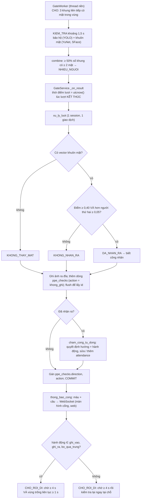

# Logic chấm công của SafeGate (theo code đang chạy)

Tài liệu này mô tả **đúng những gì code đang làm** ngày 30/10/2026, không theo `DE_TAI.md`.
- Nền: nhánh `giao-dien-v2`, có phần backend giống `main`.
- Chỗ nào code khác `DE_TAI.md` thì ghi ở mục 19.
- Lần này **không sửa logic nào**.

Mọi ví dụ đều đã chạy thật bằng [scripts/kich_ban_cham_cong.py](../scripts/kich_ban_cham_cong.py):
- Script có 29 kịch bản, gọi đúng các hàm nghiệp vụ thật, chạy trên SQLite trong bộ nhớ, với thời điểm giả lập.
- Kết quả đầy đủ ở **Phụ lục**. Ký hiệu **[KB n]** là kịch bản số n.
- Chạy lại: `.venv\Scripts\python.exe scripts\kich_ban_cham_cong.py`. Muốn chạy vài kịch bản thì thêm số, ví dụ `... 9 12`.

Mỗi quy tắc ghi theo thứ tự: **Lời** · **Điều kiện / công thức** · **Code** · **Tham số** · **Test** · **Ví dụ**.

**Làm tròn dùng chung.** Mọi số phút (muộn, về sớm, số phút làm) đều đi qua hàm
`_phut(td) = max(0, floor(số giây của td / 60))` ([cham_cong.py:60](../app/services/cham_cong.py#L60)):
- **cắt bỏ phần giây** (5 phút 59 giây tính là 5 phút);
- **không bao giờ âm** (âm thì thành 0).

## Tóm tắt nhanh

- Mỗi công nhân, mỗi ngày, có **tối đa 1 dòng** `attendance` (theo ca mặc định).
- Dòng đó chỉ giữ **giờ vào đầu tiên** và **giờ ra cuối cùng**. Các lần ra / vào ở giữa không được lưu trong bảng công.
- Không có nút chọn vào hay ra. Hệ thống **đoán hướng** theo dòng công trong ngày:
  - chưa vào, hoặc đã ra → lượt này là **VÀO**;
  - đang có mặt → lượt này là **RA**.
- Lượt **VÀO** chỉ được ghi khi nhận ra mặt **và** kết quả bảo hộ là `DAT`.
- Lượt **RA** được ghi khi nhận ra mặt và **không xét bảo hộ**. Ngoại lệ: kết quả `NHIEU_NGUOI` hoặc `KHONG_CO_NGUOI` thì không ghi.
- Phút muộn, phút về sớm, số phút làm được tính lại mỗi lần ghi vào hoặc ra, theo ca ở thời điểm đó.
- "Thiếu giờ ra" và "Vắng" **không lưu trong CSDL**, chỉ tính lúc hiển thị. "Vắng" chỉ có ở giao diện bảng công tháng.
- Chấm công thủ công thêm hoặc sửa được giờ vào / ra, bắt buộc có lý do, nhưng **không lưu giá trị cũ**.
- Chưa có: nhiều ca, phân ca, ca qua đêm, tăng ca, ngày lễ, khái niệm vắng ở backend.

---

## 1. Luồng tổng quát: từ lúc một lượt kết thúc tới khi ghi CSDL



Từng bước:

1. **Bắt đầu lượt** ([src/gate/worker.py](../src/gate/worker.py) `step`, [src/gate/state.py](../src/gate/state.py) `on_idle_frame`).
   - Ở trạng thái CHO, khi có mặt đủ lớn trong vùng liên tiếp `gate.trigger_frames` = 3 khung thì chạy 1 lượt.
   - Một lượt dài `checkpoint.timeout_s` = 1,5 s.
2. **Kết quả bảo hộ** gồm 5 loại: `DAT` / `KHONG_DAT` / `KHONG_XAC_DINH` / `NHIEU_NGUOI` / `KHONG_CO_NGUOI`.
   - Tính bởi `src/checkpoint/evaluate.py` (phần này không thuộc phạm vi tài liệu).
   - Sau đó [src/gate/combine.py](../src/gate/combine.py) ghi đè thành `NHIEU_NGUOI` nếu tỷ lệ khung có từ 2 mặt trở lên ≥ `checkpoint.multi_person_ratio` = 0,5.
3. **Gửi sang backend** ([app/gate_service.py:159](../app/gate_service.py#L159) `_on_result`).
   - `LuotKiemTra.tu_ket_qua_cong(result, utcnow())`: **thời điểm của lượt là lúc lượt kết thúc** (sau khoảng 1,5 s kiểm tra), theo đồng hồ máy chủ.
   - Mở 1 session riêng rồi gọi `xu_ly_luot`. Chỉ có **1 thread cổng**, nên các lượt được xử lý **lần lượt**, không song song.
4. **`xu_ly_luot`** ([app/services/luot.py:102](../app/services/luot.py#L102)):
   - Không có vector khuôn mặt → `KHONG_THAY_MAT`.
   - Có vector → so khớp ([nhan_dien.py:57](../app/services/nhan_dien.py#L57)). Chỉ so với công nhân **đang làm** có ≥ `face.min_samples` = 3 mẫu.
   - Nhận ra khi điểm ≥ `face.match_threshold` = 0,40 **và** hơn người thứ hai ≥ `face.match_margin` = 0,05. Khi đó là `DA_NHAN_RA`, ngược lại `KHONG_NHAN_RA`.
   - **Không kiểm tra** công nhân đã ghi nhận đồng ý hay chưa. Sự đồng ý chỉ được kiểm tra lúc thêm mẫu khuôn mặt.
   - Ghi ảnh ra đĩa (`luu_anh`) **trước** khi commit. Thêm dòng `ppe_checks` với `action = khong_ghi`, rồi `flush()` để lấy id.
   - Nếu đã nhận ra người → gọi `cham_cong_tu_dong` (mục 2, 3). Hàm này trả về hướng và hành động, gán vào `ppe_checks.direction` và `action`.
   - **Một lần `commit()`** cho cả `ppe_checks` và `attendance`.
5. **Thông báo** ([luot.py:82](../app/services/luot.py#L82) `thong_bao_cong`): chọn màu, câu thông báo và tạo sự kiện WebSocket. Trường `ghi_cong` = hành động là `ghi_vao` hoặc `ghi_ra`.
6. **Cổng chờ người rời đi** ([gate_service.py:42](../app/gate_service.py#L42) `DA_XONG`, [state.py](../src/gate/state.py) `on_round_done`):
   - Hành động thuộc {`ghi_vao`, `ghi_ra`, `bo_qua_trung`} → không bắt đầu lượt mới cho tới khi đã qua `gate.cooldown_seconds` = 4 s **và** vùng trống liên tục `gate.empty_seconds` = 1 s.
   - Hành động khác (`khong_ghi`) → sau 4 s kiểm tra lại ngay, kể cả khi người vẫn đứng đó.

**Lưu ý về lỗi:**
- Nếu `xu_ly_luot` gặp lỗi (ví dụ trùng khoá ở mục 15), session đóng lại và **huỷ cả lượt** (không còn dòng `ppe_checks`). Tuy vậy **ảnh đã ghi ra đĩa vẫn còn** (thành file mồ côi).
- `GateWorker._loop` bắt lỗi và quay lại CHO sau 1 s. Màn hình báo "Cổng gặp lỗi" **cho tới khi một lượt sau chạy xong**: `error` chỉ được xoá ở cuối một lượt thành công.

**Test:** `test_cham_cong.py::VaoRaTest::test_vao_dat_ghi_gio_vao`; `test_app.py::GateInAppTest::test_luot_vao_ghi_cong_va_phat_su_kien` (cổng chạy thật với mô hình giả); `test_gate.py` (máy trạng thái).

---

## 2. Điều kiện được ghi công

**Lời:**
- Chỉ người **đã nhận ra mặt** mới được xét chấm công.
- `NHIEU_NGUOI` và `KHONG_CO_NGUOI` thì không ghi gì, kể cả khi đã nhận ra mặt.
- Các kết quả còn lại: lượt VÀO cần `DAT`; lượt RA ghi với mọi kết quả.

**Code:** [cham_cong.py:146](../app/services/cham_cong.py#L146) `cham_cong_tu_dong`, [luot.py:130](../app/services/luot.py#L130).

| Nhận diện | Kết quả bảo hộ | Hướng VÀO (chưa vào, hoặc đã ra) | Hướng RA (đang có mặt) | `direction` lưu |
|---|---|---|---|---|
| `KHONG_THAY_MAT` | bất kỳ | `khong_ghi` | `khong_ghi` | rỗng |
| `KHONG_NHAN_RA` | bất kỳ | `khong_ghi` | `khong_ghi` | rỗng |
| `DA_NHAN_RA` | `NHIEU_NGUOI` | `khong_ghi` | `khong_ghi` | rỗng (không xét hướng) |
| `DA_NHAN_RA` | `KHONG_CO_NGUOI` | `khong_ghi` | `khong_ghi` | rỗng (không xét hướng) |
| `DA_NHAN_RA` | `DAT` | **`ghi_vao`**: lần đầu thì đặt giờ vào; vào lại thì xoá giờ ra | **`ghi_ra`**, hoặc `bo_qua_trung` nếu cách lần vào gần nhất < 2 phút | `vao` / `ra` |
| `DA_NHAN_RA` | `KHONG_DAT` | `khong_ghi` | **`ghi_ra`** / `bo_qua_trung` | `vao` / `ra` |
| `DA_NHAN_RA` | `KHONG_XAC_DINH` | `khong_ghi` | **`ghi_ra`** / `bo_qua_trung` | `vao` / `ra` |

**Màu và câu trên màn hình cổng** ([luot.py:82](../app/services/luot.py#L82)), xét theo thứ tự từ trên xuống:

| Điều kiện | Màu | Câu |
|---|---|---|
| kết quả `NHIEU_NGUOI` | vàng | "Mời từng người một" |
| kết quả `KHONG_CO_NGUOI` | vàng | "Mời đứng vào vị trí, nhìn vào camera" |
| không nhận ra mặt (`KHONG_NHAN_RA` / `KHONG_THAY_MAT`) | vàng | "Chưa nhận diện được, mời nhìn thẳng camera" |
| `ghi_vao` | xanh | "Xin chào {tên}. Đã ghi giờ vào HH:MM" (vào lại: "Đã ghi vào lại HH:MM") |
| `ghi_ra` | xanh | "Tạm biệt {tên}. Đã ghi giờ ra HH:MM" |
| `bo_qua_trung` | xanh | "{tên}: đã ghi giờ vào HH:MM, không ghi lặp" |
| `KHONG_DAT` (lượt vào) | đỏ | "{tên}: thiếu mũ bảo hộ, thiếu áo phản quang. Chưa ghi công" |
| còn lại (`KHONG_XAC_DINH` lượt vào) | vàng | "{tên}: mời đứng yên để kiểm tra lại" |

**Test:**
- `test_cham_cong.py`: `ThongBaoTest::test_mau_va_cau_thong_bao_tung_truong_hop` (10 trường hợp màu + câu);
- `KhongGhiCongTest`: `test_nguoi_la_khong_ghi`, `test_khong_thay_mat`, `test_nhieu_nguoi_khong_ghi_du_khop_mat`, `test_hai_cong_nhan_giong_nhau_qua_khong_nhan_ra`, `test_cong_nhan_chua_du_3_mau_khong_duoc_so_khop`;
- `VaoRaTest::test_vao_khong_dat_khong_ghi`, `test_ra_ghi_gio_ra_khong_can_bao_ho`.

**Ví dụ:**
- [KB 15] Người lạ có bảo hộ `DAT` → vàng, `khong_ghi`. `ppe_checks.worker_id` để rỗng, nhưng vẫn lưu "người giống nhất CN001, điểm 0,03". Không tạo dòng công.
- [KB 16] An bị nhận ra nhưng kết quả `NHIEU_NGUOI` → `khong_ghi`, hướng rỗng.
  - `KHONG_XAC_DINH` lúc vào → `khong_ghi`, vàng.
  - Sau khi đã vào, lượt RA `KHONG_XAC_DINH` lúc 17:01 → **`ghi_ra`**, nhưng lượt RA `NHIEU_NGUOI` lúc 17:00 thì **không ghi**.
- [KB 17] Lượt RA `KHONG_CO_NGUOI` (đã nhận ra mặt An) → `khong_ghi`, cuối ngày "thiếu giờ ra".

---

## 3. Xác định vào hay ra

### 3.1. Hướng của lượt
- **Lời:** xét dòng công của công nhân trong **ngày công của lượt** (mục 4), với **ca mặc định** (mục 5).
  - Chưa có dòng, hoặc đã có cả giờ vào lẫn giờ ra → **VÀO**.
  - Có giờ vào mà chưa có giờ ra → **RA**.
- **Điều kiện:** `huong(att) = VAO nếu att is None hoặc att.check_in is None hoặc att.check_out is not None; ngược lại RA`.
  - Thực tế `check_in` không bao giờ rỗng khi đã có dòng, vì cả lượt tự động lẫn chấm tay đều bắt buộc có giờ vào.
- **Code:** [cham_cong.py:122](../app/services/cham_cong.py#L122) `huong`; dòng công tìm bằng `tim_bang_cong(worker_id, ngày, shift_id)` ([:117](../app/services/cham_cong.py#L117)).
- **Không xét:** giờ trong ngày, khoảng cách tới giờ ca, lượt hôm trước.
- **Test:** `VaoRaTest` (toàn bộ).
- **Ví dụ:** [KB 1] 06:55 → VÀO; 17:00 → RA.

### 3.2. Lượt vào lần đầu trong ngày
- **Lời:** chỉ ghi khi bảo hộ `DAT`. Giờ vào là thời điểm của **lượt `DAT` đầu tiên**. Các lượt không đạt trước đó không được tính là giờ đến.
- **Điều kiện:** khi đó gán `check_in = t`, `ppe_check_id = id lượt`, và
  `status = binh_thuong` nếu `bắt đầu ca − early_checkin_minutes ≤ t ≤ kết thúc ca`, ngược lại `ngoai_ca`.
  Nếu dòng đã có trạng thái `cham_thu_cong` thì giữ nguyên trạng thái đó. Sau đó gọi `tinh_cong` (mục 6–8).
- **Code:** [cham_cong.py:155-170](../app/services/cham_cong.py#L155), `trong_khung_vao` ([:90](../app/services/cham_cong.py#L90)).
- **Test:** `test_vao_dat_ghi_gio_vao`, `test_khong_dat_roi_dat_gio_vao_la_luot_dat`, `test_ngoai_ca`.
- **Ví dụ:** [KB 4] 07:02 thiếu mũ → không ghi; 07:10 đạt → giờ vào 07:10, **muộn 10 phút**.

### 3.3. Vào lại sau khi đã ra (ví dụ đi ăn trưa)
- **Lời:** phải `DAT` mới được vào lại.
  - Giữ **giờ vào đầu tiên**.
  - **Xoá giờ ra** để người đó trở lại trạng thái "đang có mặt".
  - Không đổi `status`, không đổi `ppe_check_id`.
  - Tính lại công: chưa có giờ ra nên phút về sớm = 0 và **số phút làm = 0** cho tới khi quét ra lần sau.
- **Điều kiện:** `vao_lai = att đã có check_in` → `att.check_out = None`, rồi `tinh_cong`.
- **Code:** [cham_cong.py:158-163](../app/services/cham_cong.py#L158).
- **Test:** `test_vao_lai_sau_khi_ra_giu_gio_vao_dau_cap_nhat_gio_ra`.
- **Ví dụ:**
  - [KB 9] 07:00 vào, 11:30 ra (lúc này 270 phút), 12:30 vào lại (về **0 phút**), 17:00 ra → 540 phút.
  - [KB 10] 12:30 thiếu mũ → không ghi, giờ ra 11:30 vẫn còn; 12:35 đạt → vào lại.
  - [KB 29] Ra 11:30, **14:00** mới vào lại → vẫn đủ 540 phút (mục 8).

### 3.4. Lượt ra
- **Lời:** **không xét bảo hộ**. `DAT`, `KHONG_DAT`, `KHONG_XAC_DINH` đều ghi giờ ra; `NHIEU_NGUOI` và `KHONG_CO_NGUOI` thì không (mục 2).
- **Điều kiện:** nếu không bị chống trùng (3.5) thì `check_out = t`, rồi `tinh_cong`. Ra nhiều lần trong ngày thì mỗi lần ghi đè giờ ra.
- **Code:** [cham_cong.py:172-178](../app/services/cham_cong.py#L172).
- **Test:** `test_ra_ghi_gio_ra_khong_can_bao_ho` (ra lúc 17:05 khi đã tháo mũ vẫn được ghi).
- **Ví dụ:** [KB 28] An ra lúc 09:00, thiếu cả mũ lẫn áo → màn hình xanh "Tạm biệt…". Lượt này vẫn bị đếm là "lượt không đạt" ở trang Tổng quan (mục 14).

### 3.5. Chống trùng (`bo_qua_trung`)
- **Lời:** lượt RA đến quá sớm sau lần vào gần nhất thì bỏ qua, coi như người đó đứng lại trước camera.
  - Lượt vẫn được lưu với `action = bo_qua_trung`, màn hình báo xanh.
  - Màn hình cổng coi lượt này là "đã xong" và chờ người rời đi.
- **Điều kiện:** `t − lần_vào_gần_nhất < duplicate_minutes` (so sánh **nhỏ hơn hẳn**). Đúng 2 phút thì đã là RA.
- **Mốc "lần vào gần nhất"** (`lan_vao_gan_nhat`, [:128](../app/services/cham_cong.py#L128)) = `max(thời điểm lượt ghi_vao mới nhất trong ngày công, att.check_in)`. Không có lượt `ghi_vao` nào (ví dụ giờ vào do chấm tay) thì dùng `att.check_in`.
  - Vì vậy sau khi vào lại, mốc là **lúc vào lại**, không phải giờ vào đầu tiên.
  - Nếu cán bộ sửa tay giờ vào thì mốc là giá trị lớn hơn trong hai giá trị trên.
- **Tham số:** `attendance.duplicate_minutes` = 2 (settings.yaml).
- **Test:**
  - `test_ra_trong_2_phut_sau_khi_vao_bi_bo_qua` (07:01:30 bị bỏ qua, 07:02:00 thì ghi ra);
  - `test_vao_lai_...` (13:01 bỏ qua vì mốc là lúc vào lại 13:00);
  - `ChamThuCongTest::test_cham_vao_thu_cong_roi_dung_truoc_camera_khong_ghi_ra_ngay`.
- **Ví dụ:** [KB 11] vào 07:00, 07:01 bị bỏ qua, **07:04 thành RA**: giờ ra 07:04, làm 4 phút, về sớm 596 phút.

### 3.6. Không có chống trùng cho VÀO ngay sau RA
- **Lời:** chống trùng chỉ áp dụng cho lượt RA ngay sau một lượt VÀO. Một lượt `DAT` ngay sau khi đã ra được coi là **vào lại** và xoá giờ ra.
- **Ví dụ:**
  - [KB 26] Ra 17:00, đứng lại trước camera lúc 17:01 → "Đã ghi vào lại 17:01", giờ ra bị xoá, cuối ngày "thiếu giờ ra", 0 phút.
  - Biến thể quay lại khi đã tháo mũ → `khong_ghi`, đỏ "…thiếu mũ bảo hộ. Chưa ghi công" (dù người đó đang ra về), giờ ra 17:00 vẫn giữ.

### 3.7. Ảnh hưởng của máy trạng thái cổng
Sau một lượt đã ghi, cổng chỉ bắt đầu lượt mới khi vùng kiểm tra đã trống ít nhất 1 s (mục 1, bước 6). Vì vậy tình huống "quét lại sau 1–4 phút" ([KB 11], [KB 26]) chỉ xảy ra khi người đó **bước ra khỏi vùng rồi quay lại**. Đứng yên tại chỗ thì không tạo thêm lượt.

---

## 4. Ngày công (`work_date`) và múi giờ

- **Lời:**
  - CSDL lưu thời điểm theo **UTC**.
  - Ngày công là **ngày lịch theo giờ Việt Nam** của thời điểm lượt.
  - Không có khái niệm "ngày công theo ca": một lượt lúc 00:20 luôn thuộc ngày mới.
- **Điều kiện:** `ngay_cong(t) = t.astimezone(Asia/Ho_Chi_Minh).date()`.
  - Lượt lúc **23:59:59** thuộc ngày D; lượt lúc **00:00:00** thuộc ngày D+1.
  - Khoảng một ngày dùng để lọc lượt: `[00:00, 24:00)` giờ Việt Nam (`khoang_ngay`).
- **Code:** [cham_cong.py:41-57](../app/services/cham_cong.py#L41) (`mui_gio`, `ngay_cong`, `khoang_ngay`, `gio_phut`); kiểu `UTCDateTime` trong [app/db.py](../app/db.py). MariaDB dùng `DATETIME(6)` lưu giờ UTC "trơn", đọc ra gắn lại UTC.
- **Tham số:** `attendance.timezone` = `Asia/Ho_Chi_Minh`.
- **Ca qua đêm:** **không hỗ trợ.**
  - `moc_ca` có cộng thêm 1 ngày khi giờ kết thúc ≤ giờ bắt đầu, nhưng `sua_ca` và `seed_demo.py --ca` đều chặn tạo ca như vậy.
  - Cờ `is_overnight` không được đọc ở đâu.
- **Test:** `test_ngay_cong_tinh_theo_gio_viet_nam` (06:30 giờ VN = 23:30 UTC hôm trước → ngày công là ngày VN). Chưa có test cho lượt qua nửa đêm.
- **Ví dụ:** [KB 22]
  - Vào 23:50 ngày 02/11 → dòng 02/11, `ngoai_ca`, **muộn 1010 phút**.
  - "Ra" 00:20 ngày 03/11 → bị coi là **VÀO** của ngày 03/11 (mở dòng mới, `ngoai_ca`).
  - Dòng 02/11 mãi "thiếu giờ ra".

---

## 5. Ca làm và phân ca

- **Số ca:**
  - Bảng `shifts` có thể chứa nhiều dòng, nhưng **chỉ dòng có id nhỏ nhất** (`ca_mac_dinh`, [cham_cong.py:65](../app/services/cham_cong.py#L65)) được dùng ở mọi nơi: chấm công tự động, chấm tay, bảng công ngày và tháng, sửa ca.
  - CSDL thật hiện có đúng 1 ca. Đã kiểm tra (chỉ đọc) ngày 30/10/2026: "Ca hành chính" 07:00–17:00, nghỉ 11:30 trong 60 phút, ân hạn 5 phút, cho vào sớm 60 phút.
- **Chọn ca cho một lượt:** luôn là ca mặc định, không xét tổ đội, cá nhân hay giờ trong ngày.
- **`shift_assignments`:** **chưa có bảng này** (trong code không có; [docs/RA_SOAT.md](RA_SOAT.md) ghi "CHƯA CÓ").
- **Cửa sổ cho vào:**
  - `[bắt đầu − early_checkin_minutes, kết thúc]`, tính cả hai đầu. Với ca hiện tại là `[06:00, 17:00]`.
  - Vào ngoài cửa sổ **vẫn được ghi giờ vào**, chỉ bị gắn `status = ngoai_ca`. Nhãn này không ảnh hưởng tới phút làm, phút muộn hay số ngày công, và không cần ai duyệt.
  - Nhãn chỉ được đặt ở **lượt vào đầu tiên**: vào lại không đổi; dòng chấm tay thì giữ `cham_thu_cong`.
  - Ví dụ: [KB 5] vào 05:30 → `ngoai_ca`, 540 phút; [KB 6] vào 06:10 → `binh_thuong`; [KB 13] vào 22:00 → `ngoai_ca`, muộn 900 phút.
  - Test: `test_ngoai_ca` (05:30 → `ngoai_ca`; đúng 06:00 → `binh_thuong`; 18:00 → `ngoai_ca`).
- **Ca qua đêm, tăng ca, nhiều ca trong một ngày:** **không hỗ trợ.**
  - Cờ `is_overnight` và `is_overtime` có trong bảng nhưng không dùng.
  - Ràng buộc duy nhất `(worker_id, work_date, shift_id)` cùng việc luôn dùng ca mặc định nghĩa là **mỗi ngày 1 dòng**.
  - Ví dụ: [KB 8] ra 19:30 → vẫn 540 phút, không ghi nhận 2 giờ 30 phút làm thêm.
- **Sửa ca** (trang Cấu hình ca, `PATCH /api/ca-lam` → `sua_ca`, [cham_cong.py:217](../app/services/cham_cong.py#L217)):
  - Sửa được: tên, giờ bắt đầu, giờ kết thúc, giờ bắt đầu nghỉ, số phút nghỉ (0–240), ân hạn (0–120), cho vào sớm (0–240).
  - Bắt buộc: kết thúc > bắt đầu; giờ nghỉ nằm trong giờ ca (chỉ kiểm tra khi số phút nghỉ > 0).
  - Sau khi sửa, **chỉ tính lại các dòng công của HÔM NAY**: chạy lại `tinh_cong`, và đặt lại `binh_thuong` / `ngoai_ca` cho dòng không phải chấm tay. Các ngày trước giữ nguyên số đã tính.
  - Không lưu lịch sử ca.
  - Test: `test_pages.py::test_sua_ca_lam_kiem_tra_va_tinh_lai_hom_nay` (đổi giờ nghỉ sang 10:00 → dòng 08:00–11:00 từ 180 còn 120 phút); `test_seed.py::test_ca_doi_gio_bat_dau_ket_thuc`.
  - Ví dụ: [KB 27] Hôm qua vào 07:10 với ca 07:00 → muộn 10 phút. Hôm nay 09:00 đổi ca sang 07:30 → giờ vào 07:10 hôm nay **muộn 0**, hôm qua vẫn muộn 10.

---

## 6. Đi muộn

- **Lời:**
  - Muộn = giờ vào − giờ bắt đầu ca, tính bằng phút (cắt giây).
  - Chỉ ghi nhận khi **vượt** ân hạn. Khi đã vượt thì tính **toàn bộ số phút từ giờ bắt đầu ca**, không trừ ân hạn.
- **Công thức:** `muộn = _phut(check_in − bắt_đầu_ca)`; `late_minutes = muộn nếu muộn > grace_minutes, ngược lại 0`.
- **Mốc giờ vào** là `att.check_in`:
  - lượt `DAT` đầu tiên trong ngày (3.2), **không phải** lần đầu xuất hiện ở cổng;
  - hoặc giờ vào do chấm tay.
- **Vào lại giữa ca:** **không ảnh hưởng**. Phút muộn chỉ tính từ giờ vào đầu tiên; vào lại muộn sau giờ nghỉ cũng không tính muộn.
- **Tính khi nào:** mỗi lần chạy `tinh_cong` (ghi vào, ghi ra, vào lại, chấm tay, sửa ca trong ngày). Kết quả luôn dựa trên `check_in` hiện tại.
- **Code:** [cham_cong.py:95-99](../app/services/cham_cong.py#L95) `tinh_cong`.
- **Tham số:** `shifts.grace_minutes` = 5, `shifts.start_time` = 07:00.
- **Test:** `test_di_muon_trong_va_ngoai_an_han` (07:05 → 0; 07:20 → 20).
- **Ví dụ:**
  - [KB 2] 07:04 → 0 phút; **07:05:59 → 0** (cắt giây còn 5, mà 5 không lớn hơn 5).
  - [KB 3] 07:06 → **6** (không phải 1).
  - [KB 4] đến cổng 07:02 nhưng thiếu mũ, đạt lúc 07:10 → 10.
  - [KB 13] vào 22:00 → **900**.
  - [KB 10] vào lại 12:35 (quá giờ nghỉ 5 phút) → không tính.

---

## 7. Về sớm

- **Lời:** về sớm = giờ kết thúc ca − giờ ra (phút, cắt giây, không âm). Chỉ tính khi đã có **cả** giờ vào lẫn giờ ra. **Không có ân hạn.**
- **Công thức:** `early_leave_minutes = _phut(kết_thúc_ca − check_out)` nếu có `check_in` và `check_out`, ngược lại 0.
- **Ra nhiều lần:**
  - Mỗi lần ghi ra thì tính lại theo giờ ra **mới nhất**.
  - Vào lại thì giờ ra bị xoá, về sớm trở về 0.
  - Vì vậy chỉ lần ra cuối cùng quyết định kết quả.
- **Code:** [cham_cong.py:100-101](../app/services/cham_cong.py#L100).
- **Tham số:** `shifts.end_time` = 17:00.
- **Test:** `ChamThuCongTest::test_sua_gio_ra_giu_gio_vao_tu_dong` (ra 16:30 → 30); `test_app.py::test_bang_cong_cham_thu_cong_tong_quan`. Chưa có test riêng cho lượt ra tự động về sớm.
- **Ví dụ:**
  - [KB 7] ra 16:30 → 30 phút, làm 510 phút.
  - [KB 9] ra 11:30 → tạm thời về sớm 330; vào lại → 0; ra 17:00 → 0.
  - [KB 11] ra 07:04 → **596**.
  - [KB 19] giờ ra chấm tay 06:50 → 610.

---

## 8. Số phút làm

- **Lời:** chỉ tính phần **nằm trong giờ ca**, từ giờ vào đầu tiên tới giờ ra cuối cùng, trừ phần **giao nhau** với giờ nghỉ cố định.
  - **Không trừ các khoảng ra ngoài ở giữa** (không lưu các cặp vào / ra).
  - **Không tính phần ngoài giờ ca** (đến sớm, ở lại muộn).
- **Công thức** (chỉ khi có cả `check_in` và `check_out`):
  ```
  từ  = max(check_in,  bắt_đầu_ca)
  đến = min(check_out, kết_thúc_ca)
  nghỉ = độ dài phần chung của [từ, đến] và [break_start, break_start + break_minutes]   (0 nếu không giao nhau)
  worked_minutes = _phut(đến − từ − nghỉ)      → cắt giây, âm thì về 0
  ```
  Chưa có giờ ra (đang làm, thiếu giờ ra, vừa vào lại) → `worked_minutes = 0`.
- **Code:** [cham_cong.py:100-106](../app/services/cham_cong.py#L100), `moc_nghi` ([:80](../app/services/cham_cong.py#L80)), `giao_nhau` ([:85](../app/services/cham_cong.py#L85)).
- **Tham số:** `shifts.break_start` = 11:30, `shifts.break_minutes` = 60, giờ ca 07:00–17:00.
- **Test:** `GioNghiTest` (07:00–17:00 → 540; 06:30–17:30 → 540; 07:00–11:00 → 240; 08:00–11:30 → 210; 13:00–17:00 → 240; 07:00–12:00 → 270; 12:12–12:15 → 0), `test_luot_vao_ra_ghi_so_phut_lam_theo_gio_nghi`.
- **Ví dụ:**
  - [KB 1] 06:55–17:00 → 540 (5 phút đến sớm không được tính).
  - [KB 2] 07:04–17:00 → **536**: ân hạn không bù phút làm.
  - [KB 8] 07:00–19:30 → 540.
  - [KB 14] 07:00 vào, 07:30 ra, 08:00 vào, 17:00 ra → **540** (30 phút vắng không bị trừ).
  - [KB 29] ra ăn trưa 11:30 → 14:00 → **540**.
  - [KB 13] 22:00–23:30 → 0 (nằm ngoài giờ ca).
  - [KB 9] sau lượt vào lại 12:30, số phút làm hiển thị **0** cho tới khi quét ra.

---

## 9. Thiếu giờ ra

- **Lời:** dòng có giờ vào, không có giờ ra, và **đã quá giờ kết thúc ca + 4 giờ** (tức sau 21:00) thì hiển thị "Thiếu giờ ra".
- **Điều kiện:** `thieu_gio_ra = check_in có, check_out rỗng, và now > kết_thúc_ca(của work_date) + missing_checkout_hours` (**lớn hơn hẳn**: đúng 21:00:00 chưa tính).
- **Lưu hay tính:** **chỉ tính khi hiển thị**, không lưu.
  - `now` là thời điểm mở trang ([api.py:393](../app/routers/api.py#L393)).
  - `status` trong CSDL vẫn là `binh_thuong`, `ngoai_ca` hoặc `cham_thu_cong`.
  - Giờ kết thúc ca lấy theo **ca hiện tại**, kể cả khi xem các ngày cũ.
- **Code:** [cham_cong.py:109](../app/services/cham_cong.py#L109); được dùng trong `bao_cao.dong_bang_cong`.
- **Tham số:** `attendance.missing_checkout_hours` = 4.
- **Hôm sau quét vào:**
  - Lượt hôm sau thuộc ngày công mới nên mở dòng mới bình thường.
  - **Dòng hôm trước giữ nguyên**: không giờ ra, 0 phút, mãi "thiếu giờ ra", **vẫn được tính 1 ngày công** trong bảng công tháng.
  - Không có gì tự đóng dòng đó hay nhắc cán bộ, ngoài nhãn hiển thị.
- **Test:** `BaoCaoTest::test_thieu_gio_ra_sau_4_gio` (20:59 → chưa; 21:01 → thiếu), `test_bang_cong_ngay_va_tong_quan` (xem lúc 22:00 → thiếu).
- **Ví dụ:** [KB 12]
  - Lúc 20:00 và 21:00 → "không"; 21:30 và sáng hôm sau → "CÓ".
  - Hôm sau vào 07:00 và ra 17:00 → tháng 11 có **2 ngày công**, 540 phút.
  - Xem thêm [KB 17], [KB 20], [KB 25], [KB 26].

---

## 10. Vắng / bỏ ca

- **Backend:** **không có khái niệm vắng.**
  - Bảng công ngày trả `trang_thai = "chua_vao"` cho người không có dòng công ([bao_cao.py:24](../app/services/bao_cao.py#L24)).
  - Bảng công tháng chỉ có ô cho những ngày **có dòng công**.
  - File Excel để trống ô ngày không có công. Không có cột "số ngày vắng".
- **Giao diện React — bảng công tháng** ([MonthlyAttendancePage.jsx:24-27](../frontend/src/pages/MonthlyAttendancePage.jsx#L24)) tô ô **"Vắng"** khi **đủ cả 4 điều kiện**:
  1. ngày đó không có dòng công, hoặc dòng không có giờ vào;
  2. ngày **đã qua** (`ngày < hôm nay`; hôm nay và tương lai không bao giờ là vắng);
  3. **không phải Chủ nhật**;
  4. ngày ≥ **ngày tạo công nhân** (`created_at` theo giờ Việt Nam). Không có ngày tạo thì không xét điều kiện này.
- **Hệ quả của quy tắc này:**
  - Thứ Bảy và **ngày lễ** vẫn bị tô vắng.
  - Công nhân **nghỉ việc** chỉ xuất hiện trong tháng mà họ có công. Trong tháng đó, mọi ngày đã qua không có công, **kể cả sau ngày nghỉ việc**, đều bị tô vắng, vì không lưu ngày nghỉ việc.
  - Công nhân **đi làm lại** có trạng thái `dang_lam` nên xuất hiện ở mọi tháng. Những tháng họ đã nghỉ cũng toàn ô vắng.
  - Quy tắc chỉ nằm ở giao diện. Excel, API và giao diện dự phòng `/cu` không có.
- **Test:** không có (quy tắc nằm ở frontend). Playwright chỉ kiểm tra trang mở được, không lỗi.

---

## 11. Ngày nghỉ, ngày lễ, Chủ nhật

- **Lời:** **không xử lý gì** ở backend.
  - Quét vào ngày Chủ nhật hay ngày lễ được ghi như ngày thường: `binh_thuong`, có tính muộn và về sớm, không đánh dấu, không hệ số.
  - Giao diện tháng chỉ tô đậm cột Chủ nhật và không tính Chủ nhật là vắng (mục 10).
- **Test:** không có.
- **Ví dụ:** [KB 21] Chủ nhật 01/11 và 02/09 (Thứ Tư) → mỗi ngày 07:00–17:00, 540 phút, `binh_thuong`.

---

## 12. Chấm công thủ công

- **Cách gọi:** `POST /api/cham-cong-thu-cong` ([api.py:426](../app/routers/api.py#L426)) → `cham_thu_cong` ([cham_cong.py:182](../app/services/cham_cong.py#L182)).
  - Body: `worker_id`, `ngay`, `gio_vao?`, `gio_ra?`, `ly_do`.
  - Ai đã đăng nhập cũng làm được (hiện chỉ có vai trò admin).
  - Giao diện: [ManualAttendanceModal.jsx](../frontend/src/components/common/ManualAttendanceModal.jsx). Ô để trống thì giữ nguyên giờ đó; lý do tối đa 500 ký tự (chỉ giới hạn phía giao diện).
- **Thêm / sửa được gì:**
  - Giờ vào và / hoặc giờ ra của **một ngày**, nhập dạng `HH:MM`, theo giờ Việt Nam, **cùng ngày đó**. Không nhập được giờ ra sang ngày hôm sau.
  - Chưa có dòng thì tạo dòng mới.
  - Không xoá được giờ ra, không xoá được dòng. Để trống nghĩa là "giữ", không phải "xoá".
- **Kiểm tra hợp lệ** (lỗi → `ChamCongError` → HTTP 400 kèm câu tiếng Việt):
  1. Lý do bỏ khoảng trắng hai đầu mà vẫn rỗng → "Bắt buộc ghi lý do khi chấm công thủ công". Thiếu hẳn trường `ly_do` → 422.
  2. Không có cả giờ vào lẫn giờ ra → "Cần nhập giờ vào hoặc giờ ra".
  3. `ngay > hôm nay` (giờ Việt Nam) → "Không chấm công cho ngày trong tương lai". **Chỉ chặn ngày, không chặn giờ**: lúc 09:00 vẫn nhập được giờ ra 17:00 của hôm nay ([KB 24]).
  4. Sau khi ghép với giá trị cũ mà vẫn không có giờ vào → "Chưa có giờ vào: nhập giờ vào trước".
  5. `giờ ra < giờ vào` → "Giờ ra phải sau giờ vào". **Bằng nhau thì được chấp nhận** → dòng 0 phút ([KB 19]).
- **Không kiểm tra:**
  - công nhân đã nghỉ việc chưa;
  - ngày quá xa trong quá khứ;
  - giờ có nằm trong ca không;
  - có dòng chấm tay khác vừa sửa không.
- **Sau khi ghi:**
  - `status = cham_thu_cong` (vĩnh viễn với dòng đó).
  - `updated_by` = người sửa, `updated_at` = lúc sửa.
  - Tính lại muộn / về sớm / số phút làm bằng `tinh_cong`.
  - `ppe_check_id` **không đổi**, vẫn trỏ tới lượt vào tự động cũ nếu có.
- **Lịch sử sửa:** chỉ **nối thêm một dòng** vào `attendance.note`, dạng `"HH:MM dd/mm <username>: <lý do>"`.
  - **Không lưu giá trị cũ / mới**, nên không biết đã sửa từ giờ nào sang giờ nào.
  - `updated_by` và `updated_at` chỉ giữ lần cuối.
- **Lượt tự động sau khi chấm tay:** dòng chấm tay được xử lý như mọi dòng khác (mục 3).
  - Chấm tay giờ vào rồi quét → RA. Chống trùng tính từ giờ vào chấm tay ([KB 18]).
  - Lượt RA tự động **ghi đè `updated_at`** bằng giờ quét, còn `updated_by` vẫn là admin ([KB 18]).
  - Đã chấm tay giờ ra mà sau đó công nhân đi ngang camera và đạt → **vào lại**, **giờ ra chấm tay bị xoá** ([KB 25]).
- **Test:**
  - `ChamThuCongTest`: `test_thieu_ly_do_bi_tu_choi`, `test_them_gio_vao_ra`, `test_sua_gio_ra_giu_gio_vao_tu_dong`, `test_du_lieu_sai_bi_tu_choi` (chưa có giờ vào, ra trước vào, ngày mai), `test_cham_vao_thu_cong_roi_dung_truoc_camera_khong_ghi_ra_ngay`;
  - `test_app.py::test_bang_cong_cham_thu_cong_tong_quan` (422 / 400 / 200 qua API).
- **Ví dụ:**
  - [KB 18] chấm tay giờ vào 07:00 lúc 08:00, quét ra 17:00 → 540 phút, `cham_thu_cong`, `ppe_check_id` rỗng.
  - [KB 19] sửa giờ vào 07:00 thành 06:50 → giờ ra 06:40 bị từ chối, giờ ra 06:50 được nhận.

---

## 13. Nghỉ việc / đi làm lại

- **Cho nghỉ việc** (`POST /api/cong-nhan/{id}/nghi-viec` → `cho_nghi_viec`, [cong_nhan.py:62](../app/services/cong_nhan.py#L62)):
  - `status = nghi_viec`, **xoá toàn bộ mẫu khuôn mặt** (vector và ảnh), xoá bộ nhớ đệm nhận diện. Từ lượt sau, người đó là `KHONG_NHAN_RA`.
  - **Không đụng tới bảng công:** dòng đang mở (đang có mặt) vẫn mở, và thường thành "thiếu giờ ra" vĩnh viễn ([KB 20]).
  - **Không lưu ngày nghỉ việc.**
- **Đi làm lại** (`POST /api/cong-nhan/{id}/di-lam-lai` → `di_lam_lai`, [:71](../app/services/cong_nhan.py#L71)):
  - `status = dang_lam`, xoá thông tin đồng ý (`consent_at`, `consent_by`) → phải ghi nhận đồng ý và đăng ký khuôn mặt lại từ đầu.
  - Lịch sử công giữ nguyên. Không lưu ngày đi làm lại.
- **Ảnh hưởng tới báo cáo** (`_workers_for`, [bao_cao.py:30](../app/services/bao_cao.py#L30)):
  - Bảng công ngày và tháng liệt kê **công nhân đang làm**, cộng thêm **công nhân đã nghỉ nhưng có dòng công trong khoảng đang xem**.
  - Lọc tổ dùng tổ **hiện tại** của công nhân.
  - Trang Tổng quan: "Công nhân đang làm" không tính người nghỉ việc, nhưng "Đã vào" thì có tính (mục 14).
- **Test:** `DangKyMatTest::test_nghi_viec_khong_nhan_dien_va_xoa_mau` (kiểm tra không nhận ra nữa, mẫu đã xoá, đi làm lại phải đồng ý lại; **không** kiểm tra dòng công đang mở); `test_app.py::test_to_doi_va_cong_nhan_tim_kiem_loc_sua_nghi_viec`.

---

## 14. Báo cáo

### 14.1. Trang Tổng quan (`GET /api/tong-quan` → `tong_quan`, [bao_cao.py:133](../app/services/bao_cao.py#L133))

"Hôm nay" là ngày công của `now`, tức `[00:00, 24:00)` giờ Việt Nam.

| Con số | Định nghĩa chính xác |
|---|---|
| Công nhân đang làm (`so_cong_nhan`) | số công nhân có `status = dang_lam` (kể cả người chưa có mẫu mặt) |
| Đã vào (`da_vao`) | số công nhân **khác nhau** có dòng `attendance` hôm nay với `check_in` có giá trị (mọi trạng thái, kể cả chấm tay, ngoài ca, người đã nghỉ việc) |
| Đang có mặt (`dang_co_mat`) | trong số đó, những người có `check_out` rỗng (người vừa vào lại cũng tính) |
| Số lượt (`so_luot`) | số dòng `ppe_checks` hôm nay, mọi kết quả, kể cả người lạ, không thấy mặt, lượt lặp |
| Lượt đạt / không đạt | số lượt hôm nay có `result = DAT` / `KHONG_DAT`, **không phân biệt** lượt vào hay ra, người quen hay người lạ |
| Tỷ lệ đạt (`ty_le_dat`) | `round(đạt / (đạt + không đạt), 3)`; chưa có lượt nào thì rỗng. Không tính `KHONG_XAC_DINH`, `NHIEU_NGUOI`, `KHONG_CO_NGUOI` |
| Lượt theo giờ | 24 ô theo giờ Việt Nam; mỗi ô đếm `dat` / `khong_dat` / `khac`. Biểu đồ chỉ vẽ đạt và không đạt |
| Lượt mới nhất | 10 lượt mới nhất của **mọi ngày** (không lọc hôm nay) |

- **Test:** `test_bang_cong_ngay_va_tong_quan`, `test_pages.py::test_tong_quan_co_ty_le_dat_va_nguoi_dang_co_mat`, `test_frontend.py::test_tong_quan_dem_luot_theo_gio_hom_nay`.
- **Ví dụ:** [KB 28], ngày 04/11 lúc 10:00:
  - 6 lượt: 2 đạt, **3 không đạt** (An lúc vào thiếu mũ, người lạ, An **ra** lúc 09:00 thiếu đồ bảo hộ), 1 khác.
  - Tỷ lệ đạt 0,4. Đã vào 2, đang có mặt 1.

### 14.2. Bảng công ngày (`GET /api/bang-cong?ngay=&to_doi=` → `bang_cong_ngay`, [bao_cao.py:38](../app/services/bao_cao.py#L38))

- Mỗi công nhân 1 dòng (danh sách theo `_workers_for`, mục 13), **kể cả người chưa vào**. Chỉ lấy dòng công của ca mặc định.
- Các trường: mã, họ tên, tổ, ngày, tên ca, giờ vào, giờ ra (HH:MM giờ Việt Nam), phút muộn, phút về sớm, số phút làm, `trang_thai` (`binh_thuong` / `ngoai_ca` / `cham_thu_cong` / `chua_vao`), `thieu_gio_ra` (mục 9), ghi chú.
- Giao diện ([labels.js:59](../frontend/src/lib/labels.js#L59) `trangThaiNgay`) đổi thành chữ, xét theo thứ tự: Thiếu giờ ra → Chấm thủ công → Ngoài ca → Đã ra → Đang làm → Chưa vào.
- Bộ lọc nhanh ([AttendancePage.jsx:18](../frontend/src/pages/AttendancePage.jsx#L18)):
  - "Đang có mặt" = có giờ vào, chưa có giờ ra, chưa bị coi là thiếu giờ ra;
  - "Chưa ra" = thiếu giờ ra;
  - "Chưa vào" = không có giờ vào.
- Trang chi tiết công nhân dùng `bang_cong_gan_day`: 14 ngày gần nhất, mọi ca.

### 14.3. Bảng công tháng (`GET /api/bang-cong/thang?thang=YYYY-MM` → `bang_cong_thang`, [bao_cao.py:55](../app/services/bao_cao.py#L55))

- **Mỗi ô ngày** là một dòng bảng công ngày như 14.2, **chỉ có ở những ngày có dòng công**.
- **Số ngày công** (`so_ngay_cong`) = số ngày có `check_in`. **Tính cả** ngày thiếu giờ ra (0 phút), ngày đang làm, ngày ngoài ca, ngày chấm tay.
- **Tổng phút** (`tong_phut`) = tổng `worked_minutes`.
- **Số lần muộn** (`so_lan_muon`) = số ngày có `late_minutes > 0`.
- **Giao diện:**
  - màu ô xét theo thứ tự: thiếu giờ ra → chấm thủ công → đi muộn → đủ công;
  - ô chỉ ghi số giờ (làm tròn 1 chữ số thập phân) khi đã có giờ ra;
  - quy tắc "Vắng" xem mục 10.
- **Test:** `test_pages.py::test_bang_cong_thang_va_excel` (2 ngày công, 520 + 240 phút, 1 lần muộn).
- **Ví dụ:** [KB 12] 2 ngày công / 540 phút (1 ngày thiếu giờ ra); [KB 28] An 3 ngày công / 660 phút.

### 14.4. File Excel (`GET /api/bang-cong/thang/excel` → `excel_bang_cong_thang`, [bao_cao.py:81](../app/services/bao_cao.py#L81))

- **Sheet "Bang cong":**
  - Dòng 1 là tiêu đề "BẢNG CÔNG THÁNG MM/YYYY - {tên ca}".
  - Dòng 2 là các cột: Mã, Họ tên, Tổ đội, 1…số ngày trong tháng, **Số ngày công**, **Tổng giờ làm** (h:mm), **Số lần đi muộn**.
  - Ô ngày = số giờ làm dạng `h:mm` nếu có giờ vào, ngược lại để trống. Ngày thiếu giờ ra hoặc đang làm ghi **"0:00"**.
  - Ô ngày đi muộn tô màu cam nhạt.
  - Không có vắng, Chủ nhật, thiếu giờ ra.
- **Sheet "Chi tiet":** mỗi ngày có công 1 dòng, gồm: Ngày (dd/mm/yyyy), Mã, Họ tên, Tổ đội, Giờ vào, Giờ ra, Đi muộn (phút), Về sớm (phút), Số giờ làm (h:mm), **Trạng thái (mã kỹ thuật, ví dụ `binh_thuong`)**, Ghi chú.
- **Ví dụ:** [KB 28], xem Phụ lục.

---

## 15. Ràng buộc dữ liệu và đồng thời

**Ràng buộc trong CSDL** ([models.py](../app/models.py)):
- `attendance`: **duy nhất `(worker_id, work_date, shift_id)`** (`uq_attendance_worker_ngay_ca`). Khoá ngoại tới `workers` (xoá công nhân thì xoá dòng công), tới `shifts`, và tới `ppe_checks` (xoá lượt thì `ppe_check_id` về rỗng).
- `workers.code` duy nhất; `users.username` duy nhất.
- `ppe_checks` không có ràng buộc duy nhất nào.
- **Không có** ràng buộc kiểm tra ở mức CSDL như `check_out ≥ check_in` hay `late_minutes ≥ 0`. Mọi kiểm tra nằm trong code Python.

**Ai ghi vào `attendance`, ghi khi nào:**
- **Thread cổng** (1 thread, xử lý lượt **lần lượt**).
- **API chấm tay** và **API sửa ca**: FastAPI chạy các endpoint `def` trong threadpool, nên chúng **có thể chạy song song** với thread cổng.
- Không có khoá hàng (`SELECT … FOR UPDATE`), không có khoá theo công nhân, không thử lại khi lỗi.

**Hai lượt của cùng một người đến gần như cùng lúc:**
- **Hiện tại không xảy ra** với 1 cổng, vì thread cổng xử lý tuần tự. Thêm nữa, sau lượt đã ghi, cổng chờ ≥ 4 s và vùng trống ≥ 1 s.
- [KB 23] mô phỏng trường hợp có 2 cổng: 2 thread, mỗi thread 1 session, chạy trên **file SQLite**.
  - SQLite khoá cả file khi ghi, nên 2 giao dịch luôn chạy **lần lượt**.
  - Kết quả luôn là 1 `ghi_vao` + 1 `bo_qua_trung`, 1 dòng công, 2 lượt.
  - **Thread nào thắng là ngẫu nhiên.** Có lần lượt đến sau 0,5 s lại thành giờ vào; số lần mỗi bên thắng thay đổi giữa các lần chạy.
- **Trên MariaDB (InnoDB, mặc định REPEATABLE READ)** — đây là phân tích, **chưa chạy thử** vì không được động vào CSDL thật:
  - Nếu thread B đọc `attendance` trước khi A commit, B không thấy dòng của A và cũng thêm dòng mới.
  - Lệnh INSERT của B sẽ chờ khoá của A. Khi A commit, B nhận lỗi **trùng khoá** (`IntegrityError`).
  - Trong thread cổng, lỗi này làm **mất cả lượt của B** (cả dòng `ppe_checks`), màn hình báo "Cổng gặp lỗi" cho tới lượt sau, còn ảnh thì vẫn nằm trên đĩa.
  - Nếu A đã commit trước khi B đọc, B thấy dòng của A → `bo_qua_trung` (giống SQLite).
- **Chấm tay cùng lúc với lượt cổng** (có thể xảy ra ngay bây giờ):
  - Cùng **tạo** dòng của một ngày → một bên nhận `IntegrityError`. Nếu là API thì trả 409 "Dữ liệu bị trùng…" ([main.py:135](../app/main.py#L135)); nếu là cổng thì mất lượt.
  - Cùng **sửa** một dòng → bên commit sau ghi đè các cột mình đổi (cập nhật bị mất). Các cột tính toán như `worked_minutes` có thể ứng với giờ vào / ra của bên kia.

---

## 16. Bảng tham số liên quan tới chấm công

| Tham số | Giá trị hiện tại | Nơi đặt | Dùng ở |
|---|---|---|---|
| `attendance.duplicate_minutes` | 2 | `configs/settings.yaml` | chống trùng lượt RA (3.5) |
| `attendance.missing_checkout_hours` | 4 | settings.yaml | thiếu giờ ra (9) |
| `attendance.timezone` | `Asia/Ho_Chi_Minh` | settings.yaml | ngày công, hiển thị (4) |
| `attendance.default_shift.*` (name, start, end, break_start, break_minutes, grace_minutes, early_checkin_minutes) | Ca hành chính, 07:00, 17:00, 11:30, 60, 5, 60 | settings.yaml | **chỉ** khi `seed_demo.py` tạo ca lần đầu; sau đó giá trị thật nằm ở bảng `shifts` |
| `shifts.start_time` / `end_time` | 07:00 / 17:00 | bảng `shifts` (sửa ở trang Cấu hình ca hoặc `seed_demo.py --ca`) | muộn, về sớm, phút làm, cửa sổ vào, thiếu giờ ra |
| `shifts.break_start` / `break_minutes` | 11:30 / 60 | bảng `shifts` | trừ nghỉ (8) |
| `shifts.grace_minutes` | 5 | bảng `shifts` | ân hạn đi muộn (6) |
| `shifts.early_checkin_minutes` | 60 | bảng `shifts` | cửa sổ vào → `ngoai_ca` (5) |
| `shifts.is_overnight` / `is_overtime` | False / False | bảng `shifts` | **không dùng** |
| `face.match_threshold` / `match_margin` | 0,40 / 0,05 | settings.yaml | ai được nhận ra (bước 4, mục 1) |
| `face.min_samples` | 3 | settings.yaml | dưới 3 mẫu thì không bao giờ nhận ra |
| `gate.trigger_frames` / `cooldown_seconds` / `empty_seconds` | 3 / 4 / 1,0 | settings.yaml | tần suất lượt, khi nào quét lại được (3.7) |
| `checkpoint.timeout_s` | 1,5 | settings.yaml | độ dài một lượt; thời điểm lượt = lúc kết thúc |
| `checkpoint.multi_person_ratio`, `min_valid_frames`, `present_ratio`, `absent_ratio` | 0,5 / 3 / 0,6 / 0,2 | settings.yaml | quyết định 5 kết quả bảo hộ, gián tiếp quyết định ghi công |
| `DATABASE_URL` | MariaDB cổng 3307 | `.env` | hành vi khi ghi đồng thời (15) |
| Giới hạn khi sửa ca | nghỉ 0–240, ân hạn 0–120, vào sớm 0–240; kết thúc > bắt đầu | viết cứng trong `sua_ca` + `ShiftPatch` | (5) |
| Số ngày ở "bảng công gần đây" | 14 | viết cứng trong `bang_cong_gan_day` | trang chi tiết công nhân |
| Quy tắc "Vắng" | trước hôm nay, không phải Chủ nhật, từ ngày tạo | viết cứng trong `MonthlyAttendancePage.jsx` | (10) |

---

## 17. Độ phủ test

| Quy tắc | Có test | Test / ghi chú |
|---|---|---|
| Vào đạt ghi giờ vào; không đạt thì không ghi | có | `test_vao_dat_ghi_gio_vao`, `test_vao_khong_dat_khong_ghi` |
| Giờ vào = lượt DAT đầu tiên | có | `test_khong_dat_roi_dat_gio_vao_la_luot_dat` |
| Ra không cần bảo hộ | có | `test_ra_ghi_gio_ra_khong_can_bao_ho` (KHONG_DAT); KHONG_XAC_DINH khi ra có trong `ThongBaoTest` |
| Chống trùng < 2 phút, mốc = lần vào gần nhất | có | `test_ra_trong_2_phut_...`, `test_vao_lai_...`, `test_cham_vao_thu_cong_roi_dung_...` |
| Vào lại giữ giờ vào đầu, xoá giờ ra | có | `test_vao_lai_sau_khi_ra_giu_gio_vao_dau_cap_nhat_gio_ra` |
| VÀO ngay sau RA (không chống trùng) | **không** | [KB 26] |
| Người lạ / không thấy mặt / nhiều người | có | `KhongGhiCongTest` |
| Lượt ra `KHONG_CO_NGUOI` | **không** | [KB 17] |
| Ngày công theo giờ Việt Nam | có | `test_ngay_cong_tinh_theo_gio_viet_nam` |
| Lượt qua nửa đêm / ca qua đêm | **không** | [KB 22] |
| Cửa sổ vào, `ngoai_ca` | có | `test_ngoai_ca` (biên 06:00) |
| Đi muộn, ân hạn | có | `test_di_muon_trong_va_ngoai_an_han` (07:05 → 0, 07:20 → 20); **không** có test cắt giây (07:05:59) |
| Về sớm | một phần | chỉ qua chấm tay (`test_sua_gio_ra_...`) và API |
| Số phút làm, trừ nghỉ | có | `GioNghiTest` (7 trường hợp) |
| Khoảng vắng giữa ca không bị trừ | **không** | [KB 14], [KB 29] |
| Thiếu giờ ra | có | `test_thieu_gio_ra_sau_4_gio` (20:59 / 21:01); **không** có biên đúng 21:00 |
| Ngày công cho dòng thiếu giờ ra | **không** | [KB 12], [KB 28] |
| Vắng (giao diện tháng) | **không** | |
| Ngày lễ, Chủ nhật | **không** (chưa có chức năng) | [KB 21] |
| Chấm tay: lý do, ra < vào, ngày tương lai, chưa có giờ vào | có | `ChamThuCongTest`, `test_bang_cong_cham_thu_cong_tong_quan` |
| Chấm tay: giờ tương lai trong hôm nay, ra = vào | **không** | [KB 24], [KB 19] |
| Lượt tự động sau chấm tay giờ ra | **không** | [KB 25] |
| Nghỉ việc: không nhận ra, xoá mẫu | có | `test_nghi_viec_khong_nhan_dien_va_xoa_mau` |
| Nghỉ việc khi đang có mặt (dòng công mở) | **không** | [KB 20] |
| Sửa ca: kiểm tra hợp lệ, tính lại hôm nay | có | `test_sua_ca_lam_kiem_tra_va_tinh_lai_hom_nay` (chỉ kiểm tra phút làm, không kiểm tra `status`) |
| Sửa ca không đổi ngày cũ | **không** | [KB 27] |
| Tổng quan: các con số | có | `test_bang_cong_ngay_va_tong_quan`, `test_tong_quan_co_ty_le_dat_...`, `test_tong_quan_dem_luot_theo_gio_hom_nay` |
| Bảng công tháng, Excel | có | `test_bang_cong_thang_va_excel` |
| Ghi đồng thời | **không** | [KB 23] (chỉ trên SQLite) |
| Máy trạng thái cổng (đã ghi thì chờ rời đi) | có | `test_gate.py::test_da_ghi_cong_cho_nguoi_roi_di`, `test_chua_ghi_cong_kiem_tra_lai_tai_cho_sau_cooldown` |

---

## 18. Điểm hổng và chỗ chưa chặt (**chưa sửa**)

| # | Vấn đề | Mức | Bằng chứng | Hướng sửa (ngắn) |
|---|---|---|---|---|
| 1 | **Khoảng ra ngoài giữa ca không bị trừ.** Chỉ giữ giờ vào đầu và giờ ra cuối, nên ra ngoài nhiều giờ (quét ra / vào đàng hoàng) vẫn đủ công; vào lại muộn sau giờ nghỉ không tính muộn. Dễ gian lận. | **Cao** | [KB 14], [KB 29], [KB 10] | Lưu các đoạn vào / ra (bảng đoạn, hoặc dựng lại từ các lượt `ghi_vao` / `ghi_ra`). Số phút làm = tổng các đoạn ∩ giờ ca − nghỉ. Thêm "vào lại muộn sau giờ nghỉ". |
| 2 | **Vào lại xoá giờ ra.** Một lượt đạt sau khi đã ra (quay lại lấy đồ, đi ngang camera) xoá giờ ra. Nếu đó là lượt cuối ngày → thiếu giờ ra, **0 phút cả ngày** (mất cả buổi sáng). | **Cao** | [KB 26], [KB 9], [KB 25] | Không xoá mà mở đoạn mới; thêm chống trùng cho VÀO ngay sau RA; số phút làm của các đoạn đã đóng không bị mất. |
| 3 | **Chấm tay thiếu kiểm soát.** Nhập được giờ ra ở tương lai trong hôm nay; không lưu giá trị cũ; không xoá được giờ ra hay dòng; không duyệt; không chặn người đã nghỉ việc; lượt tự động sau đó ghi đè giờ ra chấm tay và `updated_at`. | **Cao** | [KB 24], [KB 19], [KB 25], [KB 18] | Bảng nhật ký sửa (giá trị cũ / mới, ai, lúc nào, lý do); chặn thời điểm > hiện tại; cho xoá giờ ra kèm lý do; dòng chấm tay không bị lượt tự động ghi đè (hoặc phải xác nhận). |
| 4 | **Không chống giả mạo khuôn mặt** (ảnh, video trên điện thoại). Mới chỉ yêu cầu mặt nằm trong vùng đầu của một người trong vùng kiểm tra. Chấm công hộ được nếu có người cầm ảnh đứng vào. | **Cao** (gian lận) | ngoài phạm vi kịch bản | Mô hình chống giả mạo (MiniFASNet, đã có trong kế hoạch đồ án); bắt nháy mắt / quay đầu; lưu ảnh để đối chiếu. |
| 5 | **Lượt nhận nhầm người không sửa được.** Đánh dấu "báo nhầm" (`review_status`) không ảnh hưởng bảng công; chấm tay không xoá được dòng công sai của người bị nhận nhầm. | Trung bình | `PATCH /api/luot/{id}/danh-gia` chỉ lưu nhãn | Báo nhầm một lượt `ghi_vao` / `ghi_ra` → hoàn tác hoặc đưa vào danh sách cần xử lý; cho xoá dòng công có lý do. |
| 6 | **Quét lại sau 2 phút bị coi là RA.** Không có hướng vào / ra thật (1 camera, 1 vùng): người bước ra rồi quay lại sau vài phút bị ghi giờ ra (07:04, về sớm 596). | Trung bình | [KB 11] | Lượt RA hợp lệ khi cách lần vào ≥ N phút lớn hơn (ví dụ 30), hoặc 2 vùng / 2 camera cho vào và ra, hoặc màn hình hỏi "Bạn ra về?". |
| 7 | **Qua nửa đêm, ca qua đêm** không hỗ trợ: lượt 00:20 thành VÀO của ngày mới, dòng hôm trước thiếu giờ ra. | Trung bình (Cao nếu có ca đêm) | [KB 22] | Ngày công theo ca chứ không theo ngày lịch; lượt sau 0h gắn vào dòng đang mở nếu còn trong khung kết thúc ca + N giờ. |
| 8 | **Ngoài ca vẫn ghi và tính muộn vô lý** (22:00 → muộn 900 phút); nhãn `ngoai_ca` không có tác dụng gì. | Trung bình | [KB 5], [KB 13] | Ngoài cửa sổ thì không tính muộn, và từ chối hoặc chờ duyệt; không mở dòng công cho lượt ngoài khung. |
| 9 | **Thiếu giờ ra vẫn tính ngày công**, 0 phút, không lưu trạng thái, không nhắc, không ai phải xử lý. | Trung bình | [KB 12], [KB 28] | Cuối ngày đánh dấu và lưu trạng thái thiếu giờ ra; chưa xử lý thì không tính ngày công; có danh sách việc cần xử lý cho cán bộ. |
| 10 | **"Lượt không đạt" ở Tổng quan đếm sai đối tượng**: cả lượt RA tháo mũ (màn hình xanh) và người lạ (màn hình vàng). | Trung bình | [KB 28] | Đếm theo màu màn hình cổng (xanh / đỏ / vàng), dùng chung một hàm phân loại với `thong_bao_cong`. |
| 11 | **Không có tăng ca, ngày lễ, ngày nghỉ, vắng ở backend.** Làm sau giờ không được ghi nhận; Chủ nhật / lễ tính như ngày thường; "Vắng" chỉ có ở giao diện tháng (lễ và thứ Bảy cũng bị tô vắng), Excel không có. | Trung bình (phạm vi đồ án) | [KB 8], [KB 21], mục 10 | Bảng ngày nghỉ / lễ; tăng ca có duyệt; tính vắng ở backend để giao diện, API và Excel thống nhất. |
| 12 | **Nghỉ việc khi đang có mặt**: dòng công mở mãi; không lưu ngày nghỉ việc / đi làm lại → bảng tháng tô vắng sau ngày nghỉ và cả thời gian đã nghỉ. | Thấp–Trung bình | [KB 20], mục 10 | Khi cho nghỉ việc thì đóng dòng đang mở (hoặc bắt cán bộ nhập giờ ra); lưu ngày nghỉ việc và ngày đi làm lại. |
| 13 | **Sửa ca chỉ tính lại hôm nay, không lưu lịch sử ca**: cùng giờ vào nhưng hôm qua muộn còn hôm nay không; "thiếu giờ ra" của ngày cũ tính theo ca mới. | Thấp–Trung bình | [KB 27] | Ca có ngày hiệu lực (phiên bản); lưu giờ ca đã dùng vào dòng công. |
| 14 | **Ghi đồng thời**: chấm tay cùng lúc với cổng có thể gây `IntegrityError` hoặc cập nhật bị mất; khi có 2 cổng (MariaDB) có thể mất lượt. | Thấp (hiện 1 cổng) | [KB 23], mục 15 | Khoá dòng (`SELECT … FOR UPDATE`) hoặc khoá theo công nhân; bắt `IntegrityError` rồi đọc lại và thử lại. |
| 15 | **NHIEU_NGUOI / KHONG_CO_NGUOI chặn cả lượt RA** dù đã nhận ra mặt chắc chắn → dễ thiếu giờ ra khi đông người lúc tan ca. | Thấp–Trung bình | [KB 16], [KB 17] | Lượt RA chỉ cần nhận ra mặt chắc chắn và chỉ có 1 mặt đủ lớn. |
| 16 | **Làm tròn và mốc**: cắt giây (07:05:59 không muộn); ân hạn không bù phút làm (07:04 → 536 phút); muộn tính từ giờ ca chứ không từ hết ân hạn; giờ vào là lượt đạt (07:02 thiếu mũ, 07:10 đạt → muộn 10). Không sai, nhưng cần **ghi thành chính sách**. | Thấp | [KB 2], [KB 3], [KB 4] | Chốt chính sách; cân nhắc lấy lần nhận ra đầu tiên làm giờ đến nếu bổ sung bảo hộ trong N phút. |
| 17 | **Dữ liệu minh chứng lệch**: `ppe_check_id` không đổi khi sửa tay giờ vào; lượt vào lại không được liên kết; ảnh vẫn được ghi khi giao dịch lỗi (file mồ côi). | Thấp | [KB 19], mục 1 | Cập nhật hoặc bỏ liên kết khi sửa tay; liên kết từng đoạn với lượt; ghi ảnh sau khi commit. |
| 18 | **Excel**: cột Trạng thái là mã kỹ thuật (`binh_thuong`); ngày thiếu giờ ra hoặc đang làm ghi "0:00"; không có thiếu giờ ra, vắng, Chủ nhật. | Thấp | [KB 28] | Đổi sang chữ tiếng Việt; thêm cột và màu cho thiếu giờ ra / vắng. |
| 19 | **Thời điểm lượt = lúc kết thúc lượt, theo đồng hồ máy chủ** (trễ khoảng 1,5 s so với lúc đứng vào; sai nếu đồng hồ máy sai). | Thấp | mục 1 | Lấy lúc bắt đầu lượt; đồng bộ giờ (NTP). |
| 20 | **Cột thừa**: `is_overnight`, `is_overtime` có nhưng không dùng; `moc_ca` có nhánh ca qua đêm mà không ai tạo được loại ca đó. Bảng `shifts` nhiều dòng thì các dòng sau bị bỏ qua. | Thấp | mục 5 | Dùng hoặc bỏ khi thiết kế lại phần ca. |

---

## 19. Khác biệt với `DE_TAI.md` (mục 6, 7 và phần Ca làm)

| `DE_TAI.md` nói | Code đang làm | Ghi chú |
|---|---|---|
| 7: "Lượt ra cách **giờ vào** dưới `duplicate_minutes` thì bỏ qua" | So với **lần vào gần nhất** = max(lượt `ghi_vao` mới nhất trong ngày, `check_in`), tức sau khi vào lại thì tính từ lúc vào lại | Docstring của `cham_cong.py` ghi đúng như code; `DE_TAI` chưa cập nhật |
| 7: "Vào lại… giữ giờ vào đầu tiên, giờ ra lấy lần ra cuối cùng" | Đúng, và thêm: lúc vào lại **xoá giờ ra**, đặt số phút làm về 0 cho tới lần ra sau | `DE_TAI` không nói trạng thái ở giữa |
| 7: chỉ nhắc `KHONG_NHAN_RA` / `KHONG_THAY_MAT` là không ghi công | Thêm: `NHIEU_NGUOI` và `KHONG_CO_NGUOI` **không ghi cả vào lẫn ra**, không xét hướng, kể cả khi đã nhận ra mặt | Có trong docstring `cham_cong.py` dòng 9 |
| 7: lượt vào cần `DAT`, lượt ra không yêu cầu bảo hộ | Đúng; `KHONG_XAC_DINH` lúc ra vẫn ghi giờ ra | |
| 7: "Mọi lượt đều lưu 1 ảnh, hạn lưu 90 ngày (chưa cần tự xoá)" | Lưu ảnh nếu lượt có ảnh; chưa tự xoá | Đúng như `DE_TAI` cho phép |
| 7: cán bộ chấm thủ công, bắt buộc lý do | Đúng; thêm các kiểm tra: không ngày tương lai, ra ≥ vào (bằng nhau được), phải có giờ vào; không lưu giá trị cũ | `DE_TAI` không nói chi tiết |
| 7: nghỉ việc → không nhận diện, xoá mẫu | Đúng; thêm: đi làm lại thì xoá thông tin đồng ý. Không đụng bảng công | |
| Ca làm (TTTN): một ca mặc định, ví dụ 07:00–17:00… | Đúng; ca là dòng có id nhỏ nhất của bảng `shifts`; sửa được qua trang Cấu hình ca (chỉ tính lại hôm nay) | Sửa ca không có trong `DE_TAI` |
| Ca làm: "phút đi muộn (vượt ân hạn mới tính)" | Vượt ân hạn thì tính **toàn bộ** từ giờ bắt đầu ca; phút cắt giây | Khớp với chú thích trong settings.yaml; `DE_TAI` không nói rõ cách tính |
| Ca làm: số phút làm = min(ra, kết thúc) − max(vào, bắt đầu) − phần giao với giờ nghỉ, không âm | Đúng, cộng thêm cắt giây | |
| Ca làm: vào ngoài [bắt đầu − 60 phút, kết thúc] → `ngoai_ca` | Đúng (60 lấy từ `shifts.early_checkin_minutes`, tính cả hai biên); nhãn không ảnh hưởng gì khác; vẫn tính muộn | |
| Ca làm: chưa có giờ ra sau kết thúc ca 4 giờ → hiển thị "thiếu giờ ra" | Đúng (lớn hơn hẳn); chỉ hiển thị, không lưu | |
| Ca làm (đồ án): nhiều ca, phân ca theo tổ và cá nhân, ca qua đêm, tăng ca | **Chưa có** gì; không có bảng `shift_assignments`; `is_overnight` / `is_overtime` không dùng | Đúng phạm vi TTTN |
| 10: `shifts` có `is_overnight`, `is_overtime` | Có cột, không dùng | |
| 9.1: trang tổng quan có "lượt không đạt" | Đếm mọi lượt có `result = KHONG_DAT` (cả lượt ra và người lạ) | Xem điểm hổng 10 |
| 6.2: so khớp công nhân **đang làm** có 3–10 mẫu, ngưỡng 0,40, chênh lệch 0,05 | Đúng (`load_gallery`, `match`) | Không kiểm tra sự đồng ý lúc nhận diện (chỉ kiểm tra lúc thêm mẫu) |
| 6.3: ≥ 50% khung có ≥ 2 mặt → `NHIEU_NGUOI` | Đúng (`combine.py`) | |

---

## Phụ lục: kết quả chạy `scripts/kich_ban_cham_cong.py` (30/10/2026)

- Chạy bằng `.venv\Scripts\python.exe scripts\kich_ban_cham_cong.py` (khoảng 5 giây).
- Ngày chính là Thứ Hai 02/11/2026. Mỗi kịch bản dùng một CSDL SQLite mới trong bộ nhớ; riêng [KB 23] dùng file SQLite tạm.
- Mỗi lần chạy lại, kết quả giống hệt, **trừ [KB 23]**: thread nào thắng là ngẫu nhiên, nên số lần mỗi bên thắng thay đổi.

```
Ca: Ca hành chính 07:00–17:00, nghỉ 11:30 (60 phút), ân hạn 5 phút, cho vào sớm 60 phút | duplicate_minutes 2 | missing_checkout_hours 4 | Asia/Ho_Chi_Minh
Ngày chính: 02/11/2026 (Thứ Hai). Cột: [thời điểm] người đứng trước camera | kết quả bảo hộ | kết quả nhận diện | hướng | hành động | màu + câu trên màn hình cổng; ↳ = dòng attendance sau lượt.

=== #1. Vào 06:55 đạt, ra 17:00 ===
  [02/11 06:55:00]          CN001 | bảo hộ DAT                        | mặt → CN001          | hướng vao | ghi_vao      | XANH: "Xin chào Nguyễn Văn An. Đã ghi giờ vào 06:55"
                ↳ bảng công CN001 02/11: vào 06:55 · ra – · muộn 0 · về sớm 0 · làm 0 · binh_thuong
  [02/11 17:00:00]          CN001 | bảo hộ DAT                        | mặt → CN001          | hướng ra  | ghi_ra       | XANH: "Tạm biệt Nguyễn Văn An. Đã ghi giờ ra 17:00"
                ↳ bảng công CN001 02/11: vào 06:55 · ra 17:00 · muộn 0 · về sớm 0 · làm 540 · binh_thuong
  → BẢNG CÔNG CN001 ngày 02/11 (Thứ Hai), xem lúc 02/11 23:59: vào 06:55 | ra 17:00 | muộn 0 | về sớm 0 | làm 540 phút (9:00) | trạng thái binh_thuong | thiếu giờ ra: không
  (không có gì bất thường)

=== #2. Vào 07:04 (trong ân hạn), ra 17:00 (thêm: người thứ hai vào 07:05:59) ===
  [02/11 07:04:00]          CN001 | bảo hộ DAT                        | mặt → CN001          | hướng vao | ghi_vao      | XANH: "Xin chào Nguyễn Văn An. Đã ghi giờ vào 07:04"
                ↳ bảng công CN001 02/11: vào 07:04 · ra – · muộn 0 · về sớm 0 · làm 0 · binh_thuong
  [02/11 07:05:59]          CN002 | bảo hộ DAT                        | mặt → CN002          | hướng vao | ghi_vao      | XANH: "Xin chào Trần Thị Bình. Đã ghi giờ vào 07:05"
                ↳ bảng công CN002 02/11: vào 07:05 · ra – · muộn 0 · về sớm 0 · làm 0 · binh_thuong
  [02/11 17:00:00]          CN001 | bảo hộ DAT                        | mặt → CN001          | hướng ra  | ghi_ra       | XANH: "Tạm biệt Nguyễn Văn An. Đã ghi giờ ra 17:00"
                ↳ bảng công CN001 02/11: vào 07:04 · ra 17:00 · muộn 0 · về sớm 0 · làm 536 · binh_thuong
  [02/11 17:00:30]          CN002 | bảo hộ DAT                        | mặt → CN002          | hướng ra  | ghi_ra       | XANH: "Tạm biệt Trần Thị Bình. Đã ghi giờ ra 17:00"
                ↳ bảng công CN002 02/11: vào 07:05 · ra 17:00 · muộn 0 · về sớm 0 · làm 534 · binh_thuong
  → BẢNG CÔNG CN001 ngày 02/11 (Thứ Hai), xem lúc 02/11 23:59: vào 07:04 | ra 17:00 | muộn 0 | về sớm 0 | làm 536 phút (8:56) | trạng thái binh_thuong | thiếu giờ ra: không
  → BẢNG CÔNG CN002 ngày 02/11 (Thứ Hai), xem lúc 02/11 23:59: vào 07:05 | ra 17:00 | muộn 0 | về sớm 0 | làm 534 phút (8:54) | trạng thái binh_thuong | thiếu giờ ra: không
  ! GHI CHÚ: 07:05:59 tính là muộn 5 phút (cắt phần giây) = đúng ân hạn → không muộn. Muộn 5 phút 59 giây vẫn không bị tính.

=== #3. Vào 07:06, ra 17:00 ===
  [02/11 07:06:00]          CN001 | bảo hộ DAT                        | mặt → CN001          | hướng vao | ghi_vao      | XANH: "Xin chào Nguyễn Văn An. Đã ghi giờ vào 07:06"
                ↳ bảng công CN001 02/11: vào 07:06 · ra – · muộn 6 · về sớm 0 · làm 0 · binh_thuong
  [02/11 17:00:00]          CN001 | bảo hộ DAT                        | mặt → CN001          | hướng ra  | ghi_ra       | XANH: "Tạm biệt Nguyễn Văn An. Đã ghi giờ ra 17:00"
                ↳ bảng công CN001 02/11: vào 07:06 · ra 17:00 · muộn 6 · về sớm 0 · làm 534 · binh_thuong
  → BẢNG CÔNG CN001 ngày 02/11 (Thứ Hai), xem lúc 02/11 23:59: vào 07:06 | ra 17:00 | muộn 6 | về sớm 0 | làm 534 phút (8:54) | trạng thái binh_thuong | thiếu giờ ra: không
  ! GHI CHÚ: Vượt ân hạn thì tính muộn từ 07:00 (6 phút), không phải từ 07:05 (1 phút): ân hạn không được trừ.

=== #4. 07:02 không đạt (thiếu mũ), 07:10 đạt, ra 17:00 ===
  [02/11 07:02:00]          CN001 | bảo hộ KHONG_DAT (thieu_mu)       | mặt → CN001          | hướng vao | khong_ghi    | ĐỎ: "Nguyễn Văn An: thiếu mũ bảo hộ. Chưa ghi công"
                ↳ bảng công CN001 02/11: chưa có bản ghi
  [02/11 07:10:00]          CN001 | bảo hộ DAT                        | mặt → CN001          | hướng vao | ghi_vao      | XANH: "Xin chào Nguyễn Văn An. Đã ghi giờ vào 07:10"
                ↳ bảng công CN001 02/11: vào 07:10 · ra – · muộn 10 · về sớm 0 · làm 0 · binh_thuong
  [02/11 17:00:00]          CN001 | bảo hộ DAT                        | mặt → CN001          | hướng ra  | ghi_ra       | XANH: "Tạm biệt Nguyễn Văn An. Đã ghi giờ ra 17:00"
                ↳ bảng công CN001 02/11: vào 07:10 · ra 17:00 · muộn 10 · về sớm 0 · làm 530 · binh_thuong
  → BẢNG CÔNG CN001 ngày 02/11 (Thứ Hai), xem lúc 02/11 23:59: vào 07:10 | ra 17:00 | muộn 10 | về sớm 0 | làm 530 phút (8:50) | trạng thái binh_thuong | thiếu giờ ra: không
  ! GHI CHÚ: Đến cổng lúc 07:02 (trong ân hạn) nhưng thiếu mũ; đội mũ xong 07:10 → bị tính muộn 10 phút. Lượt 07:02 vẫn lưu trong ppe_checks nhưng không dùng cho bảng công.

=== #5. Vào 05:30 (sớm hơn cửa sổ cho vào sớm), ra 17:00 ===
  [02/11 05:30:00]          CN001 | bảo hộ DAT                        | mặt → CN001          | hướng vao | ghi_vao      | XANH: "Xin chào Nguyễn Văn An. Đã ghi giờ vào 05:30"
                ↳ bảng công CN001 02/11: vào 05:30 · ra – · muộn 0 · về sớm 0 · làm 0 · ngoai_ca
  [02/11 17:00:00]          CN001 | bảo hộ DAT                        | mặt → CN001          | hướng ra  | ghi_ra       | XANH: "Tạm biệt Nguyễn Văn An. Đã ghi giờ ra 17:00"
                ↳ bảng công CN001 02/11: vào 05:30 · ra 17:00 · muộn 0 · về sớm 0 · làm 540 · ngoai_ca
  → BẢNG CÔNG CN001 ngày 02/11 (Thứ Hai), xem lúc 02/11 23:59: vào 05:30 | ra 17:00 | muộn 0 | về sớm 0 | làm 540 phút (9:00) | trạng thái ngoai_ca | thiếu giờ ra: không
  ! GHI CHÚ: Vào trước cửa sổ (06:00) vẫn được ghi giờ vào, chỉ gắn nhãn ngoai_ca; số phút làm vẫn đủ 540 (nhãn không ảnh hưởng tới công, không cần ai duyệt).

=== #6. Vào 06:10 (trong cửa sổ cho vào sớm), ra 17:00 ===
  [02/11 06:10:00]          CN001 | bảo hộ DAT                        | mặt → CN001          | hướng vao | ghi_vao      | XANH: "Xin chào Nguyễn Văn An. Đã ghi giờ vào 06:10"
                ↳ bảng công CN001 02/11: vào 06:10 · ra – · muộn 0 · về sớm 0 · làm 0 · binh_thuong
  [02/11 17:00:00]          CN001 | bảo hộ DAT                        | mặt → CN001          | hướng ra  | ghi_ra       | XANH: "Tạm biệt Nguyễn Văn An. Đã ghi giờ ra 17:00"
                ↳ bảng công CN001 02/11: vào 06:10 · ra 17:00 · muộn 0 · về sớm 0 · làm 540 · binh_thuong
  → BẢNG CÔNG CN001 ngày 02/11 (Thứ Hai), xem lúc 02/11 23:59: vào 06:10 | ra 17:00 | muộn 0 | về sớm 0 | làm 540 phút (9:00) | trạng thái binh_thuong | thiếu giờ ra: không
  (không có gì bất thường)

=== #7. Vào 07:00, ra 16:30 (về sớm) ===
  [02/11 07:00:00]          CN001 | bảo hộ DAT                        | mặt → CN001          | hướng vao | ghi_vao      | XANH: "Xin chào Nguyễn Văn An. Đã ghi giờ vào 07:00"
                ↳ bảng công CN001 02/11: vào 07:00 · ra – · muộn 0 · về sớm 0 · làm 0 · binh_thuong
  [02/11 16:30:00]          CN001 | bảo hộ DAT                        | mặt → CN001          | hướng ra  | ghi_ra       | XANH: "Tạm biệt Nguyễn Văn An. Đã ghi giờ ra 16:30"
                ↳ bảng công CN001 02/11: vào 07:00 · ra 16:30 · muộn 0 · về sớm 30 · làm 510 · binh_thuong
  → BẢNG CÔNG CN001 ngày 02/11 (Thứ Hai), xem lúc 02/11 23:59: vào 07:00 | ra 16:30 | muộn 0 | về sớm 30 | làm 510 phút (8:30) | trạng thái binh_thuong | thiếu giờ ra: không
  (không có gì bất thường)

=== #8. Vào 07:00, ra 19:30 (ở lại muộn, không có ca tăng ca) ===
  [02/11 07:00:00]          CN001 | bảo hộ DAT                        | mặt → CN001          | hướng vao | ghi_vao      | XANH: "Xin chào Nguyễn Văn An. Đã ghi giờ vào 07:00"
                ↳ bảng công CN001 02/11: vào 07:00 · ra – · muộn 0 · về sớm 0 · làm 0 · binh_thuong
  [02/11 19:30:00]          CN001 | bảo hộ DAT                        | mặt → CN001          | hướng ra  | ghi_ra       | XANH: "Tạm biệt Nguyễn Văn An. Đã ghi giờ ra 19:30"
                ↳ bảng công CN001 02/11: vào 07:00 · ra 19:30 · muộn 0 · về sớm 0 · làm 540 · binh_thuong
  → BẢNG CÔNG CN001 ngày 02/11 (Thứ Hai), xem lúc 02/11 23:59: vào 07:00 | ra 19:30 | muộn 0 | về sớm 0 | làm 540 phút (9:00) | trạng thái binh_thuong | thiếu giờ ra: không
  ! GHI CHÚ: 2 giờ 30 phút ở lại sau 17:00 không được ghi nhận ở đâu (không có tăng ca, không có cờ, trạng thái vẫn binh_thuong); chỉ còn dấu vết là giờ ra 19:30.

=== #9. Vào 07:00, ra 11:30, vào lại 12:30 (đạt), ra 17:00 ===
  [02/11 07:00:00]          CN001 | bảo hộ DAT                        | mặt → CN001          | hướng vao | ghi_vao      | XANH: "Xin chào Nguyễn Văn An. Đã ghi giờ vào 07:00"
                ↳ bảng công CN001 02/11: vào 07:00 · ra – · muộn 0 · về sớm 0 · làm 0 · binh_thuong
  [02/11 11:30:00]          CN001 | bảo hộ DAT                        | mặt → CN001          | hướng ra  | ghi_ra       | XANH: "Tạm biệt Nguyễn Văn An. Đã ghi giờ ra 11:30"
                ↳ bảng công CN001 02/11: vào 07:00 · ra 11:30 · muộn 0 · về sớm 330 · làm 270 · binh_thuong
  [02/11 12:30:00]          CN001 | bảo hộ DAT                        | mặt → CN001          | hướng vao | ghi_vao      | XANH: "Xin chào Nguyễn Văn An. Đã ghi vào lại 12:30"
                ↳ bảng công CN001 02/11: vào 07:00 · ra – · muộn 0 · về sớm 0 · làm 0 · binh_thuong
  [02/11 17:00:00]          CN001 | bảo hộ DAT                        | mặt → CN001          | hướng ra  | ghi_ra       | XANH: "Tạm biệt Nguyễn Văn An. Đã ghi giờ ra 17:00"
                ↳ bảng công CN001 02/11: vào 07:00 · ra 17:00 · muộn 0 · về sớm 0 · làm 540 · binh_thuong
  → BẢNG CÔNG CN001 ngày 02/11 (Thứ Hai), xem lúc 02/11 23:59: vào 07:00 | ra 17:00 | muộn 0 | về sớm 0 | làm 540 phút (9:00) | trạng thái binh_thuong | thiếu giờ ra: không
  ! GHI CHÚ: Sau lượt vào lại 12:30, giờ ra 11:30 bị xoá và số phút làm buổi sáng (270) về 0 cho tới khi quét ra. Nếu buổi chiều quên quét ra thì cả ngày còn 0 phút + 'thiếu giờ ra' (mất cả buổi sáng).

=== #10. Như #9 nhưng vào lại 12:30 KHÔNG ĐẠT, 12:35 đạt ===
  [02/11 07:00:00]          CN001 | bảo hộ DAT                        | mặt → CN001          | hướng vao | ghi_vao      | XANH: "Xin chào Nguyễn Văn An. Đã ghi giờ vào 07:00"
                ↳ bảng công CN001 02/11: vào 07:00 · ra – · muộn 0 · về sớm 0 · làm 0 · binh_thuong
  [02/11 11:30:00]          CN001 | bảo hộ DAT                        | mặt → CN001          | hướng ra  | ghi_ra       | XANH: "Tạm biệt Nguyễn Văn An. Đã ghi giờ ra 11:30"
                ↳ bảng công CN001 02/11: vào 07:00 · ra 11:30 · muộn 0 · về sớm 330 · làm 270 · binh_thuong
  [02/11 12:30:00]          CN001 | bảo hộ KHONG_DAT (thieu_mu)       | mặt → CN001          | hướng vao | khong_ghi    | ĐỎ: "Nguyễn Văn An: thiếu mũ bảo hộ. Chưa ghi công"
                ↳ bảng công CN001 02/11: vào 07:00 · ra 11:30 · muộn 0 · về sớm 330 · làm 270 · binh_thuong
  [02/11 12:35:00]          CN001 | bảo hộ DAT                        | mặt → CN001          | hướng vao | ghi_vao      | XANH: "Xin chào Nguyễn Văn An. Đã ghi vào lại 12:35"
                ↳ bảng công CN001 02/11: vào 07:00 · ra – · muộn 0 · về sớm 0 · làm 0 · binh_thuong
  [02/11 17:00:00]          CN001 | bảo hộ DAT                        | mặt → CN001          | hướng ra  | ghi_ra       | XANH: "Tạm biệt Nguyễn Văn An. Đã ghi giờ ra 17:00"
                ↳ bảng công CN001 02/11: vào 07:00 · ra 17:00 · muộn 0 · về sớm 0 · làm 540 · binh_thuong
  → BẢNG CÔNG CN001 ngày 02/11 (Thứ Hai), xem lúc 02/11 23:59: vào 07:00 | ra 17:00 | muộn 0 | về sớm 0 | làm 540 phút (9:00) | trạng thái binh_thuong | thiếu giờ ra: không
  ! GHI CHÚ: Vào lại muộn 5 phút sau giờ nghỉ (12:35) nhưng vẫn đủ 540 phút: giờ làm = giờ vào đầu tiên → giờ ra cuối cùng trừ giờ nghỉ cố định; khoảng vắng mặt thật không bị trừ, không tính muộn.

=== #11. Vào 07:00, quét lại 07:01 (trùng), quét 07:04 ===
  [02/11 07:00:00]          CN001 | bảo hộ DAT                        | mặt → CN001          | hướng vao | ghi_vao      | XANH: "Xin chào Nguyễn Văn An. Đã ghi giờ vào 07:00"
                ↳ bảng công CN001 02/11: vào 07:00 · ra – · muộn 0 · về sớm 0 · làm 0 · binh_thuong
  [02/11 07:01:00]          CN001 | bảo hộ DAT                        | mặt → CN001          | hướng ra  | bo_qua_trung | XANH: "Nguyễn Văn An: đã ghi giờ vào 07:00, không ghi lặp"
                ↳ bảng công CN001 02/11: vào 07:00 · ra – · muộn 0 · về sớm 0 · làm 0 · binh_thuong
  [02/11 07:04:00]          CN001 | bảo hộ DAT                        | mặt → CN001          | hướng ra  | ghi_ra       | XANH: "Tạm biệt Nguyễn Văn An. Đã ghi giờ ra 07:04"
                ↳ bảng công CN001 02/11: vào 07:00 · ra 07:04 · muộn 0 · về sớm 596 · làm 4 · binh_thuong
  → BẢNG CÔNG CN001 ngày 02/11 (Thứ Hai), xem lúc 02/11 23:59: vào 07:00 | ra 07:04 | muộn 0 | về sớm 596 | làm 4 phút (0:04) | trạng thái binh_thuong | thiếu giờ ra: không
  ! GHI CHÚ: Quét lại lúc 07:04 (đã quá 2 phút) bị coi là RA: ghi giờ ra 07:04, làm 4 phút, về sớm 596 phút. Không có xác nhận 'bạn muốn ra?'.

=== #12. Vào 07:00, không quét ra; xem lúc 20:00, 21:00, 21:30, sáng hôm sau; hôm sau vào 07:00 ===
  [02/11 07:00:00]          CN001 | bảo hộ DAT                        | mặt → CN001          | hướng vao | ghi_vao      | XANH: "Xin chào Nguyễn Văn An. Đã ghi giờ vào 07:00"
                ↳ bảng công CN001 02/11: vào 07:00 · ra – · muộn 0 · về sớm 0 · làm 0 · binh_thuong
  → BẢNG CÔNG CN001 ngày 02/11 (Thứ Hai), xem lúc 02/11 20:00: vào 07:00 | ra – | muộn 0 | về sớm 0 | làm 0 phút (0:00) | trạng thái binh_thuong | thiếu giờ ra: không
  → BẢNG CÔNG CN001 ngày 02/11 (Thứ Hai), xem lúc 02/11 21:00: vào 07:00 | ra – | muộn 0 | về sớm 0 | làm 0 phút (0:00) | trạng thái binh_thuong | thiếu giờ ra: không
  → BẢNG CÔNG CN001 ngày 02/11 (Thứ Hai), xem lúc 02/11 21:30: vào 07:00 | ra – | muộn 0 | về sớm 0 | làm 0 phút (0:00) | trạng thái binh_thuong | thiếu giờ ra: CÓ
  → BẢNG CÔNG CN001 ngày 02/11 (Thứ Hai), xem lúc 03/11 06:00: vào 07:00 | ra – | muộn 0 | về sớm 0 | làm 0 phút (0:00) | trạng thái binh_thuong | thiếu giờ ra: CÓ
  (sáng hôm sau)
  [03/11 07:00:00]          CN001 | bảo hộ DAT                        | mặt → CN001          | hướng vao | ghi_vao      | XANH: "Xin chào Nguyễn Văn An. Đã ghi giờ vào 07:00"
                ↳ bảng công CN001 03/11: vào 07:00 · ra – · muộn 0 · về sớm 0 · làm 0 · binh_thuong
  [03/11 17:00:00]          CN001 | bảo hộ DAT                        | mặt → CN001          | hướng ra  | ghi_ra       | XANH: "Tạm biệt Nguyễn Văn An. Đã ghi giờ ra 17:00"
                ↳ bảng công CN001 03/11: vào 07:00 · ra 17:00 · muộn 0 · về sớm 0 · làm 540 · binh_thuong
  → BẢNG CÔNG CN001 ngày 02/11 (Thứ Hai), xem lúc 03/11 18:00: vào 07:00 | ra – | muộn 0 | về sớm 0 | làm 0 phút (0:00) | trạng thái binh_thuong | thiếu giờ ra: CÓ
  → BẢNG CÔNG CN001 ngày 03/11 (Thứ Ba), xem lúc 03/11 18:00: vào 07:00 | ra 17:00 | muộn 0 | về sớm 0 | làm 540 phút (9:00) | trạng thái binh_thuong | thiếu giờ ra: không
  → BẢNG CÔNG THÁNG 11: số ngày công 2 | tổng phút 540 | số lần muộn 0
  → bản ghi attendance ngày 02/11 trong CSDL: check_out=None, status=binh_thuong ("thiếu giờ ra" không lưu, chỉ tính khi hiển thị)
  ! GHI CHÚ: Ngày 02/11 mãi 'thiếu giờ ra', 0 phút làm, nhưng vẫn được đếm là 1 ngày công trong bảng công tháng (đếm theo giờ vào). Không có gì tự đóng bản ghi hay nhắc cán bộ ngoài nhãn hiển thị.

=== #13. Vào 22:00 (ngoài khung ca) ===
  [02/11 22:00:00]          CN001 | bảo hộ DAT                        | mặt → CN001          | hướng vao | ghi_vao      | XANH: "Xin chào Nguyễn Văn An. Đã ghi giờ vào 22:00"
                ↳ bảng công CN001 02/11: vào 22:00 · ra – · muộn 900 · về sớm 0 · làm 0 · ngoai_ca
  → BẢNG CÔNG CN001 ngày 02/11 (Thứ Hai), xem lúc 02/11 23:59: vào 22:00 | ra – | muộn 900 | về sớm 0 | làm 0 phút (0:00) | trạng thái ngoai_ca | thiếu giờ ra: CÓ
  (thêm: ra lúc 23:30)
  [02/11 23:30:00]          CN001 | bảo hộ DAT                        | mặt → CN001          | hướng ra  | ghi_ra       | XANH: "Tạm biệt Nguyễn Văn An. Đã ghi giờ ra 23:30"
                ↳ bảng công CN001 02/11: vào 22:00 · ra 23:30 · muộn 900 · về sớm 0 · làm 0 · ngoai_ca
  → BẢNG CÔNG CN001 ngày 02/11 (Thứ Hai), xem lúc 02/11 23:59: vào 22:00 | ra 23:30 | muộn 900 | về sớm 0 | làm 0 phút (0:00) | trạng thái ngoai_ca | thiếu giờ ra: không
  ! GHI CHÚ: Vào lúc 22:00 (ngoài ca) vẫn ghi giờ vào, trạng thái ngoai_ca, và bị tính MUỘN 900 phút (= 22:00 − 07:00); làm 0 phút. Không chặn, không có ca tối.

=== #14. Vào 07:00, ra 07:30, vào 08:00, ra 17:00 ===
  [02/11 07:00:00]          CN001 | bảo hộ DAT                        | mặt → CN001          | hướng vao | ghi_vao      | XANH: "Xin chào Nguyễn Văn An. Đã ghi giờ vào 07:00"
                ↳ bảng công CN001 02/11: vào 07:00 · ra – · muộn 0 · về sớm 0 · làm 0 · binh_thuong
  [02/11 07:30:00]          CN001 | bảo hộ DAT                        | mặt → CN001          | hướng ra  | ghi_ra       | XANH: "Tạm biệt Nguyễn Văn An. Đã ghi giờ ra 07:30"
                ↳ bảng công CN001 02/11: vào 07:00 · ra 07:30 · muộn 0 · về sớm 570 · làm 30 · binh_thuong
  [02/11 08:00:00]          CN001 | bảo hộ DAT                        | mặt → CN001          | hướng vao | ghi_vao      | XANH: "Xin chào Nguyễn Văn An. Đã ghi vào lại 08:00"
                ↳ bảng công CN001 02/11: vào 07:00 · ra – · muộn 0 · về sớm 0 · làm 0 · binh_thuong
  [02/11 17:00:00]          CN001 | bảo hộ DAT                        | mặt → CN001          | hướng ra  | ghi_ra       | XANH: "Tạm biệt Nguyễn Văn An. Đã ghi giờ ra 17:00"
                ↳ bảng công CN001 02/11: vào 07:00 · ra 17:00 · muộn 0 · về sớm 0 · làm 540 · binh_thuong
  → BẢNG CÔNG CN001 ngày 02/11 (Thứ Hai), xem lúc 02/11 23:59: vào 07:00 | ra 17:00 | muộn 0 | về sớm 0 | làm 540 phút (9:00) | trạng thái binh_thuong | thiếu giờ ra: không
  ! GHI CHÚ: 30 phút ra ngoài (07:30–08:00) không bị trừ: hệ thống chỉ giữ giờ vào đầu tiên và giờ ra cuối cùng, không lưu các cặp vào/ra ở giữa trong bảng công.

=== #15. Người lạ (không nhận ra) đạt bảo hộ ===
  [02/11 07:00:00]       người lạ | bảo hộ DAT                        | mặt → KHONG_NHAN_RA  | hướng –   | khong_ghi    | VÀNG: "Chưa nhận diện được, mời nhìn thẳng camera"
  → ppe_checks: worker_id=None, face_status=KHONG_NHAN_RA, result=DAT, action=khong_ghi, direction=None, gần nhất=CN001 (điểm 0.0299)
  → số dòng attendance: 0
  (không có gì bất thường)

=== #16. Nhận ra đúng người nhưng NHIEU_NGUOI, rồi KHONG_XAC_DINH ===
  [02/11 07:00:00]          CN001 | bảo hộ NHIEU_NGUOI                | mặt → CN001          | hướng –   | khong_ghi    | VÀNG: "Mời từng người một"
                ↳ bảng công CN001 02/11: chưa có bản ghi
  [02/11 07:01:00]          CN001 | bảo hộ KHONG_XAC_DINH             | mặt → CN001          | hướng vao | khong_ghi    | VÀNG: "Nguyễn Văn An: mời đứng yên để kiểm tra lại"
                ↳ bảng công CN001 02/11: chưa có bản ghi
  (thêm: vào thật lúc 07:02, rồi lượt ra NHIEU_NGUOI 17:00, lượt ra KHONG_XAC_DINH 17:01)
  [02/11 07:02:00]          CN001 | bảo hộ DAT                        | mặt → CN001          | hướng vao | ghi_vao      | XANH: "Xin chào Nguyễn Văn An. Đã ghi giờ vào 07:02"
                ↳ bảng công CN001 02/11: vào 07:02 · ra – · muộn 0 · về sớm 0 · làm 0 · binh_thuong
  [02/11 17:00:00]          CN001 | bảo hộ NHIEU_NGUOI                | mặt → CN001          | hướng –   | khong_ghi    | VÀNG: "Mời từng người một"
                ↳ bảng công CN001 02/11: vào 07:02 · ra – · muộn 0 · về sớm 0 · làm 0 · binh_thuong
  [02/11 17:01:00]          CN001 | bảo hộ KHONG_XAC_DINH             | mặt → CN001          | hướng ra  | ghi_ra       | XANH: "Tạm biệt Nguyễn Văn An. Đã ghi giờ ra 17:01"
                ↳ bảng công CN001 02/11: vào 07:02 · ra 17:01 · muộn 0 · về sớm 0 · làm 538 · binh_thuong
  → BẢNG CÔNG CN001 ngày 02/11 (Thứ Hai), xem lúc 02/11 23:59: vào 07:02 | ra 17:01 | muộn 0 | về sớm 0 | làm 538 phút (8:58) | trạng thái binh_thuong | thiếu giờ ra: không
  ! GHI CHÚ: Lượt RA không xét bảo hộ nên KHONG_XAC_DINH vẫn ghi giờ ra (đúng quy tắc), nhưng NHIEU_NGUOI thì không ghi ra dù đã nhận ra mặt: hai trường hợp 'không chắc' xử lý khác nhau.

=== #17. Lượt ra với kết quả KHONG_CO_NGUOI ===
  [02/11 07:00:00]          CN001 | bảo hộ DAT                        | mặt → CN001          | hướng vao | ghi_vao      | XANH: "Xin chào Nguyễn Văn An. Đã ghi giờ vào 07:00"
                ↳ bảng công CN001 02/11: vào 07:00 · ra – · muộn 0 · về sớm 0 · làm 0 · binh_thuong
  [02/11 17:00:00]          CN001 | bảo hộ KHONG_CO_NGUOI             | mặt → CN001          | hướng –   | khong_ghi    | VÀNG: "Mời đứng vào vị trí, nhìn vào camera"
                ↳ bảng công CN001 02/11: vào 07:00 · ra – · muộn 0 · về sớm 0 · làm 0 · binh_thuong
  → BẢNG CÔNG CN001 ngày 02/11 (Thứ Hai), xem lúc 02/11 23:59: vào 07:00 | ra – | muộn 0 | về sớm 0 | làm 0 phút (0:00) | trạng thái binh_thuong | thiếu giờ ra: CÓ
  ! GHI CHÚ: Đã nhận ra mặt An nhưng kết quả bảo hộ KHONG_CO_NGUOI (YOLO không thấy đủ khung người hợp lệ) → không ghi giờ ra; cuối ngày 'thiếu giờ ra': CÓ.

=== #18. Chấm tay giờ vào 07:00 khi chưa có bản ghi, sau đó quét tự động ra 17:00 ===
  [02/11 08:00] CHẤM TAY CN001 ngày 02/11: giờ vào 07:00:00, giờ ra (giữ), lý do "Camera cổng hỏng buổi sáng, tổ trưởng xác nhận" → chấp nhận
                ↳ bảng công CN001 02/11: vào 07:00 · ra – · muộn 0 · về sớm 0 · làm 0 · cham_thu_cong
  [02/11 17:00:00]          CN001 | bảo hộ DAT                        | mặt → CN001          | hướng ra  | ghi_ra       | XANH: "Tạm biệt Nguyễn Văn An. Đã ghi giờ ra 17:00"
                ↳ bảng công CN001 02/11: vào 07:00 · ra 17:00 · muộn 0 · về sớm 0 · làm 540 · cham_thu_cong
  → BẢNG CÔNG CN001 ngày 02/11 (Thứ Hai), xem lúc 02/11 23:59: vào 07:00 | ra 17:00 | muộn 0 | về sớm 0 | làm 540 phút (9:00) | trạng thái cham_thu_cong | thiếu giờ ra: không
      ghi chú: 08:00 02/11 admin: Camera cổng hỏng buổi sáng, tổ trưởng xác nhận
  → attendance: ppe_check_id=None, updated_by=1, updated_at=17:00
  ! GHI CHÚ: Giờ ra 17:00 do camera ghi nhưng cả dòng vẫn mang trạng thái cham_thu_cong; updated_at bị lượt tự động ghi đè thành 17:00 trong khi updated_by vẫn là admin → không còn biết lúc nào admin sửa.

=== #19. Đã quét vào 07:00, chấm tay sửa giờ vào 06:50; rồi sửa giờ ra trước giờ vào ===
  [02/11 07:00:00]          CN001 | bảo hộ DAT                        | mặt → CN001          | hướng vao | ghi_vao      | XANH: "Xin chào Nguyễn Văn An. Đã ghi giờ vào 07:00"
                ↳ bảng công CN001 02/11: vào 07:00 · ra – · muộn 0 · về sớm 0 · làm 0 · binh_thuong
  [02/11 09:00] CHẤM TAY CN001 ngày 02/11: giờ vào 06:50:00, giờ ra (giữ), lý do "Đến từ 06:50, camera nhận chậm" → chấp nhận
                ↳ bảng công CN001 02/11: vào 06:50 · ra – · muộn 0 · về sớm 0 · làm 0 · cham_thu_cong
  [02/11 09:05] CHẤM TAY CN001 ngày 02/11: giờ vào (giữ), giờ ra 06:40:00, lý do "Thử nhập giờ ra trước giờ vào" → TỪ CHỐI: Giờ ra phải sau giờ vào
  (thêm: giờ ra BẰNG giờ vào)
  [02/11 09:10] CHẤM TAY CN001 ngày 02/11: giờ vào (giữ), giờ ra 06:50:00, lý do "Thử nhập giờ ra bằng giờ vào" → chấp nhận
                ↳ bảng công CN001 02/11: vào 06:50 · ra 06:50 · muộn 0 · về sớm 610 · làm 0 · cham_thu_cong
  → BẢNG CÔNG CN001 ngày 02/11 (Thứ Hai), xem lúc 02/11 09:15: vào 06:50 | ra 06:50 | muộn 0 | về sớm 610 | làm 0 phút (0:00) | trạng thái cham_thu_cong | thiếu giờ ra: không
      ghi chú: 09:00 02/11 admin: Đến từ 06:50, camera nhận chậm
      ghi chú: 09:10 02/11 admin: Thử nhập giờ ra bằng giờ vào
  → attendance.ppe_check_id trỏ tới lượt lúc 07:00, trong khi giờ vào là 06:50
  ! GHI CHÚ: Ghi chú lịch sử chỉ có 'giờ sửa + người sửa + lý do', không lưu giá trị cũ (07:00 → 06:50) → không truy được đã sửa gì. ppe_check_id vẫn trỏ lượt 07:00 nên ảnh minh chứng không khớp giờ vào.
  ! GHI CHÚ: Giờ ra = giờ vào được chấp nhận (chỉ chặn ra < vào) → dòng công 0 phút, không còn 'đang có mặt'.

=== #20. Cho nghỉ việc lúc 10:00 khi đang có mặt, rồi quét ra 17:00 ===
  [02/11 07:00:00]          CN001 | bảo hộ DAT                        | mặt → CN001          | hướng vao | ghi_vao      | XANH: "Xin chào Nguyễn Văn An. Đã ghi giờ vào 07:00"
                ↳ bảng công CN001 02/11: vào 07:00 · ra – · muộn 0 · về sớm 0 · làm 0 · binh_thuong
  [02/11 10:00] CHO NGHỈ VIỆC CN001 → status=nghi_viec, đã xoá 3 mẫu khuôn mặt
                ↳ bảng công CN001 02/11: vào 07:00 · ra – · muộn 0 · về sớm 0 · làm 0 · binh_thuong
  [02/11 17:00:00]          CN001 | bảo hộ DAT                        | mặt → KHONG_NHAN_RA  | hướng –   | khong_ghi    | VÀNG: "Chưa nhận diện được, mời nhìn thẳng camera"
  → BẢNG CÔNG CN001 ngày 02/11 (Thứ Hai), xem lúc 02/11 23:59: vào 07:00 | ra – | muộn 0 | về sớm 0 | làm 0 phút (0:00) | trạng thái binh_thuong | thiếu giờ ra: CÓ
  → BẢNG CÔNG CN001 ngày 03/11 (Thứ Ba), xem lúc 03/11 23:59: không có dòng nào (không hiện trong bảng công ngày)
  ! GHI CHÚ: Cho nghỉ việc khi đang có mặt: bản ghi công hôm đó không được đóng, lượt ra 17:00 không nhận ra → 'thiếu giờ ra' vĩnh viễn, 0 phút làm. Không lưu ngày nghỉ việc.

=== #21. Quét vào ngày Chủ nhật và ngày 02/09 (Quốc khánh) ===
  (01/11/2026 là Chủ nhật)
  [01/11 07:00:00]          CN001 | bảo hộ DAT                        | mặt → CN001          | hướng vao | ghi_vao      | XANH: "Xin chào Nguyễn Văn An. Đã ghi giờ vào 07:00"
                ↳ bảng công CN001 01/11: vào 07:00 · ra – · muộn 0 · về sớm 0 · làm 0 · binh_thuong
  [01/11 17:00:00]          CN001 | bảo hộ DAT                        | mặt → CN001          | hướng ra  | ghi_ra       | XANH: "Tạm biệt Nguyễn Văn An. Đã ghi giờ ra 17:00"
                ↳ bảng công CN001 01/11: vào 07:00 · ra 17:00 · muộn 0 · về sớm 0 · làm 540 · binh_thuong
  → BẢNG CÔNG CN001 ngày 01/11 (Chủ nhật), xem lúc 01/11 23:59: vào 07:00 | ra 17:00 | muộn 0 | về sớm 0 | làm 540 phút (9:00) | trạng thái binh_thuong | thiếu giờ ra: không
  (02/09/2026 là Thứ Tư)
  [02/09 07:00:00]          CN001 | bảo hộ DAT                        | mặt → CN001          | hướng vao | ghi_vao      | XANH: "Xin chào Nguyễn Văn An. Đã ghi giờ vào 07:00"
                ↳ bảng công CN001 02/09: vào 07:00 · ra – · muộn 0 · về sớm 0 · làm 0 · binh_thuong
  [02/09 17:00:00]          CN001 | bảo hộ DAT                        | mặt → CN001          | hướng ra  | ghi_ra       | XANH: "Tạm biệt Nguyễn Văn An. Đã ghi giờ ra 17:00"
                ↳ bảng công CN001 02/09: vào 07:00 · ra 17:00 · muộn 0 · về sớm 0 · làm 540 · binh_thuong
  → BẢNG CÔNG CN001 ngày 02/09 (Thứ Tư), xem lúc 02/09 23:59: vào 07:00 | ra 17:00 | muộn 0 | về sớm 0 | làm 540 phút (9:00) | trạng thái binh_thuong | thiếu giờ ra: không
  ! GHI CHÚ: Không có khái niệm ngày nghỉ / ngày lễ: Chủ nhật và 02/09 tính như ngày thường (binh_thuong, đủ 540 phút, có tính muộn / về sớm), không đánh dấu, không hệ số.

=== #22. Vào 23:50, ra 00:20 hôm sau (qua nửa đêm) ===
  [02/11 23:50:00]          CN001 | bảo hộ DAT                        | mặt → CN001          | hướng vao | ghi_vao      | XANH: "Xin chào Nguyễn Văn An. Đã ghi giờ vào 23:50"
                ↳ bảng công CN001 02/11: vào 23:50 · ra – · muộn 1010 · về sớm 0 · làm 0 · ngoai_ca
  [03/11 00:20:00]          CN001 | bảo hộ DAT                        | mặt → CN001          | hướng vao | ghi_vao      | XANH: "Xin chào Nguyễn Văn An. Đã ghi giờ vào 00:20"
                ↳ bảng công CN001 03/11: vào 00:20 · ra – · muộn 0 · về sớm 0 · làm 0 · ngoai_ca
  → BẢNG CÔNG CN001 ngày 02/11 (Thứ Hai), xem lúc 03/11 08:00: vào 23:50 | ra – | muộn 1010 | về sớm 0 | làm 0 phút (0:00) | trạng thái ngoai_ca | thiếu giờ ra: CÓ
  → BẢNG CÔNG CN001 ngày 03/11 (Thứ Ba), xem lúc 03/11 08:00: vào 00:20 | ra – | muộn 0 | về sớm 0 | làm 0 phút (0:00) | trạng thái ngoai_ca | thiếu giờ ra: không
  ! GHI CHÚ: Lượt 00:20 thuộc ngày công mới (03/11) nên bị coi là VÀO (mở dòng công mới, ngoai_ca) thay vì RA của ca 02/11; dòng 02/11 thành 'thiếu giờ ra'. Ca qua đêm chưa hỗ trợ.

=== #23. Hai lượt của cùng một người cách nhau 0,5 giây, gọi song song từ 2 thread ===
  Chạy 10 lần (mỗi lần CSDL mới), 2 thread bắt đầu cùng lúc (Barrier), mỗi thread 1 session riêng:
     6 lần: A → ghi_vao, B → bo_qua_trung | 1 dòng attendance, 2 lượt | giờ vào 07:00:00.0
     4 lần: A → bo_qua_trung, B → ghi_vao | 1 dòng attendance, 2 lượt | giờ vào 07:00:00.5
  (SQLite khoá cả file khi ghi nên 2 giao dịch luôn chạy lần lượt; MariaDB (InnoDB) khoá theo dòng nên có thể khác, xem mục 15 của tài liệu.)
  ! GHI CHÚ: có lần lượt B (đến sau 0,5 giây) ghi giờ vào trước, lượt A thành bo_qua_trung → giờ vào bị lệch 0,5 giây so với lần đến đầu tiên (không đáng kể nhưng thứ tự không đảm bảo).

=== #24. (thêm) Chấm tay giờ ra 17:00 lúc 09:00 cùng ngày ===
  [02/11 07:00:00]          CN001 | bảo hộ DAT                        | mặt → CN001          | hướng vao | ghi_vao      | XANH: "Xin chào Nguyễn Văn An. Đã ghi giờ vào 07:00"
                ↳ bảng công CN001 02/11: vào 07:00 · ra – · muộn 0 · về sớm 0 · làm 0 · binh_thuong
  [02/11 09:00] CHẤM TAY CN001 ngày 02/11: giờ vào (giữ), giờ ra 17:00:00, lý do "Nhập trước giờ ra cho cả tổ" → chấp nhận
                ↳ bảng công CN001 02/11: vào 07:00 · ra 17:00 · muộn 0 · về sớm 0 · làm 540 · cham_thu_cong
  → BẢNG CÔNG CN001 ngày 02/11 (Thứ Hai), xem lúc 02/11 09:01: vào 07:00 | ra 17:00 | muộn 0 | về sớm 0 | làm 540 phút (9:00) | trạng thái cham_thu_cong | thiếu giờ ra: không
      ghi chú: 09:00 02/11 admin: Nhập trước giờ ra cho cả tổ
  ! GHI CHÚ: Lúc 09:00 nhập được giờ ra 17:00 cùng ngày (giờ chưa tới): chỉ chặn NGÀY tương lai, không chặn GIỜ tương lai trong hôm nay → có thể chấm công trước cho người chưa làm.

=== #25. (thêm) Chấm tay giờ ra 16:30, sau đó công nhân đi ngang camera 16:40 ===
  [02/11 07:00:00]          CN001 | bảo hộ DAT                        | mặt → CN001          | hướng vao | ghi_vao      | XANH: "Xin chào Nguyễn Văn An. Đã ghi giờ vào 07:00"
                ↳ bảng công CN001 02/11: vào 07:00 · ra – · muộn 0 · về sớm 0 · làm 0 · binh_thuong
  [02/11 16:35] CHẤM TAY CN001 ngày 02/11: giờ vào (giữ), giờ ra 16:30:00, lý do "Về sớm có phép, quên quét" → chấp nhận
                ↳ bảng công CN001 02/11: vào 07:00 · ra 16:30 · muộn 0 · về sớm 30 · làm 510 · cham_thu_cong
  [02/11 16:40:00]          CN001 | bảo hộ DAT                        | mặt → CN001          | hướng vao | ghi_vao      | XANH: "Xin chào Nguyễn Văn An. Đã ghi vào lại 16:40"
                ↳ bảng công CN001 02/11: vào 07:00 · ra – · muộn 0 · về sớm 0 · làm 0 · cham_thu_cong
  → BẢNG CÔNG CN001 ngày 02/11 (Thứ Hai), xem lúc 02/11 23:59: vào 07:00 | ra – | muộn 0 | về sớm 0 | làm 0 phút (0:00) | trạng thái cham_thu_cong | thiếu giờ ra: CÓ
      ghi chú: 16:35 02/11 admin: Về sớm có phép, quên quét
  ! GHI CHÚ: Sau khi cán bộ chấm tay giờ ra 16:30, công nhân đi ngang camera lúc 16:40 → coi là VÀO LẠI, giờ ra chấm tay bị xoá, cuối ngày 'thiếu giờ ra'. Lượt tự động ghi đè dữ liệu chấm tay mà không báo.

=== #26. (thêm) Ra 17:00 rồi 17:01 quay lại đứng trước camera ===
  [02/11 07:00:00]          CN001 | bảo hộ DAT                        | mặt → CN001          | hướng vao | ghi_vao      | XANH: "Xin chào Nguyễn Văn An. Đã ghi giờ vào 07:00"
                ↳ bảng công CN001 02/11: vào 07:00 · ra – · muộn 0 · về sớm 0 · làm 0 · binh_thuong
  [02/11 17:00:00]          CN001 | bảo hộ DAT                        | mặt → CN001          | hướng ra  | ghi_ra       | XANH: "Tạm biệt Nguyễn Văn An. Đã ghi giờ ra 17:00"
                ↳ bảng công CN001 02/11: vào 07:00 · ra 17:00 · muộn 0 · về sớm 0 · làm 540 · binh_thuong
  [02/11 17:01:00]          CN001 | bảo hộ DAT                        | mặt → CN001          | hướng vao | ghi_vao      | XANH: "Xin chào Nguyễn Văn An. Đã ghi vào lại 17:01"
                ↳ bảng công CN001 02/11: vào 07:00 · ra – · muộn 0 · về sớm 0 · làm 0 · binh_thuong
  → BẢNG CÔNG CN001 ngày 02/11 (Thứ Hai), xem lúc 02/11 23:59: vào 07:00 | ra – | muộn 0 | về sớm 0 | làm 0 phút (0:00) | trạng thái binh_thuong | thiếu giờ ra: CÓ
  (biến thể: Bình ra 17:00, 17:01 quay lại nhưng đã tháo mũ)
  [02/11 17:00:30]          CN002 | bảo hộ DAT                        | mặt → CN002          | hướng ra  | ghi_ra       | XANH: "Tạm biệt Trần Thị Bình. Đã ghi giờ ra 17:00"
                ↳ bảng công CN002 02/11: vào 07:00 · ra 17:00 · muộn 0 · về sớm 0 · làm 539 · binh_thuong
  [02/11 17:01:30]          CN002 | bảo hộ KHONG_DAT (thieu_mu)       | mặt → CN002          | hướng vao | khong_ghi    | ĐỎ: "Trần Thị Bình: thiếu mũ bảo hộ. Chưa ghi công"
                ↳ bảng công CN002 02/11: vào 07:00 · ra 17:00 · muộn 0 · về sớm 0 · làm 539 · binh_thuong
  → BẢNG CÔNG CN002 ngày 02/11 (Thứ Hai), xem lúc 02/11 23:59: vào 07:00 | ra 17:00 | muộn 0 | về sớm 0 | làm 539 phút (8:59) | trạng thái binh_thuong | thiếu giờ ra: không
  ! GHI CHÚ: Ra 17:00 rồi 1 phút sau đứng lại trước camera → VÀO LẠI (chống trùng chỉ áp dụng cho lượt RA ngay sau lượt VÀO, không áp dụng cho VÀO ngay sau RA): giờ ra 17:00 bị xoá, cuối ngày 'thiếu giờ ra' = CÓ, 0 phút làm.

=== #27. (thêm) Sửa giờ bắt đầu ca giữa ngày (07:00 → 07:30) ===
  [01/11 07:10:00]          CN001 | bảo hộ DAT                        | mặt → CN001          | hướng vao | ghi_vao      | XANH: "Xin chào Nguyễn Văn An. Đã ghi giờ vào 07:10"
                ↳ bảng công CN001 01/11: vào 07:10 · ra – · muộn 10 · về sớm 0 · làm 0 · binh_thuong
  [01/11 17:00:00]          CN001 | bảo hộ DAT                        | mặt → CN001          | hướng ra  | ghi_ra       | XANH: "Tạm biệt Nguyễn Văn An. Đã ghi giờ ra 17:00"
                ↳ bảng công CN001 01/11: vào 07:10 · ra 17:00 · muộn 10 · về sớm 0 · làm 530 · binh_thuong
  [02/11 07:10:00]          CN001 | bảo hộ DAT                        | mặt → CN001          | hướng vao | ghi_vao      | XANH: "Xin chào Nguyễn Văn An. Đã ghi giờ vào 07:10"
                ↳ bảng công CN001 02/11: vào 07:10 · ra – · muộn 10 · về sớm 0 · làm 0 · binh_thuong
  [02/11 09:00] SỬA CA: bắt đầu 07:00 → 07:30 (sua_ca tính lại 1 dòng của hôm nay)
  [02/11 17:00:00]          CN001 | bảo hộ DAT                        | mặt → CN001          | hướng ra  | ghi_ra       | XANH: "Tạm biệt Nguyễn Văn An. Đã ghi giờ ra 17:00"
                ↳ bảng công CN001 02/11: vào 07:10 · ra 17:00 · muộn 0 · về sớm 0 · làm 510 · binh_thuong
  → BẢNG CÔNG CN001 ngày 01/11 (Chủ nhật), xem lúc 02/11 18:00: vào 07:10 | ra 17:00 | muộn 10 | về sớm 0 | làm 530 phút (8:50) | trạng thái binh_thuong | thiếu giờ ra: không
  → BẢNG CÔNG CN001 ngày 02/11 (Thứ Hai), xem lúc 02/11 18:00: vào 07:10 | ra 17:00 | muộn 0 | về sớm 0 | làm 510 phút (8:30) | trạng thái binh_thuong | thiếu giờ ra: không
  ! GHI CHÚ: Cùng giờ vào 07:10: hôm qua muộn 10 phút (ca cũ), hôm nay muộn 0 (ca mới). Bảng công không lưu đã tính theo ca nào; 'thiếu giờ ra' của ngày cũ lại tính theo giờ ca hiện tại.

=== #28. (thêm) Báo cáo: tổng quan, bảng công tháng, Excel trên 3 ngày dữ liệu ===
  (02/11) An 07:00–17:00, ra đã tháo mũ; Bình muộn 07:20–17:00
  (03/11) An vào 07:00, không quét ra; Bình được chấm tay 07:00–17:00
  [03/11 18:00] CHẤM TAY CN002 ngày 03/11: giờ vào 07:00:00, giờ ra 17:00:00, lý do "Quên quét cả ngày" → chấp nhận
                ↳ bảng công CN002 03/11: vào 07:00 · ra 17:00 · muộn 0 · về sớm 0 · làm 540 · cham_thu_cong
  (04/11, hôm nay, xem lúc 10:00) các lượt:
  [04/11 06:58:00]          CN001 | bảo hộ KHONG_DAT (thieu_mu)       | mặt → CN001          | hướng vao | khong_ghi    | ĐỎ: "Nguyễn Văn An: thiếu mũ bảo hộ. Chưa ghi công"
                ↳ bảng công CN001 04/11: chưa có bản ghi
  [04/11 07:00:00]          CN001 | bảo hộ DAT                        | mặt → CN001          | hướng vao | ghi_vao      | XANH: "Xin chào Nguyễn Văn An. Đã ghi giờ vào 07:00"
                ↳ bảng công CN001 04/11: vào 07:00 · ra – · muộn 0 · về sớm 0 · làm 0 · binh_thuong
  [04/11 07:05:00]       người lạ | bảo hộ KHONG_DAT (thieu_mu)       | mặt → KHONG_NHAN_RA  | hướng –   | khong_ghi    | VÀNG: "Chưa nhận diện được, mời nhìn thẳng camera"
  [04/11 07:06:00]          CN002 | bảo hộ KHONG_XAC_DINH             | mặt → CN002          | hướng vao | khong_ghi    | VÀNG: "Trần Thị Bình: mời đứng yên để kiểm tra lại"
                ↳ bảng công CN002 04/11: chưa có bản ghi
  [04/11 07:07:00]          CN002 | bảo hộ DAT                        | mặt → CN002          | hướng vao | ghi_vao      | XANH: "Xin chào Trần Thị Bình. Đã ghi giờ vào 07:07"
                ↳ bảng công CN002 04/11: vào 07:07 · ra – · muộn 7 · về sớm 0 · làm 0 · binh_thuong
  [04/11 09:00:00]          CN001 | bảo hộ KHONG_DAT (thieu_mu, thieu_ao) | mặt → CN001          | hướng ra  | ghi_ra       | XANH: "Tạm biệt Nguyễn Văn An. Đã ghi giờ ra 09:00"
                ↳ bảng công CN001 04/11: vào 07:00 · ra 09:00 · muộn 0 · về sớm 480 · làm 120 · binh_thuong
  → TỔNG QUAN 04/11 10:00: số công nhân 3 | đã vào 2 | đang có mặt 1 | số lượt 6 | lượt đạt 2 | lượt không đạt 3 | tỷ lệ đạt 0.4
    lượt theo giờ (đạt, không đạt, khác): {6: (0, 1, 0), 7: (2, 1, 1), 9: (0, 1, 0)}
  → BẢNG CÔNG THÁNG 11/2026 (xem 04/11 10:00):
    CN001: ngày công 3 | tổng phút 660 | lần muộn 0 | 2/11 07:00–17:00 540p binh_thuong; 3/11 07:00–? 0p binh_thuong THIẾU RA; 4/11 07:00–09:00 120p binh_thuong
    CN002: ngày công 3 | tổng phút 1060 | lần muộn 2 | 2/11 07:20–17:00 520p binh_thuong; 3/11 07:00–17:00 540p cham_thu_cong; 4/11 07:07–? 0p binh_thuong
    CN003: ngày công 0 | tổng phút 0 | lần muộn 0 | (không có ngày nào)
  → EXCEL sheet 'Bang cong': 36 cột = Mã, Họ tên, Tổ đội, 1..30, Số ngày công, Tổng giờ làm, Số lần đi muộn
    CN001: ngày 1–4 = [None, '9:00', '0:00', '2:00'] | Số ngày công 3 | Tổng giờ làm 11:00 | Số lần đi muộn 0
    CN002: ngày 1–4 = [None, '8:40', '9:00', '0:00'] | Số ngày công 3 | Tổng giờ làm 17:40 | Số lần đi muộn 2
    CN003: ngày 1–4 = [None, None, None, None] | Số ngày công 0 | Tổng giờ làm 0:00 | Số lần đi muộn 0
  → EXCEL sheet 'Chi tiet': cột ['Ngày', 'Mã', 'Họ tên', 'Tổ đội', 'Giờ vào', 'Giờ ra', 'Đi muộn (phút)', 'Về sớm (phút)', 'Số giờ làm', 'Trạng thái', 'Ghi chú']
    ['02/11/2026', 'CN001', 'Nguyễn Văn An', None, '07:00', '17:00', 0, 0, '9:00', 'binh_thuong']
    ['03/11/2026', 'CN001', 'Nguyễn Văn An', None, '07:00', None, 0, 0, '0:00', 'binh_thuong']
    ['04/11/2026', 'CN001', 'Nguyễn Văn An', None, '07:00', '09:00', 0, 480, '2:00', 'binh_thuong']
    ['02/11/2026', 'CN002', 'Trần Thị Bình', None, '07:20', '17:00', 20, 0, '8:40', 'binh_thuong']
    ['03/11/2026', 'CN002', 'Trần Thị Bình', None, '07:00', '17:00', 0, 0, '9:00', 'cham_thu_cong']
    ['04/11/2026', 'CN002', 'Trần Thị Bình', None, '07:07', None, 7, 0, '0:00', 'binh_thuong']
  ! GHI CHÚ: 'Lượt không đạt' = 3 gồm cả lượt RA tháo mũ (09:00, màn hình báo XANH) và người lạ (màn hình báo VÀNG); tỷ lệ đạt tính trên các lượt đó.
  ! GHI CHÚ: An ngày 03/11 thiếu giờ ra (0 phút) vẫn tính 1 ngày công; Excel ô ngày 3 ghi '0:00'.

=== #29. (thêm) Ra ăn trưa 11:30, 14:00 mới vào lại ===
  [02/11 07:00:00]          CN001 | bảo hộ DAT                        | mặt → CN001          | hướng vao | ghi_vao      | XANH: "Xin chào Nguyễn Văn An. Đã ghi giờ vào 07:00"
                ↳ bảng công CN001 02/11: vào 07:00 · ra – · muộn 0 · về sớm 0 · làm 0 · binh_thuong
  [02/11 11:30:00]          CN001 | bảo hộ DAT                        | mặt → CN001          | hướng ra  | ghi_ra       | XANH: "Tạm biệt Nguyễn Văn An. Đã ghi giờ ra 11:30"
                ↳ bảng công CN001 02/11: vào 07:00 · ra 11:30 · muộn 0 · về sớm 330 · làm 270 · binh_thuong
  [02/11 14:00:00]          CN001 | bảo hộ DAT                        | mặt → CN001          | hướng vao | ghi_vao      | XANH: "Xin chào Nguyễn Văn An. Đã ghi vào lại 14:00"
                ↳ bảng công CN001 02/11: vào 07:00 · ra – · muộn 0 · về sớm 0 · làm 0 · binh_thuong
  [02/11 17:00:00]          CN001 | bảo hộ DAT                        | mặt → CN001          | hướng ra  | ghi_ra       | XANH: "Tạm biệt Nguyễn Văn An. Đã ghi giờ ra 17:00"
                ↳ bảng công CN001 02/11: vào 07:00 · ra 17:00 · muộn 0 · về sớm 0 · làm 540 · binh_thuong
  → BẢNG CÔNG CN001 ngày 02/11 (Thứ Hai), xem lúc 02/11 23:59: vào 07:00 | ra 17:00 | muộn 0 | về sớm 0 | làm 540 phút (9:00) | trạng thái binh_thuong | thiếu giờ ra: không
  ! GHI CHÚ: Ra ăn trưa 11:30, 14:00 mới vào lại (vắng 2 giờ 30 phút, quá giờ nghỉ 1 giờ 30 phút) vẫn đủ 540 phút, không muộn, không về sớm.
```
